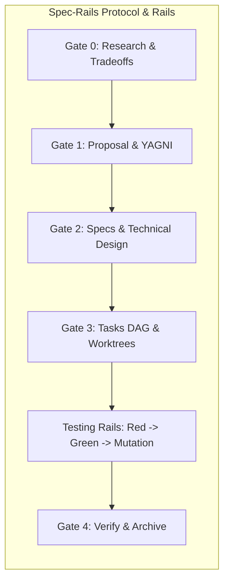

# Spec-Rails — Spec-Driven, Testing-Railed Development

Distributable, language-agnostic development workflow combining **Spec-Driven** human review gates, **Multi-Agent Git Worktree** parallelism, **Red-Green-Mutation Testing Rails**, and **Zero-Contamination Bug Isolation**.

Built as an addon on top of [@fission-ai/openspec](https://github.com/fission-ai/openspec).

---

## Methodology & Logic

Spec-Rails solves the core failure modes of autonomous and pair-programming AI development: **hallucinated scope**, **stale architectural documentation**, **tautological/untested code**, and **branch pollution**.



### 1. Spec-Driven, Not Prompt-Driven (The Ponytail Mindset & Strict YAGNI)
- AI agents easily over-engineer or misinterpret informal prompts.
- Spec-Rails applies the **Ponytail Mindset**: strictly adhere to YAGNI (You Aren't Gonna Need It), eliminating speculative abstractions and unsolicited features.
- Structured **Human Review Gates** enforce boundaries before production code is written:
  - **Gate 0 (Research)**: Explores 2–3 options, tradeoffs, and breaking changes; the human decides Go or No-Go.
  - **Gate 1 (Proposal)**: Pinpoints intent, measurable success metrics, and strict Out-of-Scope (YAGNI) boundaries.
  - **Gate 2 (Architecture & Specs)**: Formalizes uniquely keyed requirements (`REQ-*`, `NFR-*`), Given/When/Then scenarios, boundary rules (Pure Core vs. I/O Shell), and latency/allocation budgets.
  - **Gate 3 (Tasks DAG)**: Maps dependencies and partitions orthogonal tasks into parallel worktree streams.
  - **Gate 4 (Verify & Archive)**: Enforces testing rails, verifies requirement traceability, promotes delta specs, and archives via `openspec archive`.
- Drive changes with `openspec new change`, `openspec instructions <artifact>`, or the `/opsx-*` commands (equivalently the `openspec-*` skills; see [docs/how-tos/05-configure-ai-agents.md](docs/how-tos/05-configure-ai-agents.md)).

### 2. Testing Rails: Red-Green, >= 95% Mutation Kill
- Tests are not written after the fact as documentation. They are rails that guide the code.
- **Red-First**: Unit tests must fail before production code is written.
- **Mutation Verification**: Coverage numbers ($\ge 95\%$) can be gamed with tautological assertions. Spec-Rails requires **$\ge 95\%$ mutation kill score** on domain logic. Any surviving mutant below threshold flips the status to blocking failure: either an assertion is missing, or dead code was written and must be deleted.

### 3. Zero-Contamination Git Worktree Isolation
- `main` is always shippable and pristine. Direct commits to `main`/`master` are blocked.
- Vertical slices execute in disposable Git worktrees (`.worktrees/`).
- Bugfixes use the **Fast-Track Protocol** (Gates B1–B3): isolated in `.worktrees/fix-<slug>` off `main`, verified with a failing Red test before code changes, and merged via `--ff-only`.

### 4. Companion Tools & Agent Ecosystem
Spec-Rails integrates with and draws inspiration from complementary agent tooling:
- **[google/elephant-goldfish-model](https://github.com/google/elephant-goldfish-model)**: Dual-agent spec-driven framework pairing context-rich drafting (The Elephant) with adversarial zero-context review (The Goldfish).
- **[obra/superpowers](https://github.com/obra/superpowers)**: Composable agent skills and capability harnesses for autonomous workflows.
- **[dietrichgebert/ponytail](https://github.com/dietrichgebert/ponytail)**: The Ponytail engineering discipline: strict YAGNI, boring over clever, and code liability minimization.
- **[JordanCoin/codingskills](https://github.com/JordanCoin/codingskills)**: Curated agent coding skills, testing playbooks, and development heuristics.

---

## Repository Layout

Why this shape: the protocol and rules ship with the addon (`openspec/spec-rails/`); per-project data (delivery status, bug reports) lives in `docs/`. See [Where Things Live](docs/WIKI.md#16-where-things-live-and-why-docs) for the rationale and [Specs Structure](docs/WIKI.md#17-specs-structure) for how changes, delta specs and living specs fit together. There is no `specs/` folder; it was easily confused with `openspec/specs/`.

```text
spec-rails/
├── src/                      # TypeScript CLI implementation (init, check, verify, audit)
├── dist/cli.js               # Bundled CLI binary (Node >= 18)
├── schemas/spec-rails/       # OpenSpec schema + artifact templates
├── templates/                # spec-rails-ci.yml, bug-report.md, presets, pre-commit config
├── rules/                    # AGENTS.md (always-on guardrails), WORKFLOW.md (canonical protocol)
├── skills/spec-rails/SKILL.md# Agent skill runbook
├── openspec/                 # This repo's own OpenSpec layout (specs, changes, installed schema)
├── .agents/, .github/        # OpenSpec-generated skills, prompts; CI workflows
├── docs/                     # ROADMAP (delivery status), DESIGN, WAY_OF_WORKING, WIKI, bug-reports/, how-tos/01–05
├── tests/                    # Unit, schema, lint, and verification suites
└── plugin.json               # Agent plugin manifest
```

---

## Quick Start

### Install on an OpenSpec Project
Prerequisites: an existing `openspec init` project, OpenSpec ≥ 1.15.0, and Node.js ≥ 18.
```bash
npx --no-install spec-rails init [target-repo]
```

Scaffolds `spec-rails.config.json` with detected stack commands and thresholds, copies the `spec-rails` schema to `openspec/schemas/spec-rails/`, sets `schema: spec-rails` in `openspec/config.yaml`, installs local hooks into `.pre-commit-config.yaml` (spec-rails gate check, branch protection), scaffolds developer guidance in `docs/spec-rails/`, copies mutation presets, agent rules (`openspec/spec-rails/`), and `.agents/skills/spec-rails/SKILL.md` automatically, and ignores `.worktrees/`. Re-running is a no-op. Gate and lane check: `npx --no-install spec-rails check`.

### Documentation & Guides

- **Suggested Watch**: [Lead Architect Reveals His Rules for Coding Agents (Beyond Coding #272)](https://www.youtube.com/watch?v=mkN4uRZYPfs) — Carlos Kelkboom on contract scaffolding, understanding generated code, and parallel worktrees.
- **Delivery Status**: [docs/ROADMAP.md](docs/ROADMAP.md); **Design Note**: [docs/DESIGN.md](docs/DESIGN.md)
- **Architecture & Methodology Wiki**: [docs/WIKI.md](docs/WIKI.md)
- **Way of Working Handbook**: [docs/WAY_OF_WORKING.md](docs/WAY_OF_WORKING.md)
- **How-To 1**: [Bootstrap a New Project](docs/how-tos/01-bootstrap-new-project.md)
- **How-To 2**: [Drive Feature Lifecycle (Gates 0–4)](docs/how-tos/02-drive-feature-lifecycle.md)
- **How-To 3**: [Parallel Worktrees & Multi-Agent Streams](docs/how-tos/03-parallel-worktrees-multi-agent.md)
- **How-To 4**: [Fast-Track Bugfix Protocol](docs/how-tos/04-fast-track-bugfix.md)
- **How-To 5**: [Configure AI Agents](docs/how-tos/05-configure-ai-agents.md)

### Running Tests
```bash
npm test         # Native TypeScript Vitest suite (13 suites, 166 tests, < 1s)
npm run lint     # TypeScript type check (tsc --noEmit)
```

### Verifying the Test Rails in CI
The CI workflow runs `npx --no-install spec-rails verify` as a verification step (never a commit hook). It fails the PR when:
- A `REQ-*`/`NFR-*` key in an active change appears in no discovered test file matching `testGlobs`.
- A ticked Red/Green/Coverage/Mutation task lacks `Evidence: <note>`.
- Any configured command (`testCommand`, `coverageCommand`, `mutationCommand`) exits non-zero.
- The coverage score falls below `coverageMinScore` (default: 95%).
- The mutation command output lacks a numeric percentage score or falls below `mutationMinScore` (default: 95%).
- Any rail command execution exceeds the process execution timeout (default: 10 minutes).

The commands are configured in `spec-rails.config.json`, so any language or stack works. For docs-only or spec-only changesets, the mutation rail is skipped with an informational pass.
