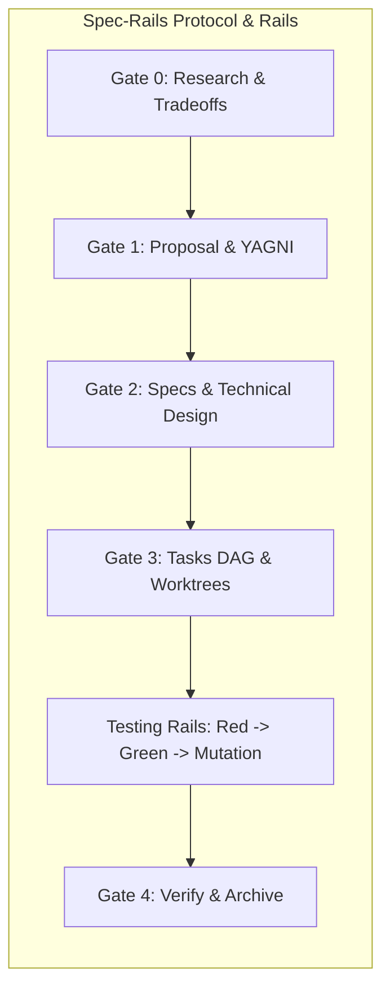

# Spec-Rails — Spec-Driven, Testing-Railed Development

Distributable, language-agnostic development workflow combining **Spec-Driven** human review gates, **Multi-Agent Git Worktree** parallelism, **Red-Green-Mutation Testing Rails**, and **Zero-Contamination Bug Isolation**.

Built as an addon on top of [@fission-ai/openspec](https://github.com/fission-ai/openspec).

---

## Methodology & Logic

Spec-Rails solves the core failure modes of autonomous and pair-programming AI development: **hallucinated scope**, **stale architectural documentation**, **tautological/untested code**, and **branch pollution**.



### 1. Spec-Driven, Not Prompt-Driven (The Ponytail Mindset & Strict YAGNI)
- AI agents easily over-engineer or misinterpret informal prompts.
- Spec-Rails applies the **Ponytail Mindset**: strictly adhere to YAGNI (You Aren't Gonna Need It), eliminating speculative abstractions and unsolicited features.
- Structured **Human Review Gates** enforce boundaries before production code is written:
  - **Gate 0 (Research)**: Explores 2–3 options, tradeoffs, and breaking changes; the human decides Go or No-Go.
  - **Gate 1 (Proposal)**: Pinpoints intent, measurable success metrics, and strict Out-of-Scope (YAGNI) boundaries.
  - **Gate 2 (Architecture & Specs)**: Formalizes uniquely keyed requirements (`REQ-*`, `NFR-*`), Given/When/Then scenarios, boundary rules (Pure Core vs. I/O Shell), and latency/allocation budgets.
  - **Gate 3 (Tasks DAG)**: Maps dependencies and partitions orthogonal tasks into parallel worktree streams.
  - **Gate 4 (Verify & Archive)**: Enforces testing rails (your own test, coverage and mutation commands), verifies requirement traceability by hand, promotes delta specs, and archives under `openspec/changes/archive/`.
- Drive changes with the `/opsx-*` commands or the equivalent `openspec-*` skills; after `spec-rails init` they are CLI-free file-based workflows (see [docs/how-tos/05-configure-ai-agents.md](docs/how-tos/05-configure-ai-agents.md)).

### 2. Testing Rails: Red-Green, >= 95% Mutation Kill
- Tests are not written after the fact as documentation. They are rails that guide the code.
- **Red-First**: Unit tests must fail before production code is written.
- **Mutation Verification**: Coverage numbers ($\ge 95\%$) can be gamed with tautological assertions. Spec-Rails requires **$\ge 95\%$ mutation kill score** on domain logic. Any surviving mutant below threshold flips the status to blocking failure: either an assertion is missing, or dead code was written and must be deleted.

### 3. Zero-Contamination Git Worktree Isolation
- `main` is always shippable and pristine. Direct commits to `main`/`master` are blocked.
- Vertical slices execute in disposable Git worktrees (`.worktrees/`).
- Bugfixes use the **Fast-Track Protocol** (Gates B1–B3): isolated in `.worktrees/fix-<slug>` off `main`, verified with a failing Red test before code changes, and merged via `--ff-only`.

### 4. Companion Tools & Agent Ecosystem
Spec-Rails integrates with and draws inspiration from complementary agent tooling:
- **[google/elephant-goldfish-model](https://github.com/google/elephant-goldfish-model)**: Dual-agent spec-driven framework pairing context-rich drafting (The Elephant) with adversarial zero-context review (The Goldfish).
- **[obra/superpowers](https://github.com/obra/superpowers)**: Composable agent skills and capability harnesses for autonomous workflows.
- **[dietrichgebert/ponytail](https://github.com/dietrichgebert/ponytail)**: The Ponytail engineering discipline: strict YAGNI, boring over clever, and code liability minimization.
- **[JordanCoin/codingskills](https://github.com/JordanCoin/codingskills)**: Curated agent coding skills, testing playbooks, and development heuristics.

---

## Repository Layout

Why this shape: the protocol and rules ship with the addon (`openspec/spec-rails/`); per-project data (delivery status, bug reports) lives in `docs/`. See [Where Things Live](docs/WIKI.md#16-where-things-live-and-why-docs) for the rationale and [Specs Structure](docs/WIKI.md#17-specs-structure) for how changes, delta specs and living specs fit together. There is no `specs/` folder; it was easily confused with `openspec/specs/`.

```text
spec-rails/
├── src/                      # TypeScript CLI implementation (`init` only)
├── dist/cli.js               # Bundled CLI binary (Node >= 18)
├── schemas/spec-rails/       # OpenSpec schema + artifact templates
├── templates/                # spec-rails-ci.yml, bug-report.md, TODO.md, Makefile (placeholder targets)
├── rules/                    # AGENTS.md (always-on guardrails), WORKFLOW.md (canonical protocol)
├── skills/spec-rails/SKILL.md# Agent skill runbook
├── openspec/                 # This repo's own OpenSpec layout (specs, changes, installed schema)
├── skills/ports/             # CLI-free ports of the OpenSpec workflow skills
├── vendor/openspec/<ver>/    # pristine upstream skills for the pinned version (maintainers)
├── openspec-version          # the single OpenSpec pin
├── scripts/                  # upgrade-openspec.mjs (maintainers)
├── .agents/, .github/        # OpenSpec-generated skills, prompts; CI workflows
├── docs/                     # ROADMAP (delivery status), DESIGN, WAY_OF_WORKING, WIKI, how-tos/01–05 (human), agentic-how-tos/ (agent runbooks copied to targets by init)
├── tests/                    # Unit, schema, lint, and verification suites
└── plugin.json               # Agent plugin manifest
```

---

## Quick Start

### Install on a Project
Prerequisites: Node.js ≥ 18. The pinned `openspec` CLI (version in [`openspec-version`](openspec-version), same major.minor) is needed **only** when the target has no `openspec/` yet; after that, neither `openspec` nor `spec-rails` is needed for day-to-day work.
```bash
npx spec-rails init [target-repo] [--tools agents,github-copilot,claude]
```

`init` is the only command. When `openspec/` is absent it runs `openspec init --tools <list>` (default `agents`) so OpenSpec generates every per-agent artifact. On every run it then:
- copies the `spec-rails` schema to `openspec/schemas/spec-rails/` and sets `schema: spec-rails` in `openspec/config.yaml`;
- rewrites the generated `explore`, `propose`, `apply`, `archive`, `sync` and `update` skills/commands/prompts (any agent layout) to the CLI-free bodies in `skills/ports/`; other generated workflows are left untouched and logged as still requiring the `openspec` CLI;
- writes `.pre-commit-config.yaml` (branch protection plus `lint`/`test` hooks that call `make lint`/`make test`, each added only if your existing Makefile defines that target), a placeholder `Makefile` (created only if absent; its `lint`, `test`, `coverage`, `mutation` targets just echo what to implement), a `spec-rails-ci.yml` skeleton (commented step placeholders plus a no-op `Placeholder` step to replace), `openspec/spec-rails/TODO.md`, developer docs in `docs/spec-rails/`, agent runbooks in `docs/agentic-how-tos/` (managed: `README.md` index plus `01`–`05`, refreshed on every run), agent rules and `.agents/skills/spec-rails/SKILL.md`, and ignores `.worktrees/`;
- removes legacy artifacts left by earlier versions (config, rails and mutmut files, old gate hooks, `opsx-*` skills).

Re-running is idempotent. Existing repos pick up new or updated agent runbooks by re-running `npx spec-rails init`: nothing changes once converged, and developer-edited hooks, CI and TODO are preserved. Each change is logged on one line.

**Upgrading OpenSpec**: in a target repo run `openspec update` then `spec-rails init` (the overlay restores the CLI-free bodies). Maintainers run `node scripts/upgrade-openspec.mjs <version>` and port the printed diff into `skills/ports/`.

### Documentation & Guides

- **Suggested Watch**: [Lead Architect Reveals His Rules for Coding Agents (Beyond Coding #272)](https://www.youtube.com/watch?v=mkN4uRZYPfs) — Carlos Kelkboom on contract scaffolding, understanding generated code, and parallel worktrees.
- **Delivery Status**: [docs/ROADMAP.md](docs/ROADMAP.md); **Design Note**: [docs/DESIGN.md](docs/DESIGN.md)
- **Architecture & Methodology Wiki**: [docs/WIKI.md](docs/WIKI.md)
- **Way of Working Handbook**: [docs/WAY_OF_WORKING.md](docs/WAY_OF_WORKING.md)
- **How-To 1**: [Bootstrap a New Project](docs/how-tos/01-bootstrap-new-project.md) (human guides below each have an agentic runbook counterpart)
- **How-To 2**: [Drive Feature Lifecycle (Gates 0–4)](docs/how-tos/02-drive-feature-lifecycle.md)
- **How-To 3**: [Parallel Worktrees & Multi-Agent Streams](docs/how-tos/03-parallel-worktrees-multi-agent.md)
- **How-To 4**: [Fast-Track Bugfix Protocol](docs/how-tos/04-fast-track-bugfix.md)
- **How-To 5**: [Configure AI Agents](docs/how-tos/05-configure-ai-agents.md)
- **Agentic How-Tos** (detailed agent runbooks; copied into target repos as `docs/agentic-how-tos/`): [Index](docs/agentic-how-tos/README.md) · [01 Bootstrap](docs/agentic-how-tos/01-bootstrap-new-project.md) · [02 Feature Lifecycle](docs/agentic-how-tos/02-drive-feature-lifecycle.md) · [03 Parallel Worktrees & Bake-Off](docs/agentic-how-tos/03-parallel-worktrees-multi-agent.md) · [04 Fast-Track Bugfix](docs/agentic-how-tos/04-fast-track-bugfix.md) · [05 Configure AI Agents](docs/agentic-how-tos/05-configure-ai-agents.md)

### Running Tests
```bash
npm ci                          # install dependencies
npm run build                   # bundle dist/cli.js (required before tests)
npm run lint                    # TypeScript type check (tsc --noEmit)
npm test                        # Vitest suite
npm run test:coverage           # Vitest with coverage
pre-commit run --all-files      # all local hooks (mirrors CI)
```
`npm test` needs `dist/cli.js` because the CLI tests spawn the bundle. CI (`test.yml`) runs `npm ci`, build, lint, test; commit hooks run build, lint, test. See [Command Reference](docs/WAY_OF_WORKING.md#command-reference) and [CI/CD Pipeline](docs/WAY_OF_WORKING.md#cicd-pipeline) in the Way of Working. Release history: [CHANGELOG.md](CHANGELOG.md).

### Test Rails
Spec-Rails does not run your quality gates. `init` writes a placeholder `Makefile` (only if absent) whose `lint`, `test`, `coverage` and `mutation` targets echo what to implement; pre-commit calls `make lint`/`make test`. Wire unit tests, coverage (>= 95%) and mutation testing (>= 95% kill) for your stack into your own commands, pre-commit hooks and CI; `openspec/spec-rails/TODO.md` lists the steps. Traceability (every `REQ-*`/`NFR-*` appears in a test) and `Evidence:` on ticked tasks are reviewed by humans and agents following the workflow.
