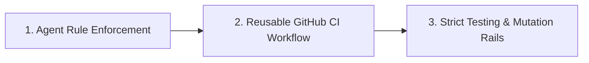

# Spec-Rails Design Note: OpenSpec Addon Rails

Spec-Rails follows strict YAGNI: an OpenSpec schema plus a TypeScript CLI (`npx spec-rails`) with a single command, `init`.
Planning, apply and archive run through CLI-free `/opsx-*` skills, standard Git, agent rules, and CI; agent runbooks ship in `docs/agentic-how-tos/`. Delivery status lives in `docs/ROADMAP.md`.

---



---

## 1. Agent-Enforced Verification

The AI coding agent validates gate artifacts; humans tick the Review Gate boxes.

- **Gate Validation**: Before presenting a gate for human sign-off, agent verifies:
  - Gate 0: `research.md` has ground truth, 2–3 options, tradeoff matrix, recommendation.
  - Gate 1: `proposal.md` has Intent, Problem, In-Scope, Out-of-Scope (YAGNI), Assumptions.
  - Gate 2: `design.md` covers delta specs (`REQ-*`, `NFR-*`), domain models, boundary rules (Pure Core vs I/O Shell), and test strategy.
  - Gate 3: `tasks.md` has DAG and multi-agent stream worktrees identified.
- **Gate 4 Spec Sync & Archival**: When a feature completes, agent runs:
  ```bash
  <your test, coverage and mutation commands>
  /opsx-archive
  ```

---

## 2. Reusable GitHub CI Workflow (`templates/spec-rails-ci.yml`)

A GitHub Actions workflow installed to `.github/workflows/spec-rails-ci.yml`:

1. **Pre-Commit Linting**:
   - Runs `pre-commit run --all-files`.
2. **Testing & Mutation Rails**:
   - An inert skeleton; you add your test, coverage ($\ge 95\%$), and mutation ($\ge 95\%$) commands.

---

## 3. Strict Testing & Mutation Rails

- Configured by you in your own hooks and CI; Spec-Rails ships no runner or stack presets.
