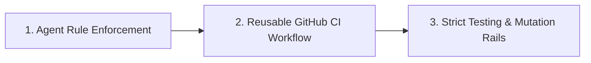

# Spec-Rails Design Note: OpenSpec Addon Rails

Spec-Rails follows strict YAGNI: an OpenSpec schema plus a TypeScript CLI (`npx spec-rails`) providing `init`, `check`, `verify`, and `audit`.
Validation and archival use `openspec`, standard Git, agent rules, and CI. Delivery status lives in `docs/ROADMAP.md`.

---



---

## 1. Agent-Enforced Verification

The AI coding agent validates gate artifacts; `spec-rails check` enforces gates and lanes mechanically.

- **Gate Validation**: Before presenting a gate for human sign-off, agent verifies:
  - Gate 0: `research.md` has ground truth, 2–3 options, tradeoff matrix, recommendation.
  - Gate 1: `proposal.md` has Intent, Problem, In-Scope, Out-of-Scope (YAGNI), Assumptions.
  - Gate 2: `design.md` covers delta specs (`REQ-*`, `NFR-*`), domain models, boundary rules (Pure Core vs I/O Shell), and test strategy.
  - Gate 3: `tasks.md` has DAG and multi-agent stream worktrees identified.
- **Gate 4 Spec Sync & Archival**: When a feature completes, agent runs:
  ```bash
  spec-rails verify
  openspec archive <feat> --yes
  ```

---

## 2. Reusable GitHub CI Workflow (`templates/spec-rails-ci.yml`)

A GitHub Actions workflow installed to `.github/workflows/spec-rails-ci.yml`:

1. **Spec-to-Code Audit**:
   - Uses `npx spec-rails check --audit`.
   - If production code is modified, fails unless `openspec/changes/` or `docs/bug-reports/` is also modified.
2. **Pre-Commit Linting**:
   - Runs `pre-commit run --all-files`.
3. **Testing & Mutation Rails**:
   - Runs `npx spec-rails verify`.
   - Executes configured test, coverage ($\ge 95\%$), and mutation ($\ge 95\%$) commands.

---

## 3. Strict Testing & Mutation Rails

- Configured via `spec-rails.config.json` with detected stack defaults (`ts`, `python`, `go`, `rust`).
- Bounded by a 10-minute execution timeout.
- Informational pass skips the mutation rail for docs-only or spec-only changesets.
