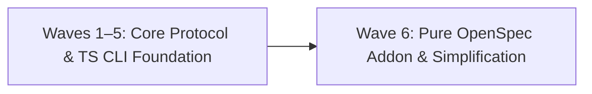

# Spec-Rails Project Roadmap

Baseline: `main` · Status: Active

---

## 1. Dependency Spine & Waves

---

## 2. Work Items & Backlog

Status Legend (changed only on `main` via `chore/roadmap-<id>` branches; see `openspec/spec-rails/WORKFLOW.md`):
- `⬜ Planned`: Scheduled for execution.
- `🔬 In Research (Gate 0)`: Actively investigating technical feasibility and options.
- `🚀 In Progress (Gates 1–4)`: Gate 0 Go decision made; active feature branch / worktree streams.
- `✅ Shipped`: Verified, merged, living specs synced, archived.
- `❌ Dropped`: Discarded at Gate 0; rationale recorded here.

### Completed Foundation (Waves 1–5 Summary)

| Wave | Scope | Status | Key Deliverables |
| :--- | :--- | :--- | :--- |
| **Wave 1** | Core Workflow Protocol & Templates | ✅ | Language-agnostic workflow (`openspec/spec-rails/WORKFLOW.md`), bug report and roadmap templates. |
| **Wave 2** | Pre-Commit & CI Automation | ✅ | Pre-commit framework integration (`.pre-commit-config.yaml`) and GitHub Actions workflow template (`templates/spec-rails-ci.yml`). |
| **Wave 3** | OpenSpec Addon Integration | ✅ | Custom `spec-rails` OpenSpec schema (`openspec/schemas/spec-rails/`), `openspec/` layout consolidation, requirement traceability. |
| **Wave 4** | OpenSpec v1.15/v1.16 Hardening | ✅ | Transitive gate DAG checks, OpenSpec JSON boundary handling, and agent skill packaging (`.agents/skills/spec-rails/SKILL.md`). |
| **Wave 5** | TypeScript CLI & Strict Testing Rails | ✅ | TypeScript CLI (`init`, `check`, `verify`, `audit`), `spec-rails.config.json`, stack detection (`ts`, `python`, `go`, `rust`), baseline mode (`openspec/spec-rails/baseline.txt`), docs-only mutation skip, and strict coverage/mutation score enforcement ($\ge 95\%$) with execution timeout. |

Dropped, do not re-propose:
- `spec-rails scaffold-check` (AST inspection of contract scaffolding; the Red rail already proves unfulfilled contracts).
- `spec-rails lint` (duplicates `openspec validate --strict` and schema constraints).
- Language-specific runner wrappers in core CLI (projects configure their own test/coverage/mutation commands in `spec-rails.config.json`).

---

### Wave 6: Pure OpenSpec Addon & Simplification

Refocus Spec-Rails as a thin, pure Spec Quality Gate and Testing-Railed workflow on top of `@fission-ai/openspec`: enforce step-by-step human review pauses at each gate (never drafting all artifacts in an unreviewed pass), validate real spec quality via `openspec validate --strict`, add pre-commit whitespace & EOF checks to prevent CI failures, fold test cases into `design.md`, replace rigid evidence regex tokens with free-text notes, collapse duplicate asset trees into a single source of truth, remove external tool coupling, and unify all repository tests under Vitest.

| ID | Item | Effort | Depends on | Status | Target Files | Notes |
| :--- | :--- | :--- | :--- | :--- | :--- | :--- |
| **W6.1** | Pure OpenSpec Schema & Gates 0–4 | S | — | ⬜ | `openspec/schemas/spec-rails/` | Remove `## Review Gate` from `spec.md` so OpenSpec delta specs stay 100% pure; fold test cases and strategy into `design.md` (**Gate 2**); renumber `tasks.md` to **Gate 3** and Verify & Archive to **Gate 4**; drop separate `.feature` tasks and Gate 5.x pauses from `schema.yaml` and `tasks.md` (`Contract scaffolding → Red → Green → Coverage & Mutation`). |
| **W6.2** | Spec Quality Gate, Review Pauses & Hygiene | M | W6.1 | ⬜ | `src/commands/check.ts`, `src/utils/evidence.ts` | Enforce step-by-step progression with explicit human review pauses at each gate (Gate 0 → Gate 1 → Gate 2 → Gate 3) before subsequent artifacts or code diffs are created; validate whitespace and EOF newline hygiene across change artifacts to catch formatting errors locally before pre-commit/CI fails; run `openspec validate <change> --strict` and verify every added/modified requirement in delta `spec.md` has a `REQ-<DOM>-<N>` or `NFR-<DOM>-<N>` key; simplify `evidence.ts` to require a free-text `Evidence:` note on ticked rail tasks. |
| **W6.3** | Single Asset Tree & Thin `init` | M | W6.2 | ⬜ | `src/commands/init.ts`, `src/config.ts`, `package.json` | Set `package.json` name to `spec-rails` and use `npx --no-install spec-rails` in generated hooks and CI; use `openspec/schemas/spec-rails/`, `openspec/spec-rails/`, and `.agents/skills/spec-rails/` as the single canonical asset source (delete duplicate root `schemas/`, `rules/`, `skills/`, `templates/mutation/`, `openspec/spec-rails/mutation/`, legacy `rails.conf` parser, unused `templates/.pre-commit-config.yaml`, and non-existent `$schema` URL); fail fast in `spec-rails init` if `openspec/` is missing; scaffold developer guide in target repo (`docs/spec-rails/` explaining workflow, gates, commands, and rails); generate stack-matched CI workflow; remove all external review tool hooks and references. |
| **W6.4** | Vitest-Only Harness & Dead Code Deletion | S | W6.3 | ⬜ | `tests/unit/`, `.github/workflows/`, `README.md` | Move `REQ-OSA-*` traceability IDs to `tests/unit/*.test.ts`; add `tests/unit/schema.test.ts` for schema and template validation; delete `tests/bdd/`, all legacy `tests/*.sh` scripts, and `Makefile`; update `.github/workflows/` and `README.md` to use `npm test` and `npm run lint`. |

---

## 3. Wave 6 Exit Criteria

- [ ] All W6 items (W6.1–W6.4) marked `✅ Shipped`.
- [ ] Planning workflow enforces step-by-step human review pauses at each gate (Gates 0–3); `spec.md` template has no `## Review Gate` footer.
- [ ] `spec-rails check` runs `openspec validate --strict`, validates whitespace/EOF newline hygiene on change artifacts, verifies `REQ-*`/`NFR-*` keys on delta requirements, and enforces Gates 0–3 before code diffs (`--audit`) or ticked implementation tasks.
- [ ] `spec-rails verify` accepts free-text `Evidence:` notes on rail tasks and verifies all `REQ-*`/`NFR-*` keys across `tests/unit/`.
- [ ] `spec-rails init` fails fast when `openspec/` is absent, scaffolds developer guide in `docs/spec-rails/`, and sets up stack-specific CI & pre-commit using `npx --no-install spec-rails`.
- [ ] Zero legacy `.sh` test scripts, zero `Makefile`, zero duplicate asset directories (`schemas/`, `rules/`, `skills/`, `templates/mutation/`), zero `.feature` files, and zero external review-tool hooks remain.
- [ ] `npm test` and `npm run lint` pass with $\ge 95\%$ coverage and $\ge 95\%$ mutation kill score.
