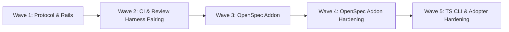

# Spec-Rails Project Roadmap

Baseline: `main` · Status: Active

---

## 1. Dependency Spine & Waves

---

## 2. Work Items & Backlog

Status Legend (changed only on `main` via `chore/roadmap-<id>` branches; see `openspec/spec-rails/WORKFLOW.md` §2):
- `⬜ Planned`: Scheduled for execution.
- `🔬 In Research (Gate 0)`: Actively investigating technical feasibility and options.
- `🚀 In Progress (Gates 1–6)`: Gate 0 Go decision made; active feature branch / worktree streams.
- `✅ Shipped`: Verified, merged, living specs synced, archived.
- `❌ Dropped`: Discarded at Gate 0; rationale here, research in `openspec/changes/archive/<id>-<slug>/`.

### Wave 1: Protocol, Lifecycle & Core Templates

| ID | Item | Effort | Depends on | Status | Spec / Feature Dir | Notes |
| :--- | :--- | :--- | :--- | :--- | :--- | :--- |
| **W1.1** | Canonical Workflow Protocol | M | — | ✅ | `rules/WORKFLOW.md` | Language-agnostic Gates 0–6, Worktrees, Rails |
| **W1.2** | Lifecycle Markdown Templates | S | W1.1 | ✅ | `templates/` | `research.md`, `proposal.md`, `spec.md`, `design.md`, `tasks.md`, `bug-report.md`, `roadmap.md` |
| **W1.3** | Project Initializer Script | S | W1.2 | ✅ | `bin/spec-rails` | Scaffolds `specs/` and `.gitignore` idempotently |
| **W1.4** | Automated Test Suite | S | W1.3 | ✅ | `tests/test_installer.sh` | Shell assertions + `Makefile` runner |

### Wave 2: CI & Review Harness Pairing

| ID | Item | Effort | Depends on | Status | Spec / Feature Dir | Notes |
| :--- | :--- | :--- | :--- | :--- | :--- | :--- |
| **W2.1** | Pre-Commit Integration | S | W1.1 | ✅ | `.pre-commit-config.yaml` | Zero-bypass formatting, linting, tests |
| **W2.2** | Reusable GitHub CI Workflow | S | W1.2 | ✅ | `templates/spec-rails-ci.yml` | Spec-to-code audit + testing rail verification |
| **W2.3** | LGTM Review Pairing Specs | M | W1.1 | ✅ | `docs/WIKI.md` | Line-anchored `#ref` steering and anti-fraud guardrails |
| **W2.4** | Chore Lane & Contradiction Pruning | S | W1.1, W2.2 | ✅ | `rules/WORKFLOW.md` | Red-commit policy, chore lane, full-copy spec rule |

### Wave 3: OpenSpec Addon

| ID | Item | Effort | Depends on | Status | Spec / Feature Dir | Notes |
| :--- | :--- | :--- | :--- | :--- | :--- | :--- |
| **W3.1** | OpenSpec Integration Review | M | W2.4 | ✅ | `openspec/changes/archive/2026-10-30-w3.1-openspec-addon/` | Gate 0 Go: Option A (`spec-rails` schema + thin installer); adopt OpenSpec delta specs and `openspec/` layout |
| **W3.2** | `spec-rails` OpenSpec Schema & Templates | M | W3.1 | ✅ | `schemas/spec-rails/` | `research` artifact, gate footers, slice-loop `apply.instruction` |
| **W3.3** | Gate-to-OpenSpec Mapping | M | W3.2 | ✅ | `rules/WORKFLOW.md` §7 | `REQ-*`/`NFR-*` convention in deltas; Gate 6 reduced to rails + `openspec archive` |
| **W3.4** | Installer CLI | M | W3.2 | ✅ | `bin/spec-rails` | Idempotent POSIX wiring into existing `openspec/` project |
| **W3.5** | Gate Enforcement | M | W3.2, W3.4 | ✅ | `bin/spec-rails-check` | CI/pre-commit Review Gate and lane checks via `openspec status --json` |
| **W3.6** | Worktree Streams vs Delta Specs | S | W3.3 | ✅ | `rules/WORKFLOW.md` §7 | Rebase + `openspec validate` discipline |
| **W3.7** | Bugfix Lane & Roadmap Mapping | S | W3.3 | ✅ | `rules/WORKFLOW.md` §7 | B1–B3 representation; `ROADMAP.md` vs OpenSpec initiatives |
| **W3.8** | Self-Migration to Addon Layout | L | W3.2–W3.5 | ✅ | `openspec/specs/openspec-addon/spec.md` | `specs/` → `openspec/`; docs, skill, rules, tests |
| **W3.9** | Addon Hygiene | S | W3.8 | ✅ | `openspec/changes/archive/2026-10-30-w3-9-addon-hygiene/` | CI audit layout, self-copy sync (REQ-OSA-21, 22) |
| **W3.10** | Cleanup & Docs | S | W3.9 | ✅ | `openspec/changes/archive/2026-10-30-w3-10-cleanup-docs/` | Dead code removal, docs lint, OpenSpec-native docs (REQ-OSA-23, 24) |
| **W3.11** | Fresh-Repo End-to-End | S | W3.10 | ✅ | `openspec/changes/archive/2026-10-30-w3-11-fresh-repo-e2e/` | Real-CLI test in a new repo (REQ-OSA-25) |
| **W3.12** | Test-Rails CI Verifier | S | W3.11 | ✅ | `openspec/changes/archive/2026-10-30-w3-12-test-rails-ci/` | CI-only traceability, evidence and config-driven test commands (REQ-OSA-26 to 28) |
| **W3.13** | Consolidate Layout & Drop `specs/` | S | W3.12 | ✅ | `openspec/changes/archive/2026-11-02-w3-13-consolidate-layout/` | Ship `WORKFLOW.md` to `openspec/spec-rails/`; move roadmap and bug reports to `docs/` (REQ-OSA-29, 30) |

### Wave 4: OpenSpec Addon Hardening

| ID | Item | Effort | Depends on | Status | Spec / Feature Dir | Notes |
| :--- | :--- | :--- | :--- | :--- | :--- | :--- |
| **W4.1** | OpenSpec v1.15/v1.16 Boundary, Gate & Rail Hardening | M | W3.13 | ✅ | `openspec/changes/archive/2026-11-02-w4-1-openspec-hardening/` | Transitive gate DAG check, OpenSpec store/JSON boundary, auto-installed skill, rail & hygiene hardening (REQ-OSA-31, 32) |

### Wave 5: TS CLI & Adopter Hardening

Driven by the first third-party adoption (a uv/pytest/mutmut repo): empty rails passed silently, the hand-written git hook collided with the pre-commit framework, and existing changes without a Review Gate blocked every commit.

| ID | Item | Effort | Depends on | Status | Spec / Feature Dir | Notes |
| :--- | :--- | :--- | :--- | :--- | :--- | :--- |
| **W5.1** | Agent Hardening | M | W4.1 | ✅ | `openspec/changes/archive/2026-11-03-w5-1-agent-hardening/` | Anti-drift rails for agent planning and slice execution (REQ-OSA-33, 34, 35; NFR-OSA-5) |
| **W5.2** | Multi-Language Rails | L | W5.1 | 🚀 | `openspec/changes/archive/2026-11-06-w5-2-multi-language-rails/` | Stack detection and presets (ts, python, go, rust); archived, pending merge (REQ-OSA-36, 37, 38, 39; NFR-OSA-1, 5) |
| **W5.3** | TypeScript CLI Replaces Shell Scripts | L | W5.2 | ⬜ | `src/`, `bin/` | `spec-rails init/check/verify` in TS reaches parity with `bin/spec-rails*` (the `check` command does not exist yet); shell scripts removed; no `jq`; the `NFR-OSA-1` wording and the Node-only distribution were settled in W5.11, so W5.3 only deletes the shell entry points and moves the hook and CI to `npx`; the inline "Audit Spec-to-Code Mapping" CI shell moves into the CLI (`audit` or part of `check`) so one implementation owns the spec-to-code rules; `rails.conf` is deprecated in favor of `spec-rails.config.json`, with a migration path and the stale "installer never overwrites" comment corrected; REQ IDs assigned at Gate 2 |
| **W5.4** | Pre-Commit Framework Required | M | W5.3 | ⬜ | `templates/.pre-commit-config.yaml` | `pre-commit` is a hard prerequisite: `init` ships spec-rails gate and LGTM checks as local hooks and runs `pre-commit install`; installer no longer writes `.git/hooks/pre-commit`; branch protection is an optional hook; lint/test hooks use the detected stack instead of Makefile targets; BDD scenario: installing alongside the pre-commit framework leaves no `.legacy` hook and no duplicated checks; REQ IDs assigned at Gate 2 |
| **W5.5** | Strict Rails by Default | M | W5.3 | ⬜ | `src/commands/verify.ts`, `templates/rails.conf` | `verify` executes the configured test/coverage/mutation commands (today it only checks evidence tokens and traceability) and fails on a non-zero exit, an empty command or a missed threshold; command output is captured and summarized, with full output only on failure; `init` fills commands from the stack (`uv run` when `uv.lock`, `[tool.mutmut]` for mutmut 3); survivor-count mutation wrapper with documented timeout policy; strict mode skips the mutation rail with an informational pass when the changeset touches no source files matching `testGlobs` (docs-only or spec-only slices; today `runVerify` has no changeset awareness and errors on empty test matches); REQ IDs assigned at Gate 2 |
| **W5.6** | Gate Check Baseline Mode | S | W5.3 | ⬜ | `src/commands/check.ts` | Grandfather list for pre-existing changes lacking `## Review Gate`, or a one-shot migration command; new changes still gate; REQ IDs assigned at Gate 2 |
| **W5.7** | CI Template Fixes | S | W5.3, W5.4, W5.5 | ⬜ | `templates/spec-rails-ci.yml` | Pin OpenSpec CLI version (also in Copilot setup workflow); install stack tooling (`uv`, Python) before verify; derive pre-commit `SKIP` from hook ids; drop Makefile-only test step; REQ IDs assigned at Gate 2 |
| **W5.8** | Schema & Template Fixes | S | W5.2 | ⬜ | `schemas/spec-rails/` | `GIVEN` in `spec.md` scenarios; grandfather legacy unprefixed `REQ-*` headings for MODIFIED/REMOVED; REQ IDs assigned at Gate 2 |
| **W5.9** | Agent Skill Footprint & Docs | S | W5.3 | ⬜ | `docs/how-tos/`, `README.md`, `bin/spec-rails` | Found adopting project_aiq: docs use `/opsx-*` commands that adopters may remove as duplicate alias skills (document both names or use `openspec-*`); guidance to commit `.claude/`, `.agents/`, `.github/skills` rather than ignore them and to keep skills only for tools in use (`openspec update` can regenerate `opsx-*` aliases); optionally install the `spec-rails` skill into `.claude/skills` too; REQ IDs assigned at Gate 2 |
| **W5.10** | Commit Timing Convention | S | W5.1 | ✅ | `openspec/changes/archive/2026-11-06-w5-10-commit-timing/` | Commit after the specs stage, the code and the archive are done, not per micro-step; document in the workflow and lifecycle how-to, and align agent skills and hooks with it |
| **W5.11** | Node-Only NFR Wording & Single Mutation Threshold | S | W5.1 | ✅ | `openspec/changes/archive/2026-11-06-w5-11-node-only-nfr/` | `NFR-OSA-1` states the Node >= 18 + OpenSpec prerequisites and build-time-only libraries (`devDependencies`); `NFR-OSA-5` is the single canonical >= 95% mutation threshold everywhere, enforced by a hygiene rule |
| **W5.12** | Review Closeout | S | W5.11 | ✅ | `openspec/changes/archive/2026-11-06-w5-12-review-closeout/` | Fold the still-valid findings of the root review files into this roadmap (docs-only mutation skip, in W5.5), then delete the eight files and their dead links |
| **W5.13** | Dev Dependency Audit | S | W5.11 | ⬜ | `package.json`, `package-lock.json` | Dev-only (`npm audit --omit=dev` is clean): bump `vitest` and `@vitest/coverage-v8` to 5.x (clears the critical `tinypool`, `vite`, `@vitest/mocker` findings); close the duplicate stale Dependabot branches; `zod` 3 -> 4 only with a `src/config.ts` migration; accept the Stryker `minimatch` advisories (no fix) with a recorded reason; land before W5.3 so the TypeScript CLI work starts on the new toolchain; REQ IDs assigned at Gate 2 |

Dropped, do not re-propose: `spec-rails scaffold-check` (AST inspection of contract scaffolding; the Red rail already proves unfulfilled contracts) and `spec-rails lint` (duplicates `openspec validate` and the schema constraints). Neither shipped.

---

## 3. Wave Exit Criteria

### Wave 1 Exit Criteria
- [x] All W1 items marked `✅ Shipped`.
- [x] 100% test pass on initializer suite.
- [x] Language-agnostic workflow free of stack-specific leaks.

### Wave 2 Exit Criteria
- [x] All W2 items marked `✅ Shipped`.
- [x] GitHub Actions workflow template verified.
- [x] Pre-commit hook active with zero bypass allowed.

### Wave 3 Exit Criteria
- [x] All W3 items marked `✅ Shipped`.
- [x] `spec-rails` schema, installer, gate/lane check, and CI verifier green on `make test`.
- [x] Legacy `specs/` directory eliminated in favor of `openspec/` and `docs/`.

### Wave 4 Exit Criteria
- [x] All W4 items marked `✅ Shipped`.
- [x] OpenSpec v1.15/v1.16 compatibility, transitive gate enforcement, skill sync, and 100% requirement traceability verified.

### Wave 5 Exit Criteria
- [ ] All W5 items (W5.1–W5.13) marked `✅ Shipped`.
- [ ] `verify` skips the mutation rail with an informational pass for docs-only or spec-only changesets (no source files matching `testGlobs`).
- [ ] `npm audit --omit=dev` is clean and every dev-only advisory is fixed or has a recorded reason.
- [ ] TypeScript CLI (`init/check/verify`) at parity with `bin/spec-rails*`; shell scripts removed; `jq` no longer required.
- [ ] `pre-commit` is a hard prerequisite: `init` installs spec-rails gate and LGTM checks as hooks; the installer writes no `.git/hooks/pre-commit`.
- [ ] `verify` executes the test, coverage and mutation commands; an empty, failing or below-threshold rail fails it; `init` fills commands from the detected stack (ts, python, go, rust).
- [ ] Existing changes without a `## Review Gate` no longer block commits (baseline mode); new changes are still gated.
- [ ] CI template pins the OpenSpec CLI version and installs stack tooling before verify.
- [ ] Docs and installed agent skills agree on command names and on which agent folders to commit.
- [ ] `make test` green and 100% requirement traceability.
