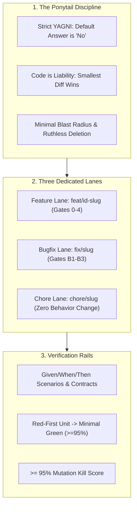
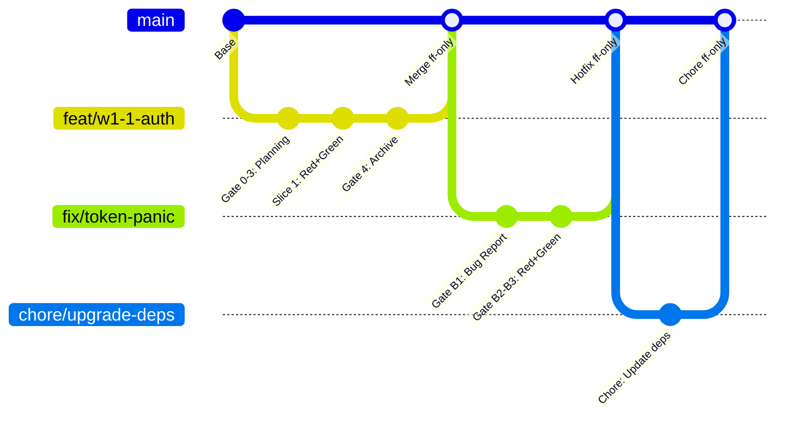
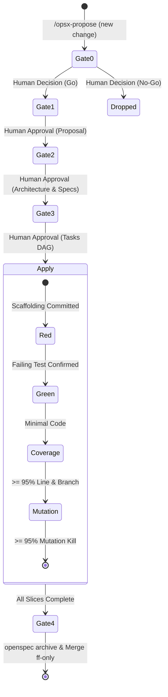
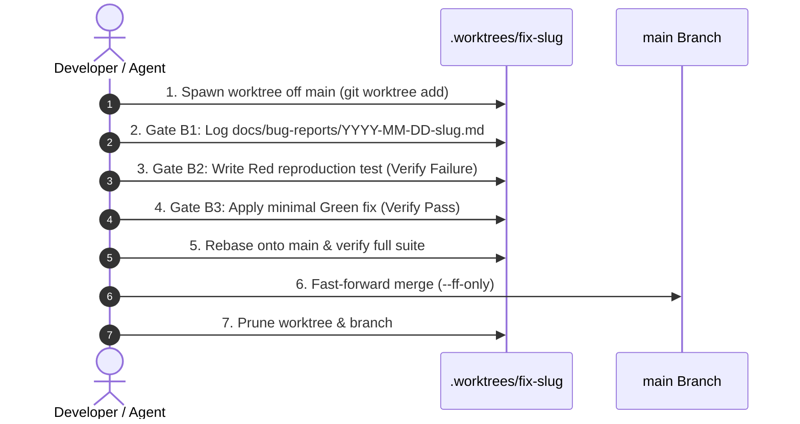

# Spec-Rails Way of Working (WoW)

> **Spec-Driven, Testing-Railed Development** — An engineering handbook for humans and autonomous AI agents.

> **Where things live**: the gate-by-gate protocol ships with the addon as `openspec/spec-rails/WORKFLOW.md`; change artifacts live in `openspec/changes/<id>-<slug>/`; delivery status (`docs/ROADMAP.md`) and bug reports (`docs/bug-reports/`) live in `docs/`. See [Wiki §1.6](WIKI.md#16-where-things-live-and-why-docs). Agents follow the step-by-step runbooks in [agentic-how-tos/](agentic-how-tos/README.md) (copied into target repos as `docs/agentic-how-tos/` by `init`; re-run `npx spec-rails init` in existing repos to refresh them).

---

## 1. Executive Summary & Core Invariants

Spec-Rails transforms AI-assisted software delivery from speculative, prompt-driven chaos into a deterministic, gated assembly line. It guarantees four engineering invariants:

1. **`main` is strictly immutable to direct edits**: Zero code, specs, or docs land directly on `main`. Every commit lands through an isolated lane via `--ff-only`.
2. **Code is a liability, not an asset**: The smallest diff that satisfies formal requirements and passes all rails wins.
3. **No untested code exists**: Code does not exist until a test fails for its absence. Coverage ($\ge 95\%$) is insufficient without a **>= 95% mutation kill score**.
4. **Specs are evergreen living truth**: Specifications live in `openspec/specs/` and change only through OpenSpec delta specs, which `openspec archive` merges upon shipping. See `openspec/spec-rails/WORKFLOW.md` §7.



---

## 2. The Mindset: Ponytail Discipline & Strict YAGNI

Spec-Rails adopts the **Ponytail Mindset** — the pragmatic, ruthless discipline of senior unix hackers who hate unnecessary code and refuse to be paged at 3 AM:

- **Default Answer is "No"**: Push back on speculative, vague, or unneeded requirements before typing code. Challenge requirements during Gate 0 and Gate 1.
- **Boring > Clever**: Choose standard library functions over third-party dependencies. Choose simple iterative loops over complex metaprogramming acrobatics.
- **Strict YAGNI**: Build strictly what the active vertical slice requires. Never add hypothetical abstractions, premature plugin interfaces, or speculative configuration toggles.
- **Minimal Blast Radius**: Touch only files strictly necessary for the active task. Do not reformat unrelated files or rename adjacent symbols.
- **Ruthless Deletion**: Deleting code is superior to adding code. When mutation testing discovers surviving mutants in defensive or unneeded branches, delete the dead code immediately.

---

## 3. The Three Lanes

Every commit belongs to one of three lanes. Direct commits to `main` or `master` are strictly rejected by pre-commit hooks.



### 1. Feature Lane (`feat/<id>-<slug>`)
- Governed by **Gates 0–4**.
- Modifies or introduces capability specs via OpenSpec delta specs.
- Mandatory test-first implementation and mutation verification.

### 2. Bugfix Lane (`fix/<slug>`)
- Governed by **Gates B1–B3**.
- Spawns in an isolated `.worktrees/fix-<slug>` off `main`.
- Mandatory Red test reproduction before applying the fix.

### 3. Chore Lane (`chore/<slug>`)
- Zero behavior change (dependency bumps, refactors, roadmap updates).
- Exempt from delta specs, but must pass all existing tests and linters.

---

## 4. The Feature Lifecycle: Gates 0–4



| Gate | Artifact | Scope | Human Check |
| :--- | :--- | :--- | :--- |
| **Gate 0** | `research.md` | Ground truth, 2–3 options, tradeoff matrix, recommendation. | Human selects the winning option (Go) or discards (No-Go). |
| **Gate 1** | `proposal.md` | Intent, Problem statement, Scope, Out-of-Scope (YAGNI), Metrics. | Human approves the bounded scope. |
| **Gate 2** | `design.md` + `specs/` | Delta specs (`REQ-*`, `NFR-*`), domain models, boundaries, test strategy. | Human approves architecture and behavioral contracts. |
| **Gate 3** | `tasks.md` | Dependency DAG, worktree stream allocation, slice breakdown. | Human approves task breakdown before code is written. |
| **Gate 4** | archive | Rebase on `main`, run your test, coverage and mutation commands, promote delta specs. | Human signs off on PR merge. |

---

## 5. The Fast-Track Bugfix Lifecycle: Gates B1–B3



---

## 6. Multi-Agent Git Worktree Parallelism

When a feature contains orthogonal tasks with zero mutual dependencies, Spec-Rails isolates execution across Git worktrees to prevent branch contamination and enable parallel subagent execution.

### Worktree Lifecycle Protocol
1. **Spawn**: `git worktree add .worktrees/<id>-<stream> -b feat/<id>/<stream>`
2. **Execute**: The agent runs its vertical slice inside the worktree without `.git/index.lock` collisions.
3. **Rebase & Merge**:
   ```bash
   git -C .worktrees/<id>-<stream> rebase feat/<id>-<slug>
   git checkout feat/<id>-<slug>
   git merge --ff-only feat/<id>/<stream>
   git worktree remove .worktrees/<id>-<stream>
   git branch -d feat/<id>/<stream>
   git worktree prune
   ```

---

## 7. Verification Rails & Pre-Commit Standards

Every repository initialized with `spec-rails` contains active pre-commit and CI verification rails:

### Pre-Commit Standards
- Pre-commit hooks run automatically on every `git commit`.
- **Zero-Bypass Policy**: `git commit --no-verify` or `-n` is strictly forbidden. If a check fails, resolve the defect.

### Command Reference
How to use the tooling by hand; the CI/CD Pipeline below shows when each command runs automatically.

| Command | Purpose |
| :--- | :--- |
| `npm ci` | Install pinned dependencies |
| `npm run build` | Bundle `dist/cli.js` with tsup (MUST precede tests: `tests/unit/cli.test.ts` spawns the bundle) |
| `npm run lint` | Type check (`tsc --noEmit`) |
| `npm test` | Vitest suite |
| `npm run test:coverage` | Vitest with coverage (>= 95%) |
| `make lint` / `make test` / `make coverage` / `make mutation` | In a target repo: placeholder targets from the `Makefile` that `init` creates when absent; replace the echoes with your stack's commands. Pre-commit calls `lint` and `test` |
| `npx spec-rails init [dir] [--tools <list>]` | The only command. Bootstraps `openspec/` through the pinned local `openspec init --tools <list>` when absent (default tools `agents`), then installs Spec-Rails and rewrites the generated workflow skills to be CLI-free. Idempotent: a second run changes nothing; legacy artifacts are removed and developer-edited hooks, CI and TODO are preserved. Needs `openspec` (version in `openspec-version`) only when `openspec/` is absent |
| `openspec update` then `npx spec-rails init` | Upgrade OpenSpec in a target repo; `init` restores the CLI-free skill bodies |
| `node scripts/upgrade-openspec.mjs <version>` | Maintainers only: refresh `vendor/openspec/<version>/`, print the skill diff to port into `skills/ports/` |
| `pre-commit run --all-files` | Run every local hook |

### CI/CD Pipeline
How the same checks run automatically, from commit to pull request.
```
git commit -> pre-commit: branch-protection -> build-cli -> lint -> test
PR            -> CI (test.yml):           npm ci -> build -> lint -> test
              -> Rails (spec-rails-ci.yml): npm ci -> build -> pre-commit run --all-files
```
- **Build before test**: `dist/cli.js` must exist before `npm test`, because `tests/unit/cli.test.ts` spawns the bundle. On a clean checkout the `--version`/`--help` tests otherwise fail with `Cannot find module dist/cli.js`.
- **Mirror CI locally**: run `pre-commit run --all-files` before pushing to catch CI failures early.

### Mutation Testing Rails
- **>= 95% Mutation Kill Score** on domain logic, eliminating tautological assertions while preventing equivalent mutant friction.
- Configure the mutation tool for your stack in your own commands and CI (see `openspec/spec-rails/TODO.md`).

---

## 8. Communication Standards (Caveman Style)

When pair-programming or coordinating agents:
- **Caveman Communication**: Short, blunt, extremely direct. Absolute fewest words possible.
- **No Fluff**: No pleasantries, no apologies, no conversational filler, no narration of internal steps.
- **Clickable Links**: Always link referenced files using GitHub-style markdown links (`[file.ext](file:///abs/path)`).

---

## 9. Anti-Patterns & Hard Prohibitions

| Violation | Why It Is Forbidden | Remedy |
| :--- | :--- | :--- |
| **Direct commit on `main`** | Contaminates production, bypasses rebase verification | Enforced by pre-commit hook; checkout dedicated lane branch |
| **Committing Red tests alone** | Leaves broken commits in git history, breaks bisecting | Commit Red test together with Green implementation |
| **Full-copy spec duplicates** | Duplicates ground truth and drifts from OpenSpec | Delta specs merged by `openspec archive` at Gate 4 |
| **Unjustified surviving mutants** | Surviving mutants prove missing assertions or dead code | Kill mutant with test, delete dead code, restructure, or justify in PR |
| **Subagent gate self-approval** | Eliminates human-in-the-loop safety | Halt and escalate to human reviewer for sign-off |
| **Stale worktrees lingering** | Causes `.git/index.lock` collisions and disk bloat | Run `git worktree remove` and `git worktree prune` after every merge |
| **Unsolicited architecture** | Violates YAGNI, inflates maintenance cost | Build only what is specified; delete speculative code |

---

## 10. Recommended Reading & Watching
- **Suggested Watch**: [Lead Architect Reveals His Rules for Coding Agents (Beyond Coding #272)](https://www.youtube.com/watch?v=mkN4uRZYPfs) — Carlos Kelkboom on contract scaffolding, understanding generated code, and parallel worktrees.
