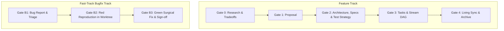

# Spec-Rails Wiki: Spec-Driven, Testing-Railed Development

Spec-Rails (Spec-Driven, Testing-Railed Development) is an engineering and AI-agent orchestration framework designed to eliminate hallucinated scope, stale documentation, untested regressions, and branch contamination in autonomous and pair-programming development.

For the operational handbook, see [WAY_OF_WORKING.md](WAY_OF_WORKING.md). Delivery status: [ROADMAP.md](ROADMAP.md); design note: [DESIGN.md](DESIGN.md). Agent-facing detailed runbooks (what `init` copies into target repos as `docs/agentic-how-tos/`): [index](agentic-how-tos/README.md) — [01 bootstrap](agentic-how-tos/01-bootstrap-new-project.md), [02 feature lifecycle](agentic-how-tos/02-drive-feature-lifecycle.md), [03 worktrees & bake-off](agentic-how-tos/03-parallel-worktrees-multi-agent.md), [04 bugfix](agentic-how-tos/04-fast-track-bugfix.md), [05 configure agents](agentic-how-tos/05-configure-ai-agents.md).

---

## 1. Core Principles

### 1.1 The Ponytail Discipline (Strict YAGNI)
- **Zero Unsolicited Architecture**: Build strictly what the active capability requires. Never introduce hypothetical abstractions, premature plugin frameworks, or configurable toggles before a concrete requirement demands them.
- **Minimal Blast Radius**: Code changes must touch only the files strictly necessary to satisfy the active vertical slice.

### 1.2 Zero-Contamination Isolation
- Production branches (`main` / `master`) are immutable to direct edits; everything lands via `--ff-only` after rebase + re-verification.
- Three lanes: features (`feat/<id>-<slug>`, Gates 0–4), bugfixes (`fix/<slug>`, Gates B1–B3), chores (`chore/<slug>`, zero behavior change, no gates).
- Concurrent subagent execution occurs in dedicated Git worktrees (`.worktrees/<id>-<stream>`).
- Bugfixes occur in dedicated bugfix worktrees (`.worktrees/fix-<slug>`) branching directly off the base branch, preventing feature-branch bleed into hotfixes.

### 1.3 Testing Rails (Red-First & >= 95% Mutation Kill)
- Code does not exist until a test fails for its absence.
- Red tests are verified locally, never committed alone; they ship in the same commit as the Green code, so every branch tip stays green.
- Coverage metrics ($\ge 95\%$ line & branch) are necessary but insufficient.
- Every logical branch must undergo mutation analysis (>= 95% mutation kill score on core business logic). Any surviving mutant below threshold is treated as a blocking bug.

### 1.4 Living Specifications
- Specs are not discarded design documents.
- Feature specs are OpenSpec delta specs; `openspec archive` merges them into `openspec/specs/` at Gate 4, keeping an evergreen, authoritative ground truth with no hand-copied files.

### 1.5 Pre-Commit Verification & Zero-Bypass Protocol
- Every project maintains active pre-commit hooks (`.pre-commit-config.yaml`).
- Before any commit: inspect `git status` / `git diff`, run all linters, and execute all tests.
- Never bypass hooks using `git commit --no-verify` or `-n`. If a check fails, resolve the defect before committing.
- Build before test (`npm run build` produces `dist/cli.js`, which the CLI tests spawn); `pre-commit run --all-files` mirrors CI. Commands: [Command Reference](WAY_OF_WORKING.md#command-reference); flow: [CI/CD Pipeline](WAY_OF_WORKING.md#cicd-pipeline).

### 1.6 Where Things Live (and Why `docs/`)
There is no `specs/` folder. Each artifact has one home, chosen by who owns it:

| Artifact | Home | Why |
| :--- | :--- | :--- |
| Capability specs, changes, archive | `openspec/specs/`, `openspec/changes/` | OpenSpec owns them; identical to upstream OpenSpec, so the CLI works unchanged. |
| Schema and templates | `openspec/schemas/spec-rails/` | The artifact graph is OpenSpec's extension point. |
| Protocol (`WORKFLOW.md`), `AGENTS.md`, bug-report template, `TODO.md` | `openspec/spec-rails/` | Same text for every adopter, ships with the addon and survives `openspec update`. |
| Developer guide (`docs/spec-rails/`) and agent runbooks (`docs/agentic-how-tos/`) | target repo `docs/` | Copied by `init` and refreshed on every run (managed); re-run `npx spec-rails init` to get updates. |
| Delivery status (`ROADMAP.md`) | `docs/` | Per-project data that spans changes; upstream OpenSpec has no roadmap concept, so it does not belong in `openspec/`. |
| Bug reports (`bug-reports/`) | `docs/` | Per-project triage records with no OpenSpec equivalent; each fix commits its report together with the regression test and fix. |

Why `docs/` rather than `specs/`: `specs/` was easily confused with `openspec/specs/` (living specs), and it mixed the addon's protocol with project data. `docs/` is the conventional place humans look for project records, needs no new top-level folder, and keeps `openspec/` pure.

### 1.7 Specs Structure
Two kinds of spec exist: **delta specs** (proposed, inside a change) and **living specs** (shipped, under `openspec/specs/`). Everything is plain Markdown.

```text
openspec/
├── config.yaml                          # schema: spec-rails
├── specs/                               # LIVING specs: shipped ground truth
│   └── <capability>/spec.md             #   one folder per capability (e.g. openspec-addon)
├── changes/
│   ├── <id>-<slug>/                     # ONE ACTIVE CHANGE (e.g. w1-2-data-ingestion)
│   │   ├── research.md                  #   Gate 0: options, tradeoffs, Go/No-Go
│   │   ├── proposal.md                  #   Gate 1: intent, scope, YAGNI exclusions
│   │   ├── specs/<capability>/spec.md   #   delta spec for that capability (pure, no gate footers)
│   │   ├── design.md                    #   Gate 2: architecture, budgets, test strategy & scenarios
│   │   └── tasks.md                     #   Gate 3: DAG, streams, vertical slices
│   └── archive/YYYY-MM-DD-<id>-<slug>/  # finished or dropped changes (same five artifacts)
├── schemas/spec-rails/                  # schema + artifact templates
└── spec-rails/                          # WORKFLOW.md, AGENTS.md, bug-report.md
```

**Lifecycle of a spec**
1. A change creates a delta at `openspec/changes/<id>-<slug>/specs/<capability>/spec.md`.
2. The delta uses `## ADDED`, `## MODIFIED`, `## REMOVED` or `## RENAMED Requirements`. A MODIFIED block repeats the full updated requirement and its exact header.
3. At Gate 4, `openspec archive` merges the requirement blocks into `openspec/specs/<capability>/spec.md` and moves the change folder into `changes/archive/`.
4. A bugfix that alters a living requirement edits `openspec/specs/` directly in the same branch (B3), with no delta.

**Conventions**
- **Change naming:** roadmap IDs normalize dots to hyphens (`W1.2` → `w1-2-<slug>`, branch `feat/w1-2-<slug>`) so change names stay within `[a-z0-9-]+`, which OpenSpec accepts.
- **Capability path:** the folder name under `specs/` (for example `identity/user-auth`). A modified capability uses the exact existing path.
- **Requirement header:** `### Requirement: REQ-<DOMAIN>-<N> <Name>` (or `NFR-<DOMAIN>-<N>` for budgets). Keys are never reused; deprecated ones keep their exact header in `## MODIFIED Requirements` and place `**[DEPRECATED by <change>]**` at the start of the requirement body.
- **Wording and scenarios:** requirement text uses MUST or SHALL. Scenarios use exactly four hashtags (`#### Scenario:`) with GIVEN, WHEN, and THEN.
- **New capabilities:** a delta for a new capability starts with `## Purpose`. Never add it to a delta for an existing capability.
- **Gates:** artifacts end with an unticked `## Review Gate` box; a human ticks it before implementation tasks or code changes are committed. Commits follow stage boundaries: after planning, after the code (per slice is fine), and after archive.

---

## 2. Gate Architecture

Spec-Rails enforces 5 human-in-the-loop gates for features (Gates 0–4) and 3 fast-track gates for defects (Gates B1–B3).



### 2.1 Feature Gate Matrix

| Gate | Name | Artifact | Required Content | Next Step |
| :--- | :--- | :--- | :--- | :--- |
| **Gate 0** | Research & Tradeoffs | `openspec/changes/<feat>/research.md` | Ground truth, 2–3 explored options, tradeoff matrix, recommendation, human developer decision. | Draft Proposal (Gate 1) |
| **Gate 1** | Proposal Review | `openspec/changes/<feat>/proposal.md` | Intent, Problem Statement, Scope (In/Out-of-scope), Success Metrics, Assumptions (`ASM-GEN-*`). | Draft Specifications & Design |
| **Gate 2** | Architecture & Specs | `design.md` + `specs/<cap>/spec.md` | Delta specs with traceable requirements (`REQ-*`, `NFR-*`) and Given/When/Then scenarios; overview, domain contracts, boundary rules, test strategy. | Task Breakdown |
| **Gate 3** | Tasks Breakdown Review | `openspec/changes/<feat>/tasks.md` | Dependency DAG, multi-agent worktree stream partitions, vertical slice task list. | Launch Worktrees / Apply Phase |
| **Gate 4** | Living Sync & Archive | `openspec/specs/` + `tasks.md` | $\ge 95\%$ coverage, $\ge 95\%$ mutation kill, worktrees pruned, delta specs promoted to `openspec/specs/`. | Feature Complete |

### 2.2 Bugfix Gate Matrix (Fast-Track)

| Gate | Name | Artifact | Required Content | Next Step |
| :--- | :--- | :--- | :--- | :--- |
| **Gate B1** | Defect Triage | `docs/bug-reports/<date>-<slug>.md` | Steps to reproduce, expected vs actual behavior, root cause analysis. | Spawn `.worktrees/fix-<slug>` |
| **Gate B2** | Red Reproduction | Target test file in worktree | Failing test proving defect on unmodified base code. | Minimal surgical fix |
| **Gate B3** | Integration Sign-off | Worktree diff + test suite output | Green test, regression suite pass, `--ff-only` merge into base branch, prune worktree. | Hotfix Deployed |

---

## 3. Parallel Worktrees & Multi-Agent Streams

When a feature contains orthogonal tasks (decoupled modules, distinct endpoints, independent algorithms):

1. **Task DAG Partitioning (Gate 3)**: The feature lead breaks down independent streams in `tasks.md`:
   - `Stream A`: Core domain rules
   - `Stream B`: Parser / Data ingestion
2. **Worktree Spawning**:
   ```bash
   git worktree add .worktrees/<feat>-stream-a -b feat/<feat>/stream-a
   git worktree add .worktrees/<feat>-stream-b -b feat/<feat>/stream-b
   ```
3. **Agent Isolation**: Each subagent is scoped to its own worktree path. No agent can dirty another agent's working directory.
4. **Integration**: Every stream rebases onto the feature branch, re-runs unit + mutation suites, then merges fast-forward:
   ```bash
   git -C .worktrees/<feat>-stream-a rebase feat/<feat>-<name>
   git checkout feat/<feat>-<name>
   git merge --ff-only feat/<feat>/stream-a
   git worktree remove .worktrees/<feat>-stream-a
   git branch -d feat/<feat>/stream-a
   git worktree prune
   ```
5. **Rebasing**: The same rebase-and-re-verify rule applies to every merge in Spec-Rails — streams into features, features/fixes/chores into `main`.

---

## 4. Testing Rails & Mutation Verification

### 4.1 The Two-Layer Rail
1. **Unit Red-Green-Refactor**: Fine-grained assertions on all code paths, edge cases, and boundary values based on Given/When/Then scenarios.
2. **Mutation Testing**: Code mutating engines (e.g. `cargo-mutants`, `stryker`) generate mutations (flipping conditionals, replacing arithmetic, deleting statements). Core logic must maintain a >= 95% mutation kill score; surviving mutants below threshold must be killed or deleted.

Spec-Rails ships no verifier: `init` writes a placeholder `Makefile` (only if absent) whose `lint`, `test`, `coverage` and `mutation` targets just echo what to implement; replace them with your stack's real commands, which the generated pre-commit hooks (`make lint`, `make test`, each only if the target exists) and your CI call (`openspec/spec-rails/TODO.md` lists the steps). Reviewers confirm that every `REQ-*`/`NFR-*` in an active change appears in a test file and that ticked Red/Green/Coverage/Mutation tasks carry `Evidence: <note>`.

### 4.2 Surviving Mutant Protocol
When a mutant survives:
1. **Case A: Missing Assertion**: The test suite failed to assert a critical boundary. Fix: Add a targeted assertion.
2. **Case B: Dead Code**: The code survived because its deletion does not alter system behavior. Fix: Delete the dead code (Ponytail rule).
3. **Case C: Equivalent Mutant**: The mutant behaves identically to the original (e.g. `i < n` → `i != n` in an index loop), so no test can kill it. Fix: Restructure the code so the equivalence disappears (iterators instead of index loops, remove redundant conditions). No exemption lists, skip comments, or lowered thresholds.
