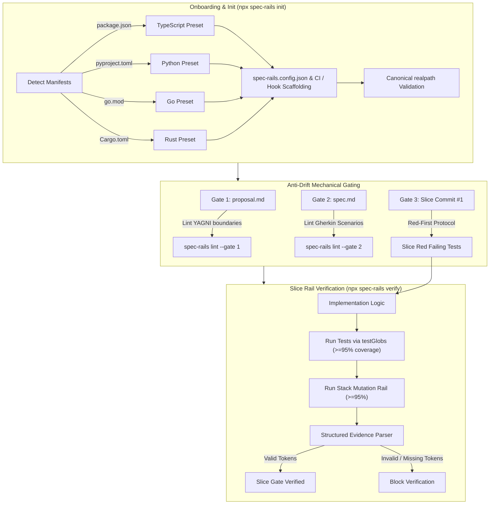

# Design Draft: Multi-Language Rails & Anti-Drift Engine

* **Status:** Finalized
* **Author:** Mohammed M
* **Date:** 2026-11-03

---

## 1. Problem Statement

Spec-Rails provides a gated specification and testing-railed workflow (Gates 0–4, Red-Green-Mutation rails, Git worktree streams) on top of OpenSpec. However, third-party adoption outside shell environments encounters two major failure modes:

1. **Third-Party Onboarding Rigidity & Stack Bias**:
   - Blanket symlink rejection (`bin/spec-rails:46-96`) aborts installation on standard developer environments (macOS `/var` / `/tmp`, pnpm symlinked virtual stores, monorepo workspaces).
   - Shell/POSIX script fragility across OS boundaries (especially Windows) and hard dependency on external `jq` binary.
   - Generated configurations (`.pre-commit-config.yaml`, CI workflows) assume Python tooling and `Makefile` targets exist.
   - Hardcoded test discovery (`RAILS_TEST_DIRS="tests"`) fails on standard Go (`*_test.go`), Rust (`src/**`), and TypeScript (`src/**/*.test.ts`) directory structures.
   - Missing native presets for mutation runners leave adopters without deterministic configuration for Stryker, mutmut, gremlins, or cargo-mutants.
   - Unconfigured mutation/coverage rails default to logging warnings and exiting with code 0 instead of blocking invalid slices under strict modes.

2. **Agentic Drift in Planning and Implementation**:
   - Autonomous AI coding agents drift during planning (speculative scope creep, inventing abstractions, vague pros/cons) due to subjective prose instructions.
   - Agents drift during slice execution (skipping Red tests, generating tautological assertions, or evading mutation thresholds) without mechanical gating.
   - Current slice verification accepts arbitrary free-form strings for evidence, allowing agents to fabricate or hallucinate verification output.

---

## 2. Overview

This design modernizes and hardens Spec-Rails into a TypeScript/Node-powered, language-agnostic OpenSpec addon for third-party projects while replacing prose guidelines with deterministic mechanical rails.

Key changes:
- **TypeScript / Node Core**: Implement Spec-Rails CLI and verification engine in TypeScript (`@openspec/spec-rails`), runnable directly via `npx spec-rails` or bundled zero-dependency executable (`dist/cli.js`).
- **Elimination of `jq` Dependency**: Native JSON parsing and typed configuration via Zod (`spec-rails.config.json`).
- **Native Cross-Platform Path Handling**: Robust `node:fs` / `node:path` canonical resolution solving pnpm, monorepo symlinks, and Windows path quirks.
- **Multi-Stack Initialization (`spec-rails init --stack=[auto|ts|python|go|rust]`)**: Automatic manifest detection (`package.json`, `pyproject.toml`, `go.mod`, `Cargo.toml`).
- **Turnkey Mutation Presets**: Pre-packaged configurations and scoped runners in `templates/presets/` enforcing the `>= 95%` mutation kill score and `>= 95%` unit test coverage thresholds across TypeScript (Stryker), Python (mutmut), Go (gremlins), and Rust (cargo-mutants).
- **Structured Bracketed Evidence Tokens**: Validates bracketed evidence tokens (`Evidence: [CMD: ...] [EXIT: 0] [COVERAGE: 95%] [MUTATION: 95%]`) recorded in `tasks.md` deterministically via regex parsing during `spec-rails verify`.
- **Formal Invariant Update (`MODIFIED NFR-OSA-1`)**: Formally updates the living spec `NFR-OSA-1` to permit a self-contained Node.js (>= 18) single-file bundle (`dist/cli.js`), eliminating external `jq` and providing native cross-platform path resolution.

---

## 3. Goals

- **TypeScript / Node Runtime Engine (`MODIFIED NFR-OSA-1`)**: Formally update living specification `NFR-OSA-1` (Dependencies) from POSIX `sh` + `jq` to Node.js (>= 18). Package Spec-Rails as a self-contained single-file CLI (`dist/cli.js`) distributed via npm / npx (`@openspec/spec-rails`) with zero runtime external dependencies. Eliminate external `jq` requirements.
- **Universal Cross-Platform Support**: Native support for Linux, macOS, and Windows without POSIX shell emulation layers.
- **Turnkey Multi-Language Onboarding**: Support automatic stack detection and generate tailored `spec-rails.config.json`, pre-commit hooks, and CI workflows for TypeScript, Python, Go, and Rust.
- **Robust Canonical Path Sandboxing**: Use `fs.realpathSync` to ensure target paths stay within repository boundaries, supporting monorepos and pnpm symlink stores without directory traversal vulnerabilities.
- **Deterministic Test & Mutation Rail Execution (`MODIFIED NFR-OSA-5`)**: Formally calibrate the living spec `NFR-OSA-5` mutation kill score threshold from `> 90%` to `>= 95%` (matching the `>= 95%` test coverage rail). Enable glob-based test discovery (`testGlobs`) and provide ready-to-run mutation configs calibrated to `>= 95%` mutation kill score.
- **Strict Verification Enforcement**: Reject empty mutation/coverage rail executions under strict mode (default in CI).
- **Anti-Drift Mechanical Rails**:
  - Mechanically lint Gate 1 YAGNI boundaries against staged diffs.
  - Mechanically enforce Gate 2 Gherkin format (`#### Scenario:`).
  - Enforce Red-First testing rail (slice commit #1 contains failing tests proving contract violation prior to implementation).
  - Mechanically parse and validate structured bracketed evidence tokens (`Evidence: [CMD: ...] [EXIT: 0] [COVERAGE: 95%] [MUTATION: 95%]`) in `tasks.md`.

---

## 4. Non-Goals

- **Custom Compilers or Mutation Engines**: Spec-Rails does not implement proprietary mutation testing engines; it orchestrates existing industry tools (Stryker, mutmut, gremlins, cargo-mutants).
- **Retroactive 100% Mutation Coverage on Legacy Repos**: Mutation thresholds (`>= 95%`) apply strictly to changesets/slices, not entire un-migrated legacy codebases.
- **Arbitrary Framework Scaffolding**: Spec-Rails does not replace framework CLI generators (e.g., `create-react-app`, `cargo init`). It rails testing and spec compliance around existing repositories.

---

## 5. Technical Plan

### 5.1 Architecture Overview & Data Flow

Spec-Rails runs as a Node.js CLI tool (`spec-rails` / `npx spec-rails`) using native Node APIs (`node:fs`, `node:child_process`, `node:path`) and Zod schema validation.



### 5.2 Component Breakdown

#### A. Core CLI Package (`@openspec/spec-rails` or `spec-rails`)
- Implemented in TypeScript, bundled to a standalone single-file binary with zero runtime dependencies via `tsup` / `esbuild`.
- Accessible via:
  - `npx spec-rails <command>`
  - Local script `bin/spec-rails` delegating to Node runner.
- Subcommands:
  - `spec-rails init [--stack auto|ts|python|go|rust]`
  - `spec-rails verify [--slice <id>] [--strict]`
  - `spec-rails lint [--gate 1|2]`

#### B. Canonical Path Sandboxing (`src/utils/paths.ts`)
- Replaces brittle `test -L` shell checks with `fs.realpathSync`.
- Validates that resolved target and worktree paths fall under authorized repository root or whitelisted directories.
- Fully compatible with pnpm virtual store links, monorepo workspaces, and Windows paths (`C:\...`).

#### C. Language Presets (`schemas/spec-rails/presets/` & `src/presets/`)
Bundled templates:
* **TypeScript (`presets/ts/`)**:
  - `stryker.config.json` with `@stryker-mutator/vitest-runner` or `jest-runner`.
  - Mutation script: `npx stryker run --mutate '<slice-files>'` with threshold break `95`.
  - Test command: `npm test` or `pnpm test`.
* **Python (`presets/python/`)**:
  - `mutmut.ini` / `pyproject.toml` tool configuration.
  - Runner checking score $\ge 95\%$ on changed modules.
  - Test command: `pytest`.
* **Go (`presets/go/`)**:
  - `gremlins.yaml` preset targeting modified packages.
  - Runner parsing mutation percentage output ($\ge 95\%$).
  - Test command: `go test ./...`.
* **Rust (`presets/rust/`)**:
  - `cargo-mutants.toml` configured with `cargo-nextest`.
  - Runner enforcing score $\ge 95\%$ mutants killed.
  - Test command: `cargo test` / `cargo nextest run`.

#### D. Verification Rail (`src/commands/verify.ts`)
1. **Configurable Test Discovery (`testGlobs`)**:
   - Evaluates fast-glob matching based on stack defaults (e.g. `src/**/*.test.ts`, `*_test.go`, `tests/**`).
2. **Strict Mode Enforcement (`strict: true`)**:
   - In CI or under strict mode, rejects unconfigured or zero-kill mutation runs.
3. **Structured Evidence Parser (`src/utils/evidence.ts`)**:
   - Validates regex tokens in `tasks.md`:
     ```text
     Evidence: [CMD: <cmd>] [EXIT: 0] [COVERAGE: <num>%] [MUTATION: <num>%]
     ```
   - Enforces `EXIT == 0`, `COVERAGE >= 95%`, and `MUTATION >= 95%`.

#### E. Spec Linter (`src/commands/lint.ts`)
- Validates Gate 1 `proposal.md` forbidden packages against staged git diff.
- Validates Gate 2 `spec.md` for compliant Gherkin `#### Scenario:` structures.

### 5.3 Configuration Schema (`spec-rails.config.json`)

```json
{
  "$schema": "https://raw.githubusercontent.com/openspec/spec-rails/main/schemas/spec-rails.schema.json",
  "stack": "ts",
  "strict": true,
  "testGlobs": ["src/**/*.test.ts", "tests/**/*.spec.ts"],
  "testCommand": "npm test",
  "coverageCommand": "npm run test:coverage",
  "coverageMinScore": 95,
  "mutationCommand": "npx stryker run",
  "mutationMinScore": 95
}
```

---

## 6. Alternatives Considered

### 6.1 Maintain Pure POSIX Shell + jq Core vs. Formal Node Update (`MODIFIED NFR-OSA-1`)
* **Description**: Continue maintaining `bin/spec-rails` and `bin/spec-rails-verify` exclusively as POSIX `sh` scripts relying on system `jq`.
* **Drawbacks / Why POSIX sh was rejected**:
  - Fragile string parsing, non-portable `sed`/`grep` regex differences across GNU (Linux) vs BSD (macOS) userlands.
  - Complete lack of native Windows support without WSL, Git Bash, or Cygwin emulation.
  - Hard dependency on external `jq` binary, which is frequently missing in minimal CI runners, scratch containers, or third-party developer machines.
  - Difficult maintenance of multi-stack config parsing in shell scripts without typed validation.
* **Formal Decision (`MODIFIED NFR-OSA-1`)**:
  - Formally update living spec `NFR-OSA-1` (Dependencies) to permit Node.js (>= 18) for Spec-Rails tooling.
  - Implement the core CLI in TypeScript, bundled via `tsup` into a self-contained single-file executable (`dist/cli.js`) with zero runtime `node_modules` dependencies.
  - Eliminates `jq` requirement completely via native JSON handling and provides native `fs.realpathSync` path resolution across Windows and POSIX systems.
  - Shell scripts in `bin/spec-rails` are retained as lightweight zero-overhead trampolines invoking `node dist/cli.js` or `npx spec-rails`.

### 6.2 Manual Language Setup Guides Only (Prose Documentation)
* **Description**: Provide documentation guides instructing adopters on how to manually configure Stryker, mutmut, gremlins, and cargo-mutants.
* **Rejected by author**: Passive documentation produces configuration drift, high setup abandonment, and unconfigured mutation rails. Turnkey preset files in `schemas/spec-rails/presets/` ensure immediate, working configurations during `spec-rails init`.

### 6.3 Monolithic Multi-Language Compiler / Custom Mutation Engine
* **Description**: Implement a unified AST-based mutation testing engine directly inside Spec-Rails to avoid depending on ecosystem tools like Stryker or cargo-mutants.
* **Rejected by author**: Massive scope creep, violates YAGNI. Native ecosystem mutation tools are mature, highly optimized, and maintained by respective language communities. Spec-Rails acts as a standardized rail and verifier orchestrator, not a compiler.

### 6.4 Free-Form Narrative Evidence in Tasks
* **Description**: Allow agents to record slice verification evidence as unstructured Markdown paragraphs (e.g. "I ran the tests and all 4 passed with 95% coverage").
* **Rejected by author**: Unstructured text allows autonomous agents to hallucinate test results or produce vague summaries without executing the actual commands. Structured bracketed tokens (`Evidence: [CMD: ...] [EXIT: 0] [COVERAGE: 95%] [MUTATION: 95%]`) enable deterministic mechanical regex validation.


---

## 7. Detailed Implementation Plan

### 7.1 File-by-File Enumeration & Rationales

| File | Action | Purpose / Rationale |
| :--- | :--- | :--- |
| `package.json` | Create | Defines `spec-rails` npm package, entrypoints (`dist/cli.js`), scripts (`build`, `test`, `test:coverage`, `mutate`), and build tooling (`tsup`, `vitest`, `zod`, `fast-glob`). |
| `tsconfig.json` | Create | Strict TypeScript configuration targeting Node 18+ (ES2022). |
| `tsup.config.ts` | Create | Bundles TypeScript sources into a single zero-runtime-dependency CLI executable with shebang (`#!/usr/bin/env node`). |
| `src/cli.ts` | Create | Main CLI router parsing subcommands (`init`, `verify`, `lint`) and global flags (`--help`, `--version`, `--verbose`). |
| `src/config.ts` | Create | Zod validation schema and loader for `spec-rails.config.json` with fallback defaults. |
| `src/utils/paths.ts` | Create | Implements canonical `realpathSync` sandbox validation, replacing brittle shell `test -L` checks with safe repository boundary enforcement. |
| `src/utils/evidence.ts` | Create | Token parsing engine for bracketed evidence (`Evidence: [CMD: ...] [EXIT: ...] [COVERAGE: ...] [MUTATION: ...]`) in `tasks.md`. |
| `src/commands/init.ts` | Create | Manifest inspector detecting `package.json`, `pyproject.toml`, `go.mod`, or `Cargo.toml`, generating configuration and copying language presets. |
| `src/commands/verify.ts` | Create | Orchestrates test execution across `testGlobs`, executes coverage and mutation commands, and verifies tasks evidence with strict exit gating. |
| `src/commands/lint.ts` | Create | Mechanical linter validating Gate 1 YAGNI forbidden dependencies against staged diffs and Gate 2 Gherkin `#### Scenario:` formatting. |
| `schemas/spec-rails.schema.json` | Create | Standard JSON Schema published for IDE autocompletion of `spec-rails.config.json`. |
| `schemas/spec-rails/presets/ts/*` | Create | TypeScript presets: `stryker.config.json` calibrated to `95%` break threshold, vitest/jest runner scripts. |
| `schemas/spec-rails/presets/python/*` | Create | Python presets: `mutmut.ini` configuration and pytest runner script. |
| `schemas/spec-rails/presets/go/*` | Create | Go presets: `gremlins.yaml` configuration and runner wrapper. |
| `schemas/spec-rails/presets/rust/*` | Create | Rust presets: `cargo-mutants.toml` configured for `cargo-nextest`. |
| `bin/spec-rails` | Modify | Replaced with a lightweight POSIX trampoline invoking `node dist/cli.js` or `npx spec-rails`. |
| `tests/unit/*.test.ts` | Create | Vitest suite testing path sandboxing, manifest auto-detection, token regex parsing, and linting rules. |
| `tests/integration/cli.test.ts` | Create | End-to-end CLI integration tests verifying `init`, `lint`, and `verify` across mock project directories. |

### 7.2 Staging & Phased Delivery

1. **Phase 1: Project Setup, Living Spec Delta (`MODIFIED NFR-OSA-1`, `MODIFIED NFR-OSA-5`) & Core CLI Foundations**:
   - Propose OpenSpec delta spec updating `NFR-OSA-1` (Node.js >= 18 self-contained bundle) and `NFR-OSA-5` (mutation kill score increased from > 90% to >= 95%).
   - Bootstrap TypeScript build pipeline (`package.json`, `tsconfig.json`, `tsup.config.ts`).
   - Implement `src/config.ts` (Zod schema) and `src/utils/paths.ts` (`realpath` boundary verification).
   - Unit tests for configuration and path validation.

2. **Phase 2: Multi-Language Manifest Detection & Presets**:
   - Create preset directories for `ts`, `python`, `go`, and `rust`.
   - Implement `src/commands/init.ts` with `--stack=[auto|ts|python|go|rust]`.
   - Integration tests verifying initialized file trees for each stack.

3. **Phase 3: Anti-Drift Rails (Spec Linting & Pre-commit Hooks)**:
   - Implement `src/commands/lint.ts` asserting Gate 1 YAGNI boundaries and Gate 2 Gherkin scenarios.
   - Pre-commit hook integration enforcing failing test presence before implementation commits.

4. **Phase 4: Structured Evidence & Verification Rail**:
   - Implement `src/utils/evidence.ts` and `src/commands/verify.ts`.
   - Enforce glob-based test discovery (`testGlobs`) and `strict` verification flags.
   - Update `bin/spec-rails` trampoline.

5. **Phase 5: Dogfooding & Documentation**:
   - Self-host Spec-Rails on itself using the TypeScript preset.
   - Verify mutation kill rail $\ge 95\%$ and unit test coverage $\ge 95\%$ using Vitest and Stryker.
   - Update `README.md`, `docs/WIKI.md`, and `docs/how-tos/`.

### 7.3 Verification & Quality Gates

Each slice implementation in this plan will be verified against the strict Spec-Rails quality gates:
1. **Red Test Scaffolding**: Vitest tests written first, asserting expected failures.
2. **Green Implementation**: Clean passing test suite across macOS, Linux, and Windows path formats.
3. **Mutation Testing Rail**: Stryker run executed against changed modules ensuring $\ge 95\%$ mutants killed and $\ge 95\%$ unit test coverage.
4. **Tokenized Evidence**: Structured evidence recorded in tasks.md:
   ```text
   Evidence: [CMD: npm test] [EXIT: 0] [COVERAGE: 95%] [MUTATION: 95%]
   ```
