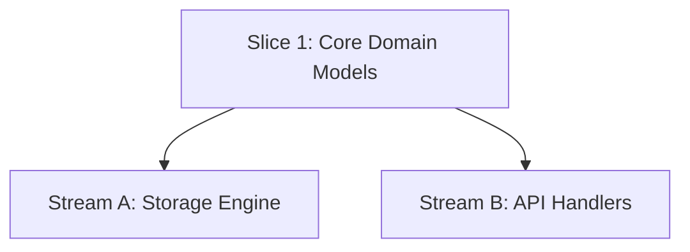

# How-To: Parallel Worktrees & Multi-Agent Streams

When a feature contains orthogonal tasks with zero mutual dependencies, Spec-Rails isolates execution across Git worktrees to prevent branch contamination and enable parallel subagent execution.

---

## 1. Identify Orthogonal Streams (Gate 4)

In `openspec/changes/w1-2-data-pipeline/tasks.md` (where roadmap `W1.2` normalizes dots to hyphens), analyze the dependency DAG after shared capability delta specs are locked at Gate 2:



- `Stream A` and `Stream B` depend on `Core`, but do not depend on each other.
- Shared capability delta specs are locked and approved on the feature branch at Gate 2 before spawning parallel worktrees.
- They can execute concurrently in separate Git worktrees, giving each agent an independent worktree index without `.git/index.lock` contention.

---

## 2. Spawn Worktrees

Ensure your base feature branch (with Gate 4 ticked) is committed and up to date:

```bash
git checkout feat/w1-2-data-pipeline
```

Spawn isolated worktrees:

```bash
git worktree add .worktrees/w1-2-storage -b feat/w1-2/storage
git worktree add .worktrees/w1-2-api -b feat/w1-2/api
```

---

## 3. Dispatch Agents to Worktrees

When delegating tasks to subagents:
- Point the subagent workspace directly to `.worktrees/w1-2-storage`.
- In Antigravity / AGY, configure subagent invocation with `Workspace: 'share'` or point to the worktree path.
- The subagent executes Gate 5.x (BDD $\rightarrow$ Unit Red $\rightarrow$ Code Green $\rightarrow$ Mutation Kill) completely isolated inside its worktree (never self-ticking Gate 5.x sign-off boxes).
- Update `tasks.md` slice checkboxes on the parent feature branch when integrating streams (or confine edits to that stream's own slice section) to avoid rebase collisions.

---

## 4. Integrate Streams Back to Feature Branch

When Stream A completes and passes Gate 5.x:

1. Inside the stream worktree, rebase onto the feature branch, re-run tests, and validate the OpenSpec change:
   ```bash
   git -C .worktrees/w1-2-storage rebase feat/w1-2-data-pipeline
   openspec validate w1-2-data-pipeline
   ```
2. Checkout the feature branch and fast-forward merge the stream:
   ```bash
   git checkout feat/w1-2-data-pipeline
   git merge --ff-only feat/w1-2/storage
   ```
3. Remove the completed worktree, delete stream branch, and prune:
   ```bash
   git worktree remove .worktrees/w1-2-storage
   git branch -d feat/w1-2/storage
   git worktree prune
   ```

---

## 5. Rebase Subsequent Streams

Before merging Stream B (or if Stream B needs code introduced by Stream A):

```bash
cd .worktrees/w1-2-api
git rebase feat/w1-2-data-pipeline
openspec validate w1-2-data-pipeline
```

Resolve any rebasing conflicts additively inside the worktree, re-run the test and mutation suites, and merge `--ff-only`.

---

## 6. Optional: Candidate Bake-Off Mode

For high-uncertainty or complex algorithmic tasks, teams may optionally run a competitive bake-off across parallel worktrees rather than a single implementation stream.

> [!TIP]
> **Suggested Watch**: [Lead Architect Reveals His Rules for Coding Agents (Beyond Coding #272)](https://www.youtube.com/watch?v=mkN4uRZYPfs) — Carlos Kelkboom on scoping AI coding agents, contract scaffolding, and parallel worktrees.

> [!NOTE]
> Bake-offs are strictly optional and intended for high-uncertainty slices. Standard features and chores execute in single-branch streams without bake-off overhead.

### 1. Spawn Candidate Worktrees
```bash
git worktree add .worktrees/w1-2-cand-a -b feat/w1-2/cand-a
git worktree add .worktrees/w1-2-cand-b -b feat/w1-2/cand-b
```

### 2. Dispatch Competing Prompts / Subagents
- Dispatch independent subagents to each candidate worktree with differing prompts, models, or architectural approaches.
- Both subagents must adhere strictly to the pre-committed contract scaffolding and testing rails.

### 3. Evaluate Candidates
Score both candidates against objective metrics:
1. **Rails Pass**: 100% test pass and $\ge 95\%$ line/branch coverage.
2. **Mutation Kill Score**: $\ge 95\%$ mutation kill score on core logic.
3. **Ponytail Simplicity**: Smallest diff, fewest abstractions, and lowest cyclomatic complexity.

### 4. Merge Winner & Prune Loser
Fast-forward merge the winning candidate into the feature branch, then prune both worktrees:
```bash
git checkout feat/w1-2-data-pipeline
git merge --ff-only feat/w1-2/cand-a
git worktree remove .worktrees/w1-2-cand-a
git worktree remove .worktrees/w1-2-cand-b
git branch -d feat/w1-2/cand-a
git branch -D feat/w1-2/cand-b
git worktree prune
```
