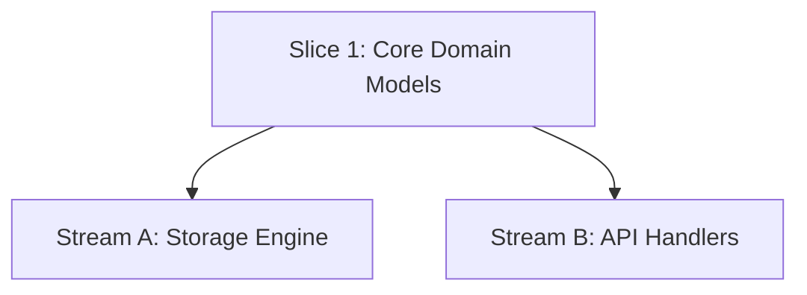

# How-To: Parallel Worktrees & Multi-Agent Streams

When a feature contains orthogonal tasks with zero mutual dependencies, Spec-Rails isolates execution across Git worktrees to prevent branch contamination and enable parallel subagent execution. Agent runbook with failure modes and the candidate bake-off: [agentic-how-tos/03](../agentic-how-tos/03-parallel-worktrees-multi-agent.md).

---

## 1. Identify Orthogonal Streams (Gate 3)

In `openspec/changes/w1-2-data-pipeline/tasks.md` (where roadmap `W1.2` normalizes dots to hyphens), analyze the dependency DAG after shared capability delta specs and architecture are approved at Gate 2:



- `Stream A` and `Stream B` depend on `Core`, but do not depend on each other.
- Shared capability delta specs and contracts are locked and approved on the feature branch at Gate 2 before spawning parallel worktrees.
- They can execute concurrently in separate Git worktrees, giving each agent an independent worktree index without `.git/index.lock` contention.

---

## 2. Spawn Worktrees

Ensure your base feature branch (with Gate 3 ticked) is committed and up to date:

```bash
git checkout feat/w1-2-data-pipeline
```

Spawn isolated worktrees:

```bash
git worktree add .worktrees/w1-2-storage -b feat/w1-2/storage
git worktree add .worktrees/w1-2-api -b feat/w1-2/api
```

---

## 3. Dispatch Agents to Worktrees

When delegating tasks to subagents:
- Point the subagent workspace directly to `.worktrees/w1-2-storage`.
- In Antigravity / AGY, configure subagent invocation with `Workspace: 'share'` or point to the worktree path.
- The subagent executes the vertical slice (Scaffolding $\rightarrow$ Unit Red $\rightarrow$ Code Green $\rightarrow$ Mutation Kill) completely isolated inside its worktree.
- Update `tasks.md` slice checkboxes on the parent feature branch when integrating streams (or confine edits to that stream's own slice section) to avoid rebase collisions.

---

## 4. Integrate Streams Back to Feature Branch

When Stream A completes:

1. Inside the stream worktree, rebase onto the feature branch, re-run tests, and validate the OpenSpec change:
   ```bash
   git -C .worktrees/w1-2-storage rebase feat/w1-2-data-pipeline
   openspec validate w1-2-data-pipeline
   ```
2. Checkout the feature branch and fast-forward merge the stream:
   ```bash
   git checkout feat/w1-2-data-pipeline
   git merge --ff-only feat/w1-2/storage
   git worktree remove .worktrees/w1-2-storage
   git branch -d feat/w1-2/storage
   git worktree prune
   ```
3. Repeat for Stream B once complete.
