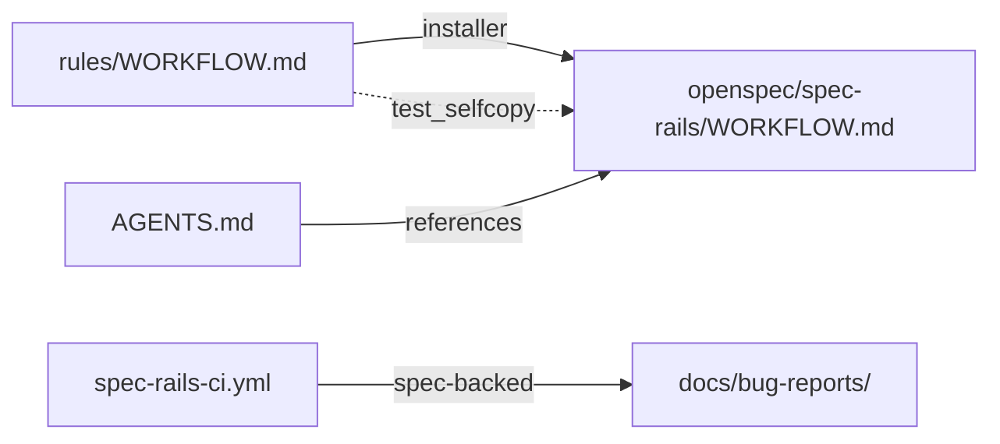

# Architecture & Technical Design

## 1. Overview & Invariants
Pure path and file relocation; no new runtime logic beyond one installer copy.
- Protocol (invariant text) ships with the addon: source `rules/WORKFLOW.md`, installed `openspec/spec-rails/WORKFLOW.md`, guarded by the self-copy test.
- Project data lives in `docs/`: `docs/ROADMAP.md` (delivery status), `docs/bug-reports/`.
- The old design note `docs/ROADMAP.md` becomes `docs/DESIGN.md`.
- Invariant: nothing outside `openspec/changes/archive/` references `specs/ROADMAP.md`, `specs/WORKFLOW.md` or `specs/bug-reports/`.

## 2. Domain Models, State & Interface Contracts
| Before | After |
| :--- | :--- |
| `specs/WORKFLOW.md` | `rules/WORKFLOW.md` (source), `openspec/spec-rails/WORKFLOW.md` (installed) |
| `specs/ROADMAP.md` | `docs/ROADMAP.md` |
| `docs/ROADMAP.md` (design note) | `docs/DESIGN.md` |
| `specs/bug-reports/` | `docs/bug-reports/` |

Installer contract: `bin/spec-rails` copies `rules/WORKFLOW.md` with the same helper used for `AGENTS.md`.

## 3. Architecture Diagram & Data Flow

## 4. Boundary Rules & Budgets
- **Pure Core vs. I/O Shell**: no core logic; the only I/O change is one additional file copy in the installer shell.
- **Concurrency, Latency & Resource Budgets**: installer stays within NFR-OSA-2; selfcopy check within NFR-OSA-6.

## 5. Testing Strategy
1. **BDD Scenarios**: update `spec_rails_workflow.feature` and `ci_audit.feature` to the new paths; add a legacy `specs/` audit case.
2. **Unit Tests (>= 95% coverage)**: `test_installer.sh` asserts the installed `WORKFLOW.md` and idempotence; `test_selfcopy.sh` gains the `rules/WORKFLOW.md` pair; `test_ci_audit.sh` uses `docs/bug-reports/`.
3. **Mutation Testing (100% kill)**: not applicable to shell relocation; the installer copy line is covered by the installer test failing when removed.

## Review Gate
- [x] **Gate 3 Approval**: Architecture & design reviewed and approved by human before task breakdown.
