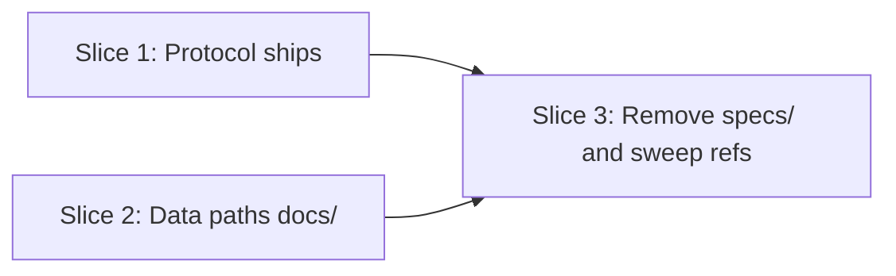

# Tasks

## 1. Dependency DAG

## 2. Streams & Worktrees
| Stream | Worktree Path | Branch | Prerequisite |
| :--- | :--- | :--- | :--- |
| single | none (sequential, small change) | `feat/w3-13-consolidate-layout` | Gate 4 |

## 3. Slice 1: Protocol ships with the addon

- [x] 3.1 BDD/installer scenarios: installed `openspec/spec-rails/WORKFLOW.md` exists (verify: test committed)
- [x] 3.2 Gate 5.1 human sign-off on scenarios
- [x] 3.3 Red: installer and selfcopy tests fail for the missing file (verify: output shown; on ticking append `Evidence: <command and result>`) Evidence: `make test-installer` -> "FAIL: workflow protocol shipped with the addon ... No such file or directory", Failed: 1
- [x] 3.4 Green: `git mv` to `rules/WORKFLOW.md`, installer copy, selfcopy pair, installed copy, AGENTS.md reference (verify: `make test-installer test-selfcopy`; on ticking append `Evidence: <command and result>`) Evidence: `make test-installer test-selfcopy` -> Failed: 0, "selfcopy: in sync"

## 4. Slice 2: Project data under docs/

- [x] 4.1 Update `ci_audit` tests/features to `docs/bug-reports/` plus a legacy `specs/` failing case (verify: committed)
- [x] 4.2 Red: audit tests fail against the old CI pattern (on ticking append `Evidence: <command and result>`) Evidence: `make test-ci-audit` -> "FAIL: bug report passes (expected exit 0, got 1)", 7 passed, 2 failed
- [x] 4.3 Green: CI template and workflow regexp, BDD tests, `templates/roadmap.md`, `docs/ROADMAP.md` (from `docs/DELIVERY.md`), `docs/DESIGN.md` (from old `docs/ROADMAP.md`), how-tos, README, skill, rules (verify: `make test`; on ticking append `Evidence: <command and result>`) Evidence: `make test` -> all suites 0 failed (ci audit 9 passed, selfcopy in sync, E2E 5 passed, verify 14 passed)

## 5. Slice 3: Remove specs/ and sweep

- [ ] 5.1 Update `openspec/specs/openspec-addon/spec.md` is done by `openspec archive`; verify `grep -r "specs/\(ROADMAP\|WORKFLOW\|bug-reports\)" . --exclude-dir=.git --exclude-dir=archive` returns nothing
- [x] 5.2 `specs/` is absent and `make test` passes (on ticking append `Evidence: <command and result>`) Evidence: `ls specs` -> No such file; `make test` -> 0 failed

## 6. Integration & Rebase Plan
- [ ] 6.1 Rebase on main, re-verify rails, `openspec archive`

## Review Gate
- [x] **Gate 4 Approval**: Tasks breakdown approved by human before writing test code.
