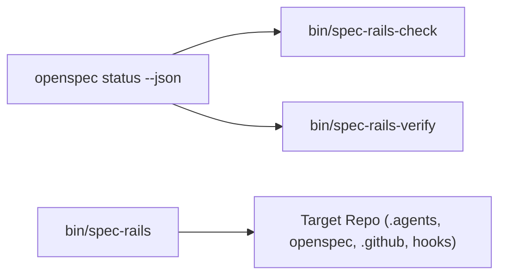

# Architecture & Technical Design

## 1. Overview & Invariants
Preserves the pure POSIX `sh` + `jq` architecture while closing all OpenSpec v1.15/v1.16 boundary, rail-gaming, and symlink/CI vulnerabilities.

## 2. Domain Models, State & Interface Contracts
- `spec-rails-check [--store <id>]`: Queries `openspec list --json` and `openspec status --change <c> --json` with isolated `stderr`; resolves `.changeRoot` and `.artifactPaths.specs.existingOutputPaths`; evaluates transitive `.requires[]` closure across non-`skipped` ancestors plus Gate 4 (`tasks.md`) pre-apply lock.
- `spec-rails-verify [--store <id>]`: Resolves active changes via OpenSpec store metadata or `find openspec/changes -mindepth 1 -maxdepth 1 -type d ! -name archive`; performs token-bounded POSIX ERE traceability matching and placeholder-stripped `Evidence:` validation.
- `spec-rails [init] [--force] [--version] [--help] [target-dir]`: Resolves `$0` symlinks, refuses destination symlinks, resolves Git worktree hook paths via `git rev-parse --git-path`, installs `.agents/skills/spec-rails/SKILL.md`, and preserves user-editable CI/mutation/pre-commit/rails configs by default.

## 3. Architecture Diagram & Data Flow

## 4. Boundary Rules & Budgets
- **Pure Core vs. I/O Shell**: Pure `awk`/`jq` parsers (`gate_state`, `violations`, `delta_keys`, `set_schema_line`, `version_ge`) remain sourceable via `SPEC_RAILS_SOURCE_ONLY=1` with zero filesystem mutation; `main()` handles CLI/git I/O.
- **Concurrency, Latency & Resource Budgets**: Meets `NFR-OSA-1`..`NFR-OSA-9` (< 5s install, < 3s check on 20 changes, < 5s verify, < 20s E2E).

## 5. Testing Strategy
1. **BDD Scenarios**: Feature specs tagged for `REQ-OSA-1..32` and `NFR-OSA-1..9`, plus offline-capable `tests/bdd/test_bdd.sh`.
2. **Unit & Fixture Suites**: `test_check.sh`, `test_verify.sh`, `test_installer.sh`, `test_ci_audit.sh`, `test_schema.sh`, `test_lint.sh`, `test_selfcopy.sh`, `test_e2e.sh`.
3. **Self-Verification**: `sh bin/spec-rails-verify` executes in CI and locally against `spec-rails` itself.

## Review Gate
- [x] **Gate 3 Approval**: Architecture & design reviewed and approved by human before task breakdown.
