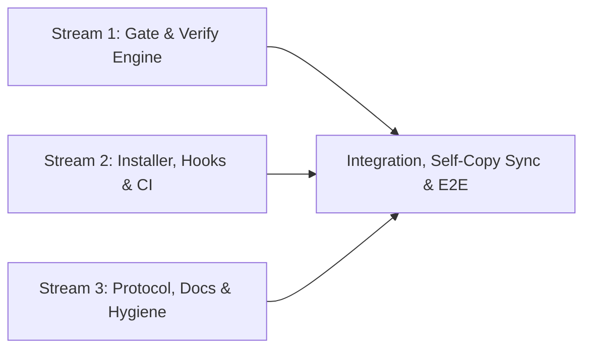

# Tasks

## 1. Dependency DAG

## 2. Streams & Worktrees
| Stream | Worktree Path | Branch | Prerequisite |
| :--- | :--- | :--- | :--- |
| Stream 1 | isolated shared worktree | `feat/w4-1-openspec-hardening` | Gate 4 |
| Stream 2 | isolated shared worktree | `feat/w4-1-openspec-hardening` | Gate 4 |
| Stream 3 | isolated shared worktree | `feat/w4-1-openspec-hardening` | Gate 4 |

## 3. Slices
- [x] 3.1 Stream 1: Transitive/store/Gate-4 `spec-rails-check` + token/evidence `spec-rails-verify` + `tasks.md`/`schema.yaml` Evidence: `sh tests/test_check.sh && sh tests/test_verify.sh && sh tests/test_schema.sh` -> 0 failed
- [x] 3.2 Stream 2: Symlink/worktree/CLI `bin/spec-rails` + portable `.pre-commit-config.yaml` & `spec-rails-ci.yml` Evidence: `sh tests/test_installer.sh && sh tests/test_ci_audit.sh` -> 0 failed
- [x] 3.3 Stream 3: Kebab-case change naming, `/opsx-*` & `.git/index.lock` rules/docs, hygiene, lint, selfcopy, E2E & BDD suites Evidence: `sh tests/test_lint.sh && sh tests/bdd/test_bdd.sh` -> 0 failed

## 4. Integration & Rebase Plan
- [x] 4.1 Sync all self-copies, archive `w3-13` and `w4-1`, verify `make test`, `spec-rails-check`, `spec-rails-verify`, and `openspec validate` Evidence: `make test && sh bin/spec-rails-verify` -> 0 failed

## Review Gate
- [x] **Gate 4 Approval**: Tasks breakdown approved by human before writing test code.
