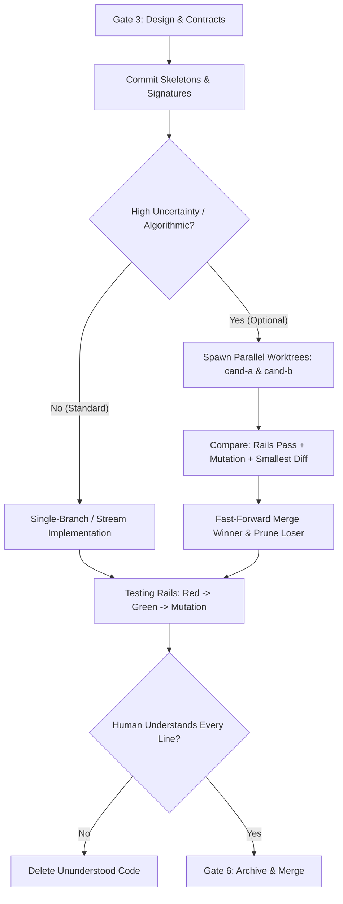

# Architecture & Technical Design

## 1. Overview & Invariants
This design formalizes Carlos Kelkboom's architectural discipline into Spec-Rails:
- **Contract Scaffolding Rail (`REQ-OSA-33`)**: Prevents hallucinated abstractions by requiring interface definitions, types, and empty signatures to be committed before code generation.
- **Comprehension Verification (`REQ-OSA-34`)**: Guards against technical debt by mandating that ununderstood AI code be deleted rather than merged.
- **Optional Parallel Bake-Off (`REQ-OSA-35`)**: Provides a documented recipe for running competitive subagents in Git worktrees without imposing worktree overhead on standard slices.
- **Mutation Threshold Calibration (`NFR-OSA-5`)**: Adjusts mutation kill rail from strict 100% to > 90% on core domain logic, preventing friction on untestable equivalent mutants and defensive logger branches.

## 2. Domain Models, State & Interface Contracts

### Rule Modifications
1. `rules/AGENTS.md`:
   - Extend Section 1 (Ponytail Mindset) with the **Contract Scaffolding Rail** and **Comprehension Invariant** ("Understand or Delete: if the human reviewer cannot explain every line, delete it").
2. `rules/WORKFLOW.md`:
   - In §1 Rule 3, document the **Optional Candidate Bake-Off Mode**.
   - In §2 (Feature Lane), update Gate 3/4 design notes to require skeleton contract commits, and Gate 6 to require comprehension sign-off.
3. `schemas/spec-rails/templates/tasks.md`:
   - In the vertical slice loop, add a scaffolding check: `- [ ] X.1 Contract & interface scaffolding committed`.
   - In Gate 6 verification, add: `- [ ] Human Comprehension Verification: reviewer can explain all generated logic line-by-line`.
4. `docs/how-tos/03-parallel-worktrees-multi-agent.md`:
   - Add §6: Optional Candidate Bake-Off Mode (`cand-a` vs `cand-b`) with criteria: test pass, 100% mutation kill, smallest diff.

## 3. Architecture Diagram & Data Flow

## 4. Boundary Rules & Budgets
- **Pure Core vs. I/O Shell**: Rules and templates are pure specification documents. Tooling (`bin/*`) remains pure POSIX shell and `jq` with zero new runtime dependencies.
- **Concurrency & Resource Budgets**: Standard slices run directly on feature branches with zero worktree overhead. Bake-off mode is strictly on-demand.

## 5. Testing Strategy
1. **Hygiene & Lint Checks**: `tests/test_lint.sh` and `tests/check_hygiene.sh` verify no broken markdown references or legacy paths.
2. **Self-Copy Integrity**: `tests/test_selfcopy.sh` ensures all installed copies in `openspec/spec-rails/` match canonical sources in `rules/`, `schemas/`, and `docs/`.
3. **Traceability Verification**: `bin/spec-rails-verify` validates `REQ-OSA-33` through `REQ-OSA-35` mapped directly into tests.

## Review Gate
- [x] **Gate 3 Approval**: Architecture & design reviewed and approved by human before task breakdown.
