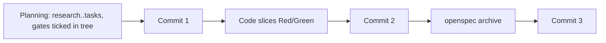

# Architecture & Technical Design

## 1. Overview & Invariants
Documentation-only change implementing REQ-OSA-25 (modified) and REQ-OSA-40. Wording that says a gate tick must be committed before the next artifact becomes the stage-boundary cadence: commit after planning, after code, after `openspec archive`.

Invariants:
- A gate passes when its box is ticked by a human in the working tree (`spec-rails-check` already reads the tree, ASM-GEN-3); no tooling change.
- Rule 4 is untouched: Red is never committed alone; green slice commits stay valid.
- Humans still tick every Gate 0-4 and 5.x box; agents never self-tick.
- Source and installed copies stay identical (`tests/test_selfcopy.sh`).

## 2. Domain Models, State & Interface Contracts
No code interfaces. Edit points (source, then installed copy via `cp`):

| Source | Installed copy | Change |
| :--- | :--- | :--- |
| `rules/WORKFLOW.md` | `openspec/spec-rails/WORKFLOW.md` | New Rule 6 "Commit Cadence" (three default commits, exceptions, not enforced); reword §2 "Gate Approval Evidence" and §7 "Gates" |
| `rules/AGENTS.md` | `openspec/spec-rails/AGENTS.md` | Line 20: "ticked by a human and committed" becomes "ticked by a human"; add one-line cadence |
| `schemas/spec-rails/schema.yaml` | `openspec/schemas/spec-rails/schema.yaml` | State cadence in `tasks` and apply instructions |
| `skills/spec-rails/SKILL.md` | `.agents/skills/spec-rails/SKILL.md` | One-line cadence |
| `docs/WIKI.md` (line 81), `docs/how-tos/02-drive-feature-lifecycle.md`, `docs/WAY_OF_WORKING.md`, `README.md` | none | Same cadence wording; remove per-artifact commit instruction |
| `tests/test_e2e.sh` | none | Tick-gate scenario commits the tick together with the next artifact |

Cadence text (single wording reused everywhere): "Commit at stage boundaries: once after planning (research through tasks), once after the code (one commit per slice is fine when there are several), once after `openspec archive`. Exceptions: multiple code slices may each get their own green commit (Rule 4), rebases and stream merges, bugfix and chore lanes."

## 3. Architecture Diagram & Data Flow

## 4. Boundary Rules & Budgets
- **Pure Core vs. I/O Shell**: no executable code changes; only Markdown, YAML text and one shell test scenario.
- **Concurrency, Latency & Resource Budgets**: no runtime effect; `make test-e2e` stays within NFR-OSA-8 (20 s).

## 5. Testing Strategy
1. **BDD Scenarios**: REQ-OSA-40 scenarios map to `tests/bdd` steps (cadence present in the three sources; none instructs per-gate commit; batched planning commit passes `spec-rails-check`; mid-stage commit not rejected).
2. **Unit Tests (>= 95% coverage)**: no production code; `tests/test_e2e.sh` updated for REQ-OSA-25; a lint/hygiene grep fails if any shipped doc, schema or template again says to commit a gate before the next artifact.
3. **Mutation Testing (> 90% kill)**: not applicable (no source logic changes).

## Review Gate
- [x] **Gate 3 Approval**: Architecture & design reviewed and approved by human before task breakdown.
