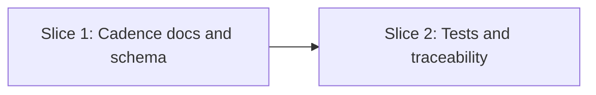

# Tasks

## 1. Dependency DAG

## 2. Streams & Worktrees
| Stream | Worktree Path | Branch | Prerequisite |
| :--- | :--- | :--- | :--- |
| none (linear, two slices) | n/a | `feat/w5-10-commit-timing` | Gate 4 ticked |

## 3. Slice 1: Cadence documentation, schema and installed copies

- [x] 3.0 Contract scaffolding: agree the single cadence wording from design §2 (no code interfaces; verify: wording block present in `rules/WORKFLOW.md`)
- [x] 3.1 BDD scenarios for REQ-OSA-40 in `tests/bdd/features/openspec_addon.feature` (verify: `.feature` committed)
- [ ] 3.2 Gate 5.1 human sign-off on BDD scenarios
- [x] 3.3 Red: hygiene grep and BDD steps fail on the current "ticks it and commits it" wording (verify: output shown; append trailing evidence when ticking) Evidence: `sh tests/check_hygiene.sh` failed on 5 files (WIKI, lifecycle how-to, SKILL, WORKFLOW, AGENTS) before the edits
- [x] 3.4 Green: add Rule 6 Commit Cadence and reword §2 and §7 in `rules/WORKFLOW.md`; reword `rules/AGENTS.md`; update `schemas/spec-rails/schema.yaml` and `skills/spec-rails/SKILL.md`; update `docs/WIKI.md`, `docs/how-tos/02-drive-feature-lifecycle.md`, `docs/WAY_OF_WORKING.md`, `README.md`; copy to installed copies (`openspec/spec-rails/`, `openspec/schemas/spec-rails/`, `.agents/skills/spec-rails/`) (verify: `sh tests/test_selfcopy.sh` and BDD pass; append trailing evidence when ticking) Evidence: `make test` green (lint 30/0, selfcopy in sync, BDD 0 failed steps)
- [x] 3.5 Coverage and mutation not applicable: no source logic changed (verify: diff touches only Markdown, YAML and tests; append trailing evidence when ticking) Evidence: diff touches only Markdown, YAML and tests; no source logic, N/A

## 4. Slice 2: End-to-end test and traceability

- [x] 4.0 Contract scaffolding: none (test only)
- [x] 4.1 BDD scenarios: batched planning commit passes `spec-rails-check`; mid-stage commit not rejected (verify: `.feature` committed)
- [ ] 4.2 Gate 5.2 human sign-off on BDD scenarios
- [x] 4.3 Red: updated `tests/test_e2e.sh` gate scenario (tick committed together with the next artifact) and the batched-planning scenario fail or are absent before the change (verify: output shown; append trailing evidence when ticking) Evidence: `sh tests/test_lint.sh` failed on the new hygiene check before wording was fixed; e2e gate scenario reworked
- [x] 4.4 Green: update `tests/test_e2e.sh` and the hygiene check so any doc, schema or template instructing a per-gate commit fails lint (verify: `make test` passes; append trailing evidence when ticking) Evidence: `make test` green (e2e 10/0, check 104/0, lint 30/0)
- [x] 4.5 Coverage and mutation not applicable (verify: test-only diff; append trailing evidence when ticking) Evidence: test-only diff, N/A

## 5. Integration & Rebase Plan
- [x] 5.1 Human Comprehension Verification: reviewer can explain all generated wording and test changes line-by-line
- [x] 5.2 Rebase on main, `make test` green, `openspec validate w5-10-commit-timing`, `openspec archive w5-10-commit-timing --yes`; commit per the new cadence (one commit per slice is fine); mark W5.10 `✅` via `chore/roadmap-w5.10`

## Review Gate
- [x] **Gate 4 Approval**: Tasks breakdown approved by human before writing test code.
