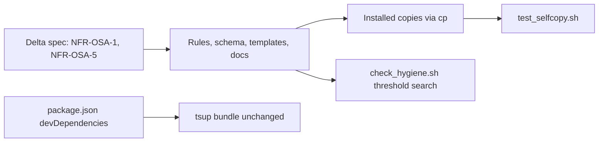

# Architecture & Technical Design

## 1. Overview & Invariants
Dependency-contract and wording change for `NFR-OSA-1` and `NFR-OSA-5`. No behavior change to the CLI or the shell scripts.

Invariants:
- `bin/` and the hook, CI and installer entry points are untouched (W5.3 owns them).
- `package.json` `bin` still points to `dist/cli.js`; the `tsup` bundle config is unchanged (`noExternal` already bundles the three libraries).
- Source and installed copies stay identical (`tests/test_selfcopy.sh`).
- The only mutation threshold anywhere is >= 95%.

## 2. Domain Models, State & Interface Contracts
No code interfaces. Edit points (source first, then `cp` to installed copies where one exists):

| Area | Files | Change |
| :--- | :--- | :--- |
| Dependencies | `package.json`, `package-lock.json` | Move `cac`, `fast-glob`, `zod` from `dependencies` to `devDependencies`; regenerate the lockfile with `npm install --package-lock-only` |
| Protocol and agent rules | `rules/WORKFLOW.md` (lines ~245, 278), `rules/AGENTS.md` (27) | `> 90%` becomes `>= 95%` |
| Skill | `skills/spec-rails/SKILL.md` (41) | same |
| Schema and templates | `schemas/spec-rails/schema.yaml` (79, 112), `schemas/spec-rails/templates/tasks.md` (17), `schemas/spec-rails/templates/design.md` (19), `templates/rails.conf` (3), `templates/roadmap.md` (48), `templates/mutation/{cargo-mutants.toml,mutmut.ini,stryker.config.json}` | `> 90%` and `100%` become `>= 95%` |
| Docs | `docs/WAY_OF_WORKING.md`, `docs/DESIGN.md` (44), `docs/WIKI.md` (118), `docs/how-tos/03-parallel-worktrees-multi-agent.md` (110) | same |
| Installed copies | `openspec/spec-rails/{WORKFLOW.md,AGENTS.md,rails.conf,mutation/*}`, `openspec/schemas/spec-rails/**`, `.agents/skills/spec-rails/SKILL.md` | refreshed with `cp` / re-run installer |
| Roadmap | `docs/ROADMAP.md` W5.3 row | Note: deleting `bin/`, `npx spec-rails` hook and CI entry points, and trampoline removal happen in W5.3 |

Stryker's `thresholds.break` (currently 91) in `templates/mutation/stryker.config.json` and the root `stryker.config.json`, if it has one, must move to 95; comment-only text changes are not enough.

## 3. Architecture Diagram & Data Flow

## 4. Boundary Rules & Budgets
- **Pure Core vs. I/O Shell**: no executable logic changes; the one new check is a small shell search in `tests/check_hygiene.sh`.
- **Concurrency, Latency & Resource Budgets**: lint stays within NFR-OSA-7 (hygiene under 2 s).

## 5. Testing Strategy
1. **BDD Scenarios**: map the four new scenarios (bundled libraries build-time only, Node prerequisite stated, single threshold in shipped docs, jq-free run) to `tests/bdd` steps; the `jq`-free run is already covered by `multi_language_rails.feature`.
2. **Unit Tests (>= 95% coverage)**: add a hygiene rule that fails when a shipped doc, rule, schema, skill or template states a mutation threshold other than 95% (fixture in `tests/test_lint.sh`); add a `package.json` check that none of `zod`, `cac`, `fast-glob` is in `dependencies`. No production code changes.
3. **Mutation Testing (>= 95% kill)**: not applicable; no source logic changes.

## Review Gate
- [x] **Gate 3 Approval**: Architecture & design reviewed and approved by human before task breakdown.
