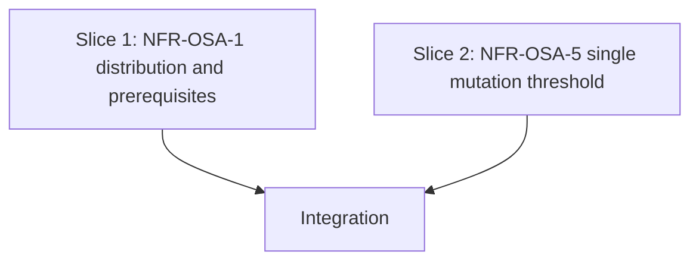

# Tasks

## 1. Dependency DAG

Both slices touch disjoint files except the installed-copy sync, so they run sequentially on one branch; no parallel streams.

## 2. Streams & Worktrees
| Stream | Worktree Path | Branch | Prerequisite |
| :--- | :--- | :--- | :--- |
| main | (repo root) | feat/w5-11-node-only-nfr | Gate 4 ticked |

## 3. Slice 1: NFR-OSA-1 distribution and prerequisites

- [x] 3.0 Contract scaffolding: move `cac`, `fast-glob`, `zod` to `devDependencies` in `package.json` and refresh the lockfile (verify: `npm ls --omit=dev` lists none of them; `npm run build` still emits `dist/cli.js`) Evidence: `npm ls --omit=dev` empty; build emits `dist/cli.js` 344 KB
- [x] 3.1 BDD scenarios for the slice (verify: `.feature` committed; covers build-time-only deps and stated Node >= 18 / OpenSpec prerequisite) Evidence: 3 scenarios appended to `tests/bdd/features/multi_language_rails.feature`
- [x] 3.2 Gate 5.1 human sign-off on BDD scenarios
- [x] 3.3 Red: add a check that the three libraries are absent from `dependencies` (verify: fails for the expected reason before 3.0 edits are applied; output shown) Evidence: with the old `package.json`, `sh tests/test_lint.sh` failed "Bundled libraries listed under dependencies" (Passed 32, Failed 1)
- [x] 3.4 Green: implementation committed with tests (verify: check passes; docs state Node >= 18, OpenSpec on PATH, no jq; trampoline wording removed) Evidence: `make test` exit 0; lint 33/0; no trampoline wording remains in shipped docs
- [x] 3.5 Coverage >= 95% and mutation >= 95% kill (verify: reports) Evidence: no TS source changed; `npm run test:coverage` 83 passed, 99.37% lines, 96.31% branches; mutation N/A (shell checks and docs only)

## 4. Slice 2: NFR-OSA-5 single mutation threshold

- [x] 4.0 Contract scaffolding: hygiene rule stub in `tests/check_hygiene.sh` plus fixture hook in `tests/test_lint.sh` (verify: stub committed) Evidence: rule and two fixtures (`docs/e.md`, `docs/f.md`) added
- [x] 4.1 BDD scenarios for the slice (verify: `.feature` committed; "Single threshold in shipped docs") Evidence: scenario appended to `tests/bdd/features/multi_language_rails.feature`
- [x] 4.2 Gate 5.2 human sign-off on BDD scenarios
- [x] 4.3 Red: fixture with a 90% or 100% mutation threshold is not rejected (verify: `make test-lint` fails for the expected reason; output shown) Evidence: with the old `check_hygiene.sh`, `sh tests/test_lint.sh` reported "Hygiene missed" for docs/e.md and docs/f.md (Passed 31, Failed 2)
- [x] 4.4 Green: rule rejects any mutation threshold other than 95; all listed files rewritten to >= 95% (rules, skill, schema incl. templates, `templates/`, `docs/`), `thresholds.break` 91 -> 95 in `templates/mutation/stryker.config.json`, installed copies synced, ROADMAP W5.3 note added (verify: `make test` passes incl. selfcopy test; grep finds no other threshold) Evidence: `make test` exit 0; lint 33/0; selfcopy in sync
- [x] 4.5 Coverage >= 95% and mutation >= 95% kill (verify: reports) Evidence: no TS source changed; coverage 99.37% lines, 96.31% branches; mutation N/A (shell checks and docs only)

## 5. Integration & Rebase Plan
- [x] 5.1 Human Comprehension Verification: reviewer can explain all generated logic line-by-line
- [ ] 5.2 Merge, rebase on main, re-verify rails (`make test`, `sh bin/spec-rails-check`), `openspec archive`

## Review Gate
- [x] **Gate 4 Approval**: Tasks breakdown approved by human before writing test code.
