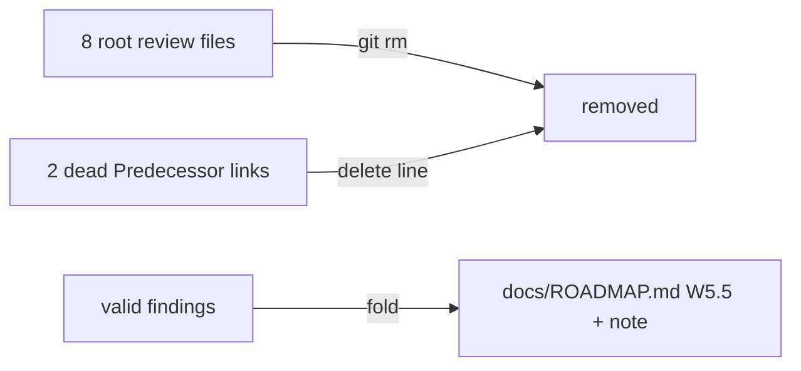

# Architecture & Technical Design

## 1. Overview & Invariants

Documentation-only cleanup (Option B). No `bin/`, `src/`, schema, rule or spec change. Invariants:
- No `REQ-*` or `NFR-*` is modified; `skip_specs: true`.
- `W5.2` wording is untouched apart from deleting one dead link line.
- The selfcopy test and the hygiene rule (including the single 95% mutation threshold) stay green.

## 2. Domain Models, State & Interface Contracts

Edit list (the whole change):

| File | Edit |
| :--- | :--- |
| `concepts_brief.md`, `design_draft.md`, `zoom_out_report.md`, `intermediate_zoom_out_report.md`, `critic_report.md`, `comprehension_report.md`, `implementation_readiness_report.md`, `consolidated_review_report.md` | `git rm` (the pending local edit in `zoom_out_report.md` is discarded with it) |
| `docs/designs/multi-language-rails-anti-drift.md` | delete the `Predecessor:` line (line 6) |
| `openspec/changes/w5-2-multi-language-rails/design.md` | delete the same `Predecessor:` line (line 6) |
| `docs/ROADMAP.md` W5.5 row | add: skip the mutation rail when the changeset touches no source files matching `testGlobs` (informational pass); today `runVerify` has no changeset awareness and strict mode errors on empty test matches |
| `docs/ROADMAP.md` | add W5.12 row (this change, ✅ on archive) and one note under Wave 5: `scaffold-check` and `spec-rails lint` were dropped; the Red rail and `openspec validate` already cover them |

## 3. Architecture Diagram & Data Flow

## 4. Boundary Rules & Budgets
- **Pure Core vs. I/O Shell**: no code is touched; only Markdown and git index changes.
- **Concurrency, Latency & Resource Budgets**: none; no `NFR-*` is affected.

## 5. Testing Strategy
1. **BDD Scenarios**: none; no spec-level behavior changes.
2. **Unit Tests (>= 95% coverage)**: none added. Verification is mechanical: `git ls-files` lists none of the eight files, `git grep` finds no reference to them, and `make test` (hygiene link check, selfcopy) and `sh bin/spec-rails-check` pass.
3. **Mutation Testing (>= 95% kill)**: not applicable; no source logic changes.

## Review Gate
- [x] **Gate 3 Approval**: Architecture & design reviewed and approved by human before task breakdown.
