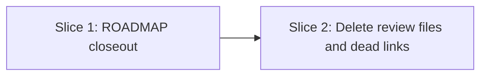

# Tasks

## 1. Dependency DAG

Slice 2 deletes only after slice 1 has folded the valid findings into `docs/ROADMAP.md`.

## 2. Streams & Worktrees
| Stream | Worktree Path | Branch | Prerequisite |
| :--- | :--- | :--- | :--- |
| none (linear, two slices) | n/a | `feat/w5-12-review-closeout` | Gate 4 ticked |

## 3. Slice 1: ROADMAP closeout (fold findings before deleting)

- [x] 3.0 Contract scaffolding: none (documentation only)
- [x] 3.1 BDD scenarios: none; no spec-level behavior changes (verify: `skip_specs: true` in `.openspec.yaml`)
- [x] 3.2 Gate 5.1 human sign-off (no scenarios; confirm the roadmap wording)
- [x] 3.3 Red: W5.5 has no docs-only skip and no W5.12 row exists (verify: `grep -n "W5.12\|docs-only" docs/ROADMAP.md` output shown; append trailing evidence when ticking) Evidence: before the edit the grep returned no match for W5.12 or docs-only in `docs/ROADMAP.md`
- [x] 3.4 Green: extend W5.5 with the docs-only mutation skip, add the W5.12 row and the dropped-proposals note (`scaffold-check`, `spec-rails lint`), and confirm every valid finding from the review files is now in the roadmap (verify: `make test` passes, hygiene finds no mutation threshold other than 95; append trailing evidence when ticking) Evidence: `make test` exit 0; W5.5 extended, W5.12 row and dropped note added; other findings are superseded (W5.11) or already in W5.5
- [x] 3.5 Coverage and mutation not applicable (verify: Markdown-only diff; append trailing evidence when ticking) Evidence: Markdown-only diff, N/A

## 4. Slice 2: Delete review files and dead links

- [x] 4.0 Contract scaffolding: none (documentation only)
- [x] 4.1 BDD scenarios: none (verify: `skip_specs: true`)
- [x] 4.2 Gate 5.2 human sign-off (no scenarios; confirm the delete list in `design.md` §2)
- [x] 4.3 Red: the eight files are tracked and the two `Predecessor:` links exist (verify: `git ls-files` and `git grep concepts_brief` output shown; append trailing evidence when ticking) Evidence: `git ls-files` listed 8 files; `git grep concepts_brief` matched the two design docs
- [x] 4.4 Green: `git rm` the eight root files; delete the `Predecessor:` line in `docs/designs/multi-language-rails-anti-drift.md` and `openspec/changes/w5-2-multi-language-rails/design.md` (verify: `git ls-files` shows none of them, `git grep` finds no reference, `make test` passes; append trailing evidence when ticking) Evidence: 0 of the 8 files tracked; `git grep` finds no reference outside this change and the archive; `make test` exit 0, `spec-rails-check` exit 0
- [x] 4.5 Coverage and mutation not applicable (verify: diff touches only Markdown and deletions; append trailing evidence when ticking) Evidence: Markdown-only diff plus deletions, N/A

## 5. Integration & Rebase Plan
- [x] 5.1 Human Comprehension Verification: reviewer can explain every roadmap line and every deleted file
- [ ] 5.2 Rebase on main, `make test` green, `openspec validate w5-12-review-closeout`, `openspec archive w5-12-review-closeout --yes`; commit per the cadence (one commit after archive is fine)

## Review Gate
- [x] **Gate 4 Approval**: Tasks breakdown approved by human before writing test code.
