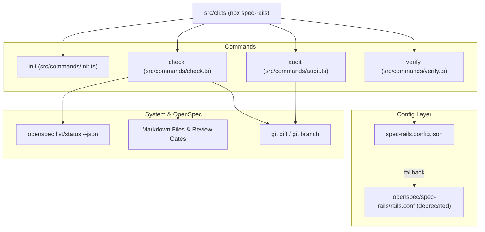

# Architecture & Technical Design

## 1. Overview & Invariants
This design replaces all POSIX shell scripts in `bin/` with a unified TypeScript command suite executed by `src/cli.ts` (`dist/cli.js`).

Key Invariants:
- **Zero External Shell Tooling**: Native Node.js replaces `jq`, `awk`, and shell scripts for gate, lane, and DAG checks.
- **Transitive DAG Integrity**: Unapproved ancestor gates must block downstream progress across the entire dependency graph defined by OpenSpec schemas.
- **Spec-to-Code Parity**: The audit rule previously running only as an inline GitHub Action is consolidated into the CLI (`spec-rails audit` or `spec-rails check --audit`), usable identically in local git hooks and CI.
- **Config Migration Continuity**: The engine prefers `spec-rails.config.json` but falls back to parsing `openspec/spec-rails/rails.conf` with a deprecation warning, ensuring existing adopters do not break.
- **Main Branch Protection**: Direct commits to `main` and `master` fail immediately.

## 2. Domain Models, State & Interface Contracts

### 1. `CheckCommand` (`src/commands/check.ts`)
```typescript
export interface CheckOptions {
  cwd?: string;
  store?: string;
  audit?: boolean;
  baseRef?: string;
}

export interface GateState {
  ticked: boolean;
  isNoGo: boolean;
  state: "ticked" | "unticked" | "missing";
}

export interface CheckResult {
  success: boolean;
  violations: string[];
}
```

### 2. `AuditCommand` (`src/commands/audit.ts`)
```typescript
export interface AuditOptions {
  cwd?: string;
  baseRef?: string;
  headRef?: string;
}

export interface AuditResult {
  success: boolean;
  isChoreExempt: boolean;
  codeChanges: string[];
  specChanges: string[];
  errors: string[];
}
```

### 3. `ConfigMigration` (`src/config.ts`)
```typescript
export function loadLegacyRailsConf(cwd: string): Partial<SpecRailsConfig> | null;
```

## 3. Architecture Diagram & Data Flow



## 4. Boundary Rules & Budgets
- **Pure Core vs. I/O Shell**: Gate parsing, DAG walking, and audit logic are pure functions taking file contents or JSON trees. I/O (git execution, file reading) is confined to command runners.
- **Concurrency & Performance**: Gate check across all active changes must complete in $< 150\text{ms}$. Native V8 JSON parsing replaces child process spawns of `jq`.
- **Zero Runtime Dependencies**: All dependencies (`cac`, `zod`, `fast-glob`) remain bundled in `devDependencies` and compiled by `tsup` into `dist/cli.js`.

## 5. Testing Strategy
1. **Unit Tests (`tests/unit/check.test.ts`, `tests/unit/audit.test.ts`)**:
   - Gate state detection (`- [x]`, `- [ ]`, `No-Go`, code fence ignoring).
   - Transitive DAG violation reporting.
   - Early implementation task failure.
   - Branch protection logic.
   - Spec-to-code audit with and without corresponding spec changes.
2. **Integration Verification**:
   - `npm run build` compiles `dist/cli.js`.
   - `npm test` passes all unit tests.
   - Running `node dist/cli.js check` on the repository succeeds.
   - Removing `bin/` files and verifying no dangling references.

## Review Gate
- [x] **Gate 3 Approval**: Architecture & design reviewed and approved by human before task breakdown.
