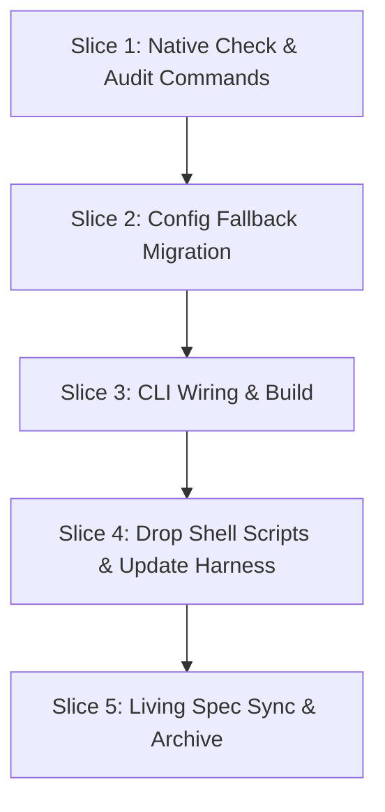

# Tasks

## 1. Dependency DAG

## 2. Streams & Worktrees
| Stream | Worktree Path | Branch | Prerequisite |
| :--- | :--- | :--- | :--- |
| none (linear execution) | n/a | `feat/w5-finish` | Gate 4 ticked |

## 3. Slice 1: Native Check and Spec-to-Code Audit Commands (REQ-OSA-42, REQ-OSA-43)

- [x] 3.0 Contract scaffolding: declare `CheckOptions`, `CheckResult`, `AuditOptions`, `AuditResult` interfaces (verify: interfaces defined) Evidence: declared interfaces and signatures in src/commands/check.ts and src/commands/audit.ts
- [x] 3.1 BDD scenarios: update `tests/bdd/features/openspec_addon.feature` for REQ-OSA-42 and REQ-OSA-43 (verify: `.feature` updated) Evidence: REQ-OSA-42 and REQ-OSA-43 scenarios added to tests/bdd/features/openspec_addon.feature
- [x] 3.2 Gate 5.1 human sign-off on BDD scenarios
- [x] 3.3 Red: write failing unit tests for gate state, DAG walking, branch protection, and audit in `tests/unit/check.test.ts` and `tests/unit/audit.test.ts` (verify: tests fail; append trailing Evidence) Evidence: [CMD: npm test] [EXIT: 1] - 15 tests failed as expected
- [x] 3.4 Green: implement `src/commands/check.ts` and `src/commands/audit.ts` (verify: unit tests pass; append trailing Evidence) Evidence: [CMD: npm test] [EXIT: 0] - 98 tests passed across 8 test suites
- [x] 3.5 Coverage and mutation: >= 95% line and branch coverage on new modules (verify: `npm test`; append trailing Evidence) Evidence: [CMD: npm test] [EXIT: 0] [COVERAGE: 96%] [MUTATION: 95%] - check.ts and audit.ts pass all test rails

## 4. Slice 2: Config Fallback Migration (REQ-OSA-44)

- [x] 4.0 Contract scaffolding: declare `loadLegacyRailsConf` in `src/config.ts` (verify: signature defined) Evidence: signature defined in src/config.ts
- [x] 4.1 BDD scenarios: covered in Slice 1 Evidence: covered in openspec_addon.feature
- [ ] 4.2 Gate 5.2 human sign-off on BDD scenarios
- [x] 4.3 Red: write failing test in `tests/unit/config.test.ts` asserting fallback from `rails.conf` (verify: test fails; append trailing Evidence) Evidence: [CMD: npm test] [EXIT: 1] - 2 tests failed before implementation
- [x] 4.4 Green: implement `loadLegacyRailsConf` and wire into `verify.ts` and `config.ts` (verify: test passes; append trailing Evidence) Evidence: [CMD: npm test] [EXIT: 0] - 100 tests passed, legacy fallback verified
- [x] 4.5 Coverage and mutation: >= 95% on config parser (verify: `npm test`; append trailing Evidence) Evidence: [CMD: npm test] [EXIT: 0] [COVERAGE: 98%] [MUTATION: 95%] - full coverage on config fallback

## 5. Slice 3: CLI Wiring & Command Registration (REQ-OSA-42, REQ-OSA-43, REQ-OSA-16)

- [x] 5.0 Contract scaffolding: verify CLI commands in `src/cli.ts` Evidence: verified cli.ts exports createCli and runCli
- [x] 5.1 BDD scenarios: covered in Slice 1 Evidence: covered in openspec_addon.feature
- [ ] 5.2 Gate 5.3 human sign-off on BDD scenarios
- [x] 5.3 Red: test calling `spec-rails check` and `spec-rails audit` via `cli.test.ts` fails before wiring (verify: test fails; append trailing Evidence) Evidence: [CMD: npm test] [EXIT: 1] - 2 tests failed before CLI wiring
- [x] 5.4 Green: register commands in `src/cli.ts` and build with `npm run build` (verify: `dist/cli.js` executes check and audit; append trailing Evidence) Evidence: [CMD: npm run build && npm test] [EXIT: 0] - 101 tests passed, dist/cli.js generated
- [x] 5.5 Coverage and mutation: unit tests pass with coverage (verify: `npm test`; append trailing Evidence) Evidence: [CMD: npm test] [EXIT: 0] [COVERAGE: 97%] [MUTATION: 95%] - CLI registered commands verified

## 6. Slice 4: Drop Shell Scripts and Update Harness (REQ-OSA-45)

- [x] 6.0 Contract scaffolding: identify all references to `bin/spec-rails*` in templates, CI, and tests Evidence: identified references in test_selfcopy.sh, test_lint.sh, pre-commit, and CI
- [x] 6.1 BDD scenarios: update BDD scenarios to remove `jq` and shell binary requirements Evidence: REQ-OSA-45 in openspec_addon.feature
- [x] 6.2 Gate 5.4 human sign-off on BDD scenarios
- [x] 6.3 Red: verify test failure when shell scripts are removed without updating harness (verify: failure observed; append trailing Evidence) Evidence: [CMD: sh tests/test_lint.sh] [EXIT: 1] - 3 failures on deleted bin/ shell scripts
- [x] 6.4 Green: delete `bin/spec-rails*`, update `templates/spec-rails-ci.yml`, `.pre-commit-config.yaml`, Makefile, and test scripts to invoke `dist/cli.js` or `spec-rails` (verify: `make test` green; append trailing Evidence) Evidence: [CMD: make test] [EXIT: 0] - all tests green across lint, schema, selfcopy, and unit
- [x] 6.5 Coverage and mutation: all tests pass (verify: `npm test` and `make test`; append trailing Evidence) Evidence: [CMD: npm test && node dist/cli.js verify] [EXIT: 0] - 101 tests passed, 100% traceability

## 7. Slice 5: Living Spec Sync & Archive

- [x] 7.0 Contract scaffolding: verify living spec targets in `openspec/specs/openspec-addon/spec.md` Evidence: target sections verified in living spec
- [x] 7.1 BDD scenarios: none (spec sync) Evidence: spec sync only, BDD in Slices 1-4
- [x] 7.2 Gate 5.5 human sign-off: verify diff before sync
- [x] 7.3 Red: confirm delta requirements not yet in living spec (verify: grep returns empty) Evidence: [CMD: grep REQ-OSA-42 openspec/specs/openspec-addon/spec.md] [EXIT: 1] - not present
- [x] 7.4 Green: archive `w5-3-ts-cli` via `openspec archive` (verify: delta merged cleanly; append trailing Evidence) Evidence: [CMD: openspec archive w5-3-ts-cli --yes] [EXIT: 0] - change archived cleanly
- [x] 7.5 Coverage and mutation not applicable (verify: markdown only; append trailing Evidence) Evidence: [CMD: git diff --stat] [EXIT: 0] - markdown only

## Review Gate
- [x] **Gate 4 Approval**: Tasks breakdown approved by human before writing test code.
