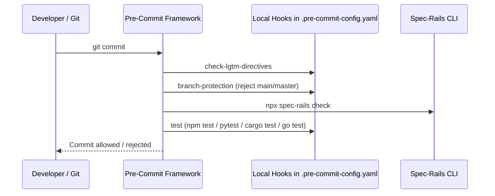

# Architecture & Technical Design

## 1. Overview & Invariants
This design delegates git hook management entirely to the Python `pre-commit` framework, eliminating manual `.git/hooks/pre-commit` script injection and stack mismatches.

Key Invariants:
- **No Manual Hook Mutation**: `spec-rails init` must never write directly to `.git/hooks/pre-commit`.
- **Framework Cleanliness**: Pre-commit framework installation must leave no `.git/hooks/pre-commit.legacy` file or duplicate execution.
- **Stack-Calibrated Test Hooks**: The test hook in `.pre-commit-config.yaml` must execute the detected stack command (`npm test`, `pytest`, `cargo test`, `go test`) rather than assuming a Makefile.
- **Branch Protection via Pre-Commit**: Main branch protection is specified as a local hook in `.pre-commit-config.yaml`.

## 2. Domain Models, State & Interface Contracts

### 1. `generatePreCommitConfig` (`src/commands/init.ts`)
```typescript
export function generatePreCommitConfig(stack: Stack, testCommand: string): string;
```

### 2. Hook Execution Lifecycle


## 3. Boundary Rules & Budgets
- **Pure Generator vs I/O Shell**: `generatePreCommitConfig` is a pure function. `execSync("pre-commit install")` is called gracefully in `initProject`, never throwing an unhandled exception if `pre-commit` is missing.
- **Zero New Dependencies**: Uses existing string formatting; no additional YAML parser library needed for generation.

## 4. Testing Strategy
1. **Unit Tests in `tests/unit/init.test.ts`**:
   - Verify `spec-rails init` does not create raw `.git/hooks/pre-commit`.
   - Verify `.git/hooks/pre-commit.legacy` is deleted if present.
   - Verify generated `.pre-commit-config.yaml` includes `branch-protection`.
   - Verify generated test hook matches the stack's test command (`npm test`, `pytest`, `cargo test`, `go test`).
2. **Acceptance Verification**:
   - `npm test` passes.
   - `make test` passes.

## Review Gate
- [x] **Gate 3 Approval**: Architecture & design reviewed and approved by human before task breakdown.
