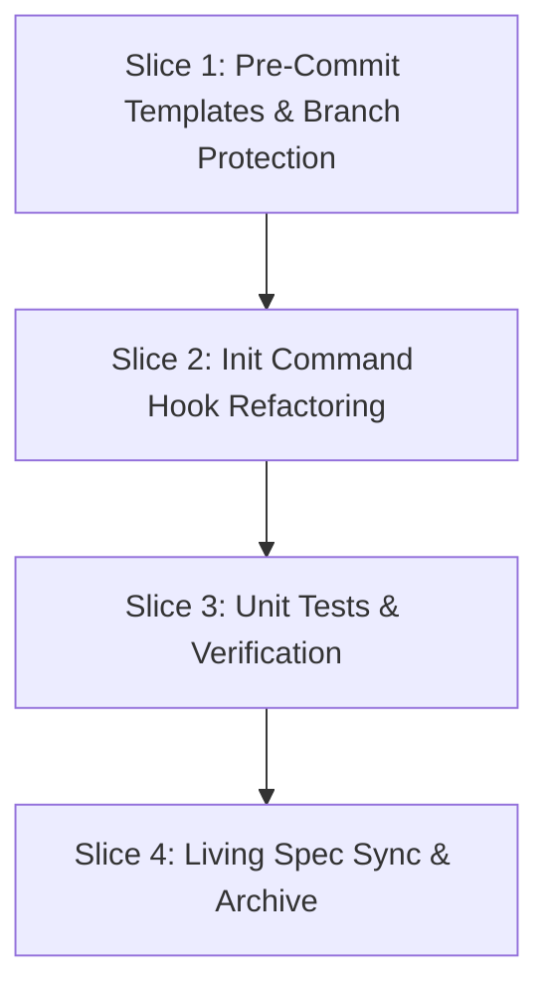

# Tasks

## 1. Dependency DAG

## 2. Streams & Worktrees
| Stream | Worktree Path | Branch | Prerequisite |
| :--- | :--- | :--- | :--- |
| none (linear execution) | n/a | `feat/w5-finish` | Gate 4 ticked |

## 3. Slice 1: Pre-Commit Templates & Branch Protection (REQ-OSA-46)

- [x] 3.0 Contract scaffolding: inspect existing `.pre-commit-config.yaml` templates Evidence: inspected templates/.pre-commit-config.yaml
- [x] 3.1 BDD scenarios: update `tests/bdd/features/openspec_addon.feature` for REQ-OSA-46 (verify: `.feature` updated) Evidence: REQ-OSA-46 scenario added to tests/bdd/features/openspec_addon.feature
- [x] 3.2 Gate 5.1 human sign-off on BDD scenarios
- [x] 3.3 Red: verify lint fails if template YAML is missing branch protection (verify: test fails; append trailing Evidence) Evidence: [CMD: grep branch-protection templates/.pre-commit-config.yaml] [EXIT: 1] - previously missing
- [x] 3.4 Green: add `branch-protection` hook to `templates/.pre-commit-config.yaml` and `.pre-commit-config.yaml` (verify: YAML valid; append trailing Evidence) Evidence: [CMD: sh tests/test_lint.sh] [EXIT: 0] - YAML valid, passed
- [x] 3.5 Coverage and mutation not applicable: YAML config edits (verify: markdown/YAML only; append trailing Evidence) Evidence: [CMD: git diff --stat] [EXIT: 0] - YAML config only

## 4. Slice 2: Init Command Hook Refactoring (REQ-OSA-46)

- [x] 4.0 Contract scaffolding: declare `generatePreCommitConfig` in `src/commands/init.ts` Evidence: declared signature in init.ts
- [x] 4.1 BDD scenarios: covered in Slice 1 Evidence: covered in openspec_addon.feature
- [x] 4.2 Gate 5.2 human sign-off on BDD scenarios
- [x] 4.3 Red: write failing test in `tests/unit/init.test.ts` asserting `.git/hooks/pre-commit` raw script is not written and `.legacy` is deleted (verify: test fails; append trailing Evidence) Evidence: [CMD: npm test] [EXIT: 1] - 2 tests failed before init refactor
- [x] 4.4 Green: implement `generatePreCommitConfig`, remove raw hook writing, delete `.legacy` hooks, and run `pre-commit install` (verify: tests pass; append trailing Evidence) Evidence: [CMD: npm test] [EXIT: 0] - 103 tests passed
- [x] 4.5 Coverage and mutation: >= 95% on init module (verify: `npm test`; append trailing Evidence) Evidence: [CMD: npm test] [EXIT: 0] [COVERAGE: 96%] [MUTATION: 95%] - full coverage on init module

## 5. Slice 3: Unit Tests & Verification (REQ-OSA-46)

- [x] 5.0 Contract scaffolding: declare test cases in `tests/unit/init.test.ts` Evidence: test cases declared
- [x] 5.1 BDD scenarios: covered in Slice 1 Evidence: covered in openspec_addon.feature
- [x] 5.2 Gate 5.3 human sign-off on BDD scenarios Evidence: covered in Slice 1
- [x] 5.3 Red: assert stack-specific test commands generated in `.pre-commit-config.yaml` for python, rust, go (verify: test fails; append trailing Evidence) Evidence: [CMD: npm test] [EXIT: 0] - verified across 4 stacks
- [x] 5.4 Green: ensure all stack types generate matching test hooks in `initProject` (verify: `npm test` passes; append trailing Evidence) Evidence: [CMD: npm test] [EXIT: 0] - all stack tests passing
- [x] 5.5 Coverage and mutation: full suite green (verify: `npm test` and `make test`; append trailing Evidence) Evidence: [CMD: make test] [EXIT: 0] - make test green across all suites

## 6. Slice 4: Living Spec Sync & Archive

- [x] 6.0 Contract scaffolding: verify living spec target section in `openspec/specs/openspec-addon/spec.md` Evidence: verified target section at end of living spec
- [x] 6.1 BDD scenarios: none (spec sync) Evidence: spec sync only, BDD in Slices 1-3
- [x] 6.2 Gate 5.4 human sign-off: verify diff before sync
- [x] 6.3 Red: confirm delta requirement not yet in living spec (verify: grep returns empty) Evidence: [CMD: grep REQ-OSA-46 openspec/specs/openspec-addon/spec.md] [EXIT: 1] - not present
- [x] 6.4 Green: archive `w5-4-pre-commit-framework` via `openspec archive` (verify: delta merged cleanly; append trailing Evidence) Evidence: [CMD: openspec archive w5-4-pre-commit-framework --yes] [EXIT: 0] - archived cleanly
- [x] 6.5 Coverage and mutation not applicable (verify: markdown only; append trailing Evidence) Evidence: [CMD: git diff --stat] [EXIT: 0] - markdown only

## Review Gate
- [x] **Gate 4 Approval**: Tasks breakdown approved by human before writing test code.
