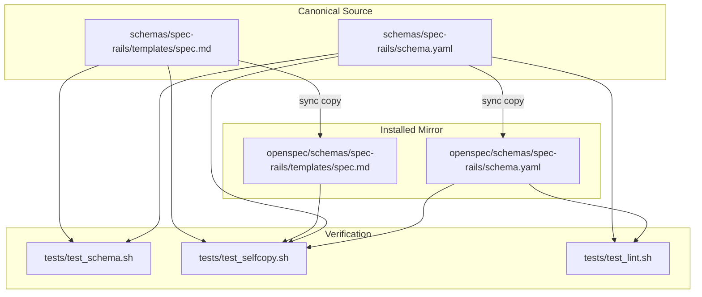

# Architecture & Technical Design

## 1. Overview & Invariants
This design aligns Spec-Rails templates and schema instructions with OpenSpec 1.16 `--strict` expectations and ensures backward compatibility when modifying legacy living specs.

Key Invariants:
- **Exact Self-Copy Parity**: `schemas/spec-rails/` and `openspec/schemas/spec-rails/` must remain byte-identical, verified by `tests/test_selfcopy.sh`.
- **Strict BDD Structure**: Spec scenario templates provide complete `GIVEN` / `WHEN` / `THEN` steps.
- **Header Verbatim Integrity**: OpenSpec exact header matching requires delta headers to mirror target living spec headers verbatim, even when legacy headers lack modern `Requirement:` prefixes.
- **Stage Isolation**: Requirement IDs (`REQ-*` / `NFR-*`) belong strictly to Gate 2 (specs artifact) to prevent premature scope locking during Gate 1 proposals.

## 2. Domain Models, State & Interface Contracts

### File Modifications
1. `schemas/spec-rails/templates/spec.md`:
   Update scenario templates to include `- **GIVEN** <!-- precondition -->`.
2. `schemas/spec-rails/schema.yaml`:
   - `proposal` instruction: document that requirement keys are assigned at Gate 2.
   - `specs` instruction: document that legacy unprefixed headers in `## MODIFIED` and `## REMOVED` must be repeated verbatim.
3. `tests/test_schema.sh`:
   Add automated assertions verifying:
   - `templates/spec.md` scenario templates contain `GIVEN`.
   - `schema.yaml` proposal instruction mentions requirement IDs assigned at Gate 2.
   - `schema.yaml` specs instruction mentions legacy unprefixed header preservation.
4. Copy identical changes to `openspec/schemas/spec-rails/`.

## 3. Architecture Diagram & Data Flow

## 4. Boundary Rules & Budgets
- **Pure Core vs. I/O Shell**: Schema and template files are pure declarative assets. Verifiers are lightweight POSIX shell scripts without external runtime dependencies or side effects.
- **Concurrency, Latency & Resource Budgets**: Schema checks must complete in $< 50\text{ms}$. Zero new dependencies.

## 5. Testing Strategy
1. **BDD / Shell Checks**:
   - `tests/test_schema.sh` extended with checks for `GIVEN`, Gate 2 ID assignment, and legacy header guidance.
2. **Hygiene & Parity**:
   - `tests/test_selfcopy.sh` asserts byte-level equivalence between source and installed mirror.
   - `tests/test_lint.sh` validates YAML formatting and link integrity.

## Review Gate
- [x] **Gate 3 Approval**: Architecture & design reviewed and approved by human before task breakdown.
