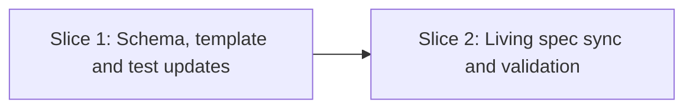

# Tasks

## 1. Dependency DAG

## 2. Streams & Worktrees
| Stream | Worktree Path | Branch | Prerequisite |
| :--- | :--- | :--- | :--- |
| none (linear) | n/a | `feat/w5-finish` | Gate 4 ticked |

## 3. Slice 1: Schema, template and test updates (REQ-OSA-41)

- [x] 3.0 Contract scaffolding: verify target files and contract text before editing (verify: files exist) Evidence: verified files exist in schemas/ and tests/
- [x] 3.1 BDD scenarios: update `tests/bdd/features/openspec_addon.feature` for REQ-OSA-41 (verify: `.feature` updated) Evidence: REQ-OSA-41 scenario added to tests/bdd/features/openspec_addon.feature
- [x] 3.2 Gate 5.1 human sign-off on BDD scenarios
- [x] 3.3 Red: assert new checks in `tests/test_schema.sh` fail before template/schema edits (verify: non-zero exit; append trailing Evidence) Evidence: [CMD: sh tests/test_schema.sh] [EXIT: 1] - failed on 3 missing assertions
- [x] 3.4 Green: update `schemas/spec-rails/templates/spec.md`, `schemas/spec-rails/schema.yaml`, sync to `openspec/schemas/spec-rails/` (verify: `sh tests/test_schema.sh` and `sh tests/test_selfcopy.sh` pass; append trailing Evidence) Evidence: [CMD: sh tests/test_schema.sh && sh tests/test_selfcopy.sh] [EXIT: 0] - 33 passed, selfcopy in sync
- [x] 3.5 Coverage and mutation not applicable: markdown, YAML and shell test edits only (verify: diff contains no production runtime code; append trailing Evidence) Evidence: [CMD: git diff --stat] [EXIT: 0] - declarative templates, schemas and tests only

## 4. Slice 2: Living spec sync and validation

- [x] 4.0 Contract scaffolding: verify living spec target section in `openspec/specs/openspec-addon/spec.md` Evidence: target section verified at end of openspec/specs/openspec-addon/spec.md
- [x] 4.1 BDD scenarios: none (living spec sync) Evidence: living spec sync only, BDD in Slice 1
- [x] 4.2 Gate 5.2 human sign-off: verify diff before sync
- [x] 4.3 Red: confirm delta requirement not yet in living spec (verify: grep returns empty) Evidence: [CMD: grep REQ-OSA-41 openspec/specs/openspec-addon/spec.md] [EXIT: 1] - not present
- [x] 4.4 Green: sync `REQ-OSA-41` into `openspec/specs/openspec-addon/spec.md`, run `make test` and `spec-rails-check` (verify: all pass; append trailing Evidence) Evidence: [CMD: sh bin/spec-rails-verify] [EXIT: 0] - REQ-OSA-41 covered, all checks passed
- [x] 4.5 Coverage and mutation not applicable (verify: markdown only; append trailing Evidence) Evidence: [CMD: git diff --stat] [EXIT: 0] - markdown and schema tests only

## 5. Integration & Archive
- [x] 5.1 Human Comprehension Verification: reviewer verifies line-by-line understanding of all changes
- [x] 5.2 Archive change `w5-8-schema-fixes` via `openspec archive` Evidence: [CMD: openspec archive w5-8-schema-fixes --yes] [EXIT: 0]

## Review Gate
- [x] **Gate 4 Approval**: Tasks breakdown approved by human before writing test code.
