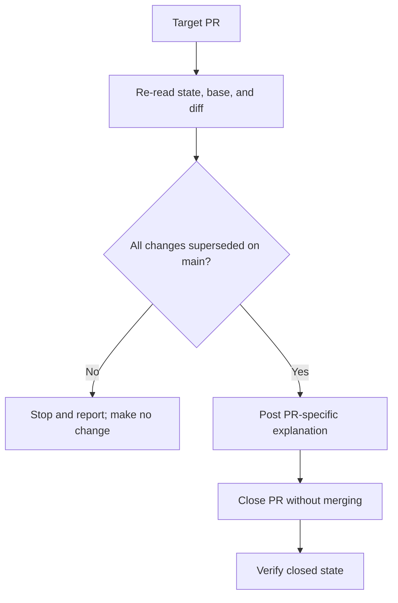

# Architecture & Technical Design

## 1. Overview & Invariants

This is a manual GitHub housekeeping chore, not a code change. Review each of PRs #7, #9, and #10 against the live `main` branch immediately before closure.

Invariants:
- Close only PRs that are still open and have no unique changes beyond what `main` already contains.
- Post a PR-specific comment naming the superseding dependency version or update before closing.
- Never merge these PRs. If a PR's state, base, or diff no longer matches the review, stop and report it.
- Do not close issue #19 as part of this work.

## 2. Domain Models, State & Interface Contracts

Each target PR follows this state flow:

`Open -> Revalidated -> Superseded -> Commented -> Closed`

If revalidation finds a closed PR, a changed base, or a unique change, stop for that PR and report the discrepancy rather than mutating it.

The inputs are the PR number and its current GitHub metadata/diff; the comparison target is the current `main` manifest and lockfile. The only state-changing operations are posting the explanation and closing an eligible PR.

## 3. Architecture Diagram & Data Flow

## 4. Boundary Rules & Budgets

- **Pure Core vs. I/O Shell**: No application code is added. Comparison is read-only; GitHub comments and close actions are explicit network side effects, performed only after revalidation.
- **Concurrency, Latency & Resource Budgets**: Process the three PRs sequentially. Revalidate each PR immediately before its close action. No new tools, dependencies, or repository changes are needed.

## 5. Testing Strategy

1. **BDD Scenarios**: No application behavior changes. Acceptance checks cover the eligible and stop/report paths described above.
2. **Unit Tests (>= 95% coverage)**: Not applicable; no code or testable module changes are planned.
3. **Mutation Testing (>= 95% kill)**: Not applicable; no core logic is touched.

## Review Gate
- [x] **Gate 3 Approval**: Architecture & design reviewed and approved by human before task breakdown.
