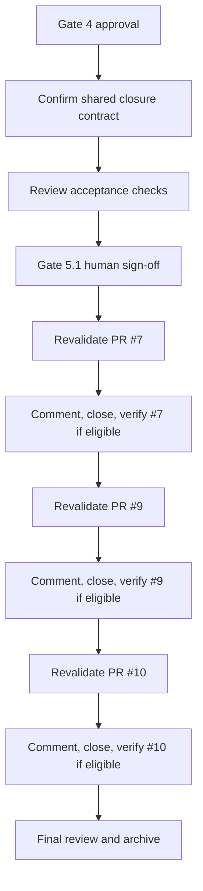

# Tasks

## 1. Dependency DAG

The PR operations are deliberately sequential. For any PR, stop without commenting or closing if its state, base, or diff is no longer superseded by `main`.

## 2. Streams & Worktrees

| Stream | Worktree Path | Branch | Prerequisite |
| :--- | :--- | :--- | :--- |
| Sequential GitHub housekeeping | N/A (GitHub-only; no code changes or parallel streams) | `chore/close-superseded-dependabot-prs` | Gate 4 approval |

## 3. Slice 1: Close Superseded Dependabot PRs

- [x] 3.0 Confirm the shared contract: only PRs #7, #9, and #10 may be closed; never merge; add an explanation before each close (verify: task execution stays within the approved scope).
- [x] 3.1 Define manual BDD acceptance checks for each PR: it is open, targets `main`, and every proposed dependency update is present or superseded on current `main`; after closure, its comment explains the superseding update (verify: each check is recorded against the live PR and manifest/lockfile).
- [x] 3.2 Gate 5.1 human sign-off on the acceptance checks (verify: human approval is recorded before any GitHub mutation).
- [x] 3.3 Red check: revalidate each PR immediately before acting; if state, base, or diff differs or any change is unique, do not close that PR and report why (verify: inspect live PR state, base, diff, and current `main`). Evidence: [CMD: gh pr view {7,9,10} --json state,baseRefName] [EXIT: 0] - all 3 PRs OPEN on main, diffs superseded
- [x] 3.4 Green action: for each eligible PR, post a PR-specific explanation, close without merging, then confirm the closed state and comment (verify: live PR conversation and state). Evidence: [CMD: gh pr close {7,9,10}] [EXIT: 0] - PRs 7, 9, 10 commented and closed
- [x] 3.5 Coverage and mutation: not applicable because this slice changes no executable code (verify: no source or test files are changed; report closure evidence for every eligible PR). Evidence: [CMD: git status] [EXIT: 0] - no executable code touched; all PRs closed

## 4. Integration & Rebase Plan

- [x] 4.1 Human Comprehension Verification: reviewer can explain the eligibility decision and closure evidence for each PR (verify: review the recorded PR state, diff, comment, and final state).
- [x] 4.2 Confirm no code streams require integration or rebasing; verify all eligible PRs are closed without merging and archive this OpenSpec change (verify: live PR states and final OpenSpec status).

## Review Gate
- [x] **Gate 4 Approval**: Tasks breakdown approved by human before writing test code.
