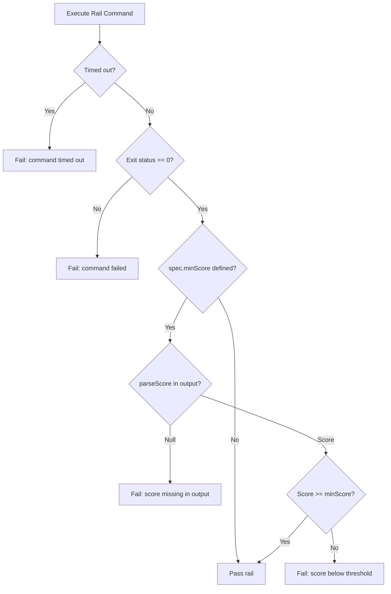

# Architecture & Technical Design

## 1. Overview & Invariants

This design completes W5.5 ("Strict Rails by Default"), eliminates dead CLI code, and synchronizes documentation:
- **Language-Neutral Verification**: `verify` configures `minScore: config.mutationMinScore` on the mutation rail.
- **Score Enforcement**: If the mutation command exits 0, `runRail` parses the output for a numeric percentage score. If no score is found or if the score is below `minScore`, verification fails.
- **Process Timeout**: `defaultExec` configures a default execution timeout (600,000 ms / 10 min) on `spawnSync` to catch infinite loops in mutated code. If a command times out (`ETIMEDOUT`), it reports a timeout error and fails verification.
- **Dead Code Cleanup**: `src/cli.ts` deletes the unexecuted `lint` command stub and the unused `--slice` option on `verify`. Stale presets in `templates/mutation/` are cleaned up.
- **Documentation Alignment**: `README.md` and `docs/ROADMAP.md` are updated to document the TypeScript CLI without legacy shell script or `jq` references.

## 2. Domain Models, State & Interface Contracts

### Strict Rail Execution in `verify.ts`
```ts
export function runRail(spec: RailSpec, cwd: string, exec: CommandRunner): string[] {
  if (!spec.command || !spec.command.trim()) {
    return spec.required ? [`${spec.name} command is empty; configure it in spec-rails.config.json`] : [];
  }
  const res = exec(spec.command, cwd);
  if (res.status !== 0) {
    return [`${spec.name} command failed (exit ${res.status}): ${spec.command}\n${res.output}`];
  }
  if (spec.minScore !== undefined) {
    const score = parseScore(res.output);
    if (score === null) {
      return [`${spec.name} output missing score percentage: ${spec.command}\n${res.output}`];
    }
    if (score < spec.minScore) {
      return [`${spec.name} score ${score}% is below threshold ${spec.minScore}%`];
    }
  }
  return [];
}
```

In `runVerify`:
```ts
rails = [
  { name: "test", command: config.testCommand, required: true },
  { name: "coverage", command: config.coverageCommand, minScore: config.coverageMinScore, required: false },
  { name: "mutation", command: config.mutationCommand, minScore: config.mutationMinScore, required: false },
];
```

In `defaultExec`:
```ts
export const defaultExec: CommandRunner = (command, cwd) => {
  const r = spawnSync(command, { cwd, shell: true, encoding: "utf-8", maxBuffer: 64 * 1024 * 1024, timeout: 600000 });
  if (r.error && (r.error as any).code === "ETIMEDOUT") {
    return { status: 124, output: `Command timed out after 600000ms: ${command}` };
  }
  return { status: r.status ?? 1, output: `${r.stdout}${r.stderr}` };
};
```

### CLI Cleanup in `src/cli.ts`
Remove lines 92–97 (`lint` command stub) and line 28 (`--slice` option).

## 3. Architecture Diagram & Data Flow



## 4. Boundary Rules & Budgets

- **Pure Core vs. I/O Shell**:
  - Pure Core: `parseScore`, `isDocsOnlyChange`, and score comparison logic operate purely on strings and numbers.
  - I/O Shell: `defaultExec` encapsulates child process execution bounded by the 600s execution budget.
- **Budgets**:
  - `defaultExec` timeout is bounded to 600,000 ms.

## 5. Testing Strategy

1. **BDD Scenarios**:
   - `tests/bdd/features/openspec_addon.feature`: scenarios for `REQ-OSA-47` (missing mutation score, below threshold, passing score, command failure, and timeout).
2. **Unit Tests (>= 95% line & branch coverage)**:
   - `tests/unit/verify.test.ts`: test cases for score parsing, threshold enforcement, missing score, non-zero exit, and timeout error.
   - `tests/unit/cli.test.ts`: test CLI command registration without dead `lint` command.
3. **Mutation Testing (>= 95% kill)**:
   - Stryker run on touched modules (`src/commands/verify.ts` and `src/cli.ts`).

## Review Gate
- [x] **Gate 3 Approval**: Architecture & design reviewed and approved by human before task breakdown.
