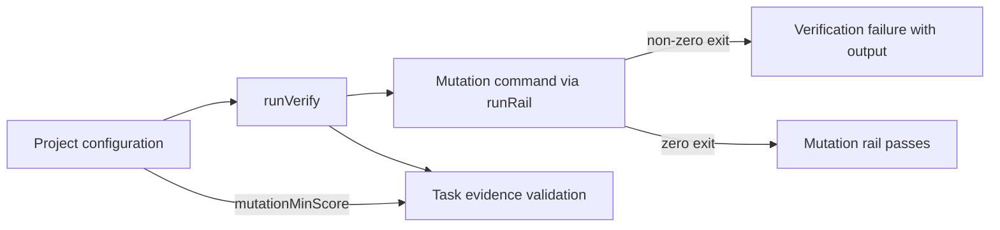

# Architecture & Technical Design

## 1. Overview & Invariants

`runVerify` supplies rail definitions to `runRail`. Omit the mutation rail's `minScore` so its success depends on the configured command's exit status, not its output. Leave the coverage rail's score handling and the docs-only mutation skip unchanged.

The project is responsible for making its mutation command fail when its required threshold is missed. `mutationMinScore` remains the threshold for task evidence; it does not configure or enforce the mutation command.

Remove code made unused by this change; retain score parsing for coverage and mutation thresholds for task evidence.

## 2. Domain Models, State & Interface Contracts

Reuse `RailSpec`, `CommandRunner`, `runRail`, and `runVerify`; no new types or signatures are needed. `runRail` retains its existing `minScore` behavior for rails that supply it. `runVerify` continues passing `mutationMinScore` to task-evidence validation but not to the mutation command rail.

## 3. Architecture Diagram & Data Flow

## 4. Boundary Rules & Budgets

- **Pure Core vs. I/O Shell**: Keep command execution behind the existing injectable `CommandRunner`; retain existing score parsing for coverage.
- **Concurrency, Latency & Resource Budgets**: No new processes, dependencies, concurrency, or score-processing overhead.

## 5. Testing Strategy

1. **BDD Scenarios**: Cover mutation command success and failure, output independence, coverage thresholds, and docs-only skips.
2. **Unit Tests (>= 95% coverage)**: Exercise `runVerify` with configured mutation and coverage commands, including unrelated percentages, non-zero exits, and custom task-evidence thresholds.
3. **Mutation Testing (>= 95% kill)**: Run the applicable mutation suite for touched core logic and address or justify survivors under the existing policy.

## Review Gate
- [x] **Gate 3 Approval**: Architecture & design reviewed and approved by human before task breakdown.
