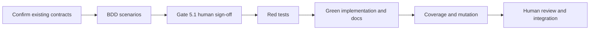

# Tasks

## 1. Dependency DAG

## 2. Streams & Worktrees

| Stream | Worktree Path | Branch | Prerequisite |
| :--- | :--- | :--- | :--- |
| Single sequential slice | Existing feature worktree | Current feature branch | Gate 4 approval |

No parallel streams are needed. Existing `RailSpec`, `CommandRunner`, `runRail`, and `runVerify` contracts are sufficient; no new scaffolding signatures are planned.

## 3. Slice 1: Tool-neutral mutation verification

- [x] 3.0 Confirm existing contracts cover the design; commit any required new scaffolding before implementation.
- [x] 3.1 Write BDD `.feature` scenarios for mutation exit status and output, unchanged coverage thresholds, and docs-only skips. Evidence: [CMD: test -s tests/bdd/features/mutation_exit_status.feature] [EXIT: 0]
- [x] 3.2 Gate 5.1 human sign-off on BDD scenarios.
- [x] 3.3 Write focused regression tests and demonstrate the expected Red failure. Evidence: [CMD: npm test -- tests/unit/verify.test.ts] [EXIT: 1]
- [ ] 3.4 Implement the mutation rail change, delete code made unused by it, document the command's threshold responsibility, and commit tests and code together. Append Green evidence when complete.
  - Green evidence: `npm run build`, `npm run lint`, and `make test` pass (125 tests).
- [ ] 3.5 Verify >= 95% line and branch coverage and >= 95% mutation kill on touched core logic; address or justify survivors. Append evidence when complete.
  - Evidence: verifier coverage is 100% lines and 98.8% branches; Stryker killed 3/3 mutants on both changed lines 26 and 174 (100% each).

## 4. Integration & Rebase Plan

- [ ] 4.1 Human comprehension review: reviewer can explain the changed logic line by line.
- [ ] 4.2 Run `npm run build`, relevant lint, `make test`, `spec-rails check`, and `spec-rails verify`; validate the OpenSpec change.
  - Evidence: build, lint, `make test` (125 tests), `spec-rails check --audit`, `spec-rails verify`, and `openspec validate w5-5-mutation-scores` pass.
- [ ] 4.3 Before merge, rebase onto the target branch and re-run the required rails; archive only after approval and completed tasks.

## Review Gate
- [x] **Gate 4 Approval**: Tasks breakdown approved by human before writing test code.
