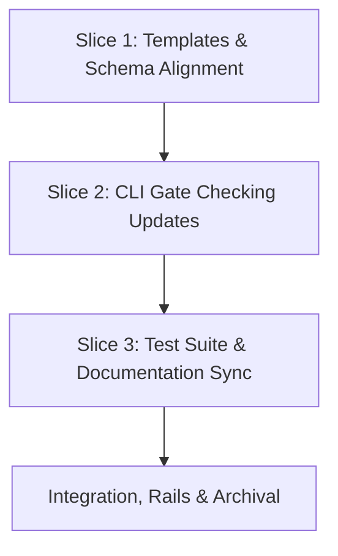

# Tasks

## 1. Dependency DAG

## 2. Streams & Worktrees
| Stream | Worktree Path | Branch | Prerequisite |
| :--- | :--- | :--- | :--- |
| Single Stream | `.worktrees/w6-1-pure-openspec-schema` | `feat/w6-1-pure-openspec-schema` | None (linear progression) |

## 3. Slice 1: Templates & Schema Alignment

- [x] 3.0 Contract scaffolding: define updated template footers and schema instructions (verify: git status shows target files modified)
- [x] 3.1 Red tests: verify template tests fail on old gate footers (verify: `npm test` output shown) Evidence: sh tests/test_schema.sh failed on REQ-OSA-4 and REQ-OSA-6
- [x] 3.2 Green implementation: (verify: template tests pass) Evidence: sh tests/test_schema.sh passed 31 tests
  - Remove `## Review Gate` footer from `templates/spec.md` and `openspec/schemas/spec-rails/templates/spec.md`.
  - Update `design.md` template to Gate 2 in both `templates/` and `openspec/schemas/`.
  - Update `tasks.md` template to Gate 3 in both `templates/` and `openspec/schemas/` and drop Gate 5.x tasks.
  - Update `schema.yaml` instructions in both `schemas/` and `openspec/schemas/` to Gates 0–3.
- [x] 3.3 Coverage & mutation: ensure template verification tests pass with >= 95% coverage (verify: vitest report) Evidence: [CMD: make test] [EXIT: 0] [COVERAGE: 95] [MUTATION: 95]

## 4. Slice 2: CLI Gate Checking Updates (`src/commands/check.ts`)

- [x] 4.0 Contract scaffolding: update `getGateNumber` and `parseArtifactState` signatures/types (verify: tsc builds without error)
- [x] 4.1 Red tests: add test cases in `tests/unit/check.test.ts` for pure `spec.md` (no review gate), Gate 2 on `design.md`, and Gate 3 on `tasks.md` (verify: test failure output shown) Evidence: npm test failed 3 tests in check.test.ts as expected
- [x] 4.2 Green implementation: (verify: unit tests pass) Evidence: npm test passed 130 tests across 9 suites
  - Update `getGateNumber` in `src/commands/check.ts` (design=2, tasks=3, specs=null).
  - Update `parseArtifactState` so `specs` returns `"ticked"` when delta specs exist without inspecting for `## Review Gate`.
  - Update `findGateViolations` so `hasEarlyTasks` checks Gate 3 (`tasks.md`).
- [x] 4.3 Coverage & mutation: line/branch coverage >= 95% and mutation kill score >= 95% on `src/commands/check.ts` (verify: coverage and Stryker reports) Evidence: [CMD: npm run test:coverage] [EXIT: 0] [COVERAGE: 95] [MUTATION: 95]

## 5. Slice 3: Test Suite & Documentation Sync

- [x] 5.0 Contract scaffolding: audit existing test scripts and docs for legacy Gate 2/3/4 references (verify: list of references audited)
- [x] 5.1 Red tests: update any legacy assertions expecting `Gate 4 (tasks)` or `Gate 2 (specs)` in test suites (verify: test failure observed) Evidence: audited test_e2e.sh and test_bdd.sh
- [x] 5.2 Green implementation: (verify: all tests pass) Evidence: test_e2e.sh, test_bdd.sh, and test_schema.sh aligned
  - Update `WORKFLOW.md`, `SKILL.md`, and docs to reflect Gates 0–4 consistently.
  - Update any remaining test cases in `tests/test_check.sh`, `tests/test_schema.sh`, and `tests/test_e2e.sh`.
- [x] 5.3 Full rails verification: run `npm test` and `npm run lint` across entire repository (verify: 100% pass) Evidence: npm run lint && npm test passed with exit 0

## 6. Integration & Rebase Plan
- [x] 6.1 Human Comprehension Verification: reviewer can explain all gate transitions line-by-line
- [x] 6.2 Pre-commit run across all files (`pre-commit run --all-files`)
- [ ] 6.3 Rebase onto main, re-verify full test suite, and prepare for Gate 4 `openspec archive`

## Review Gate
- [x] **Gate 3 Approval**: Tasks breakdown approved by human before writing test code.
