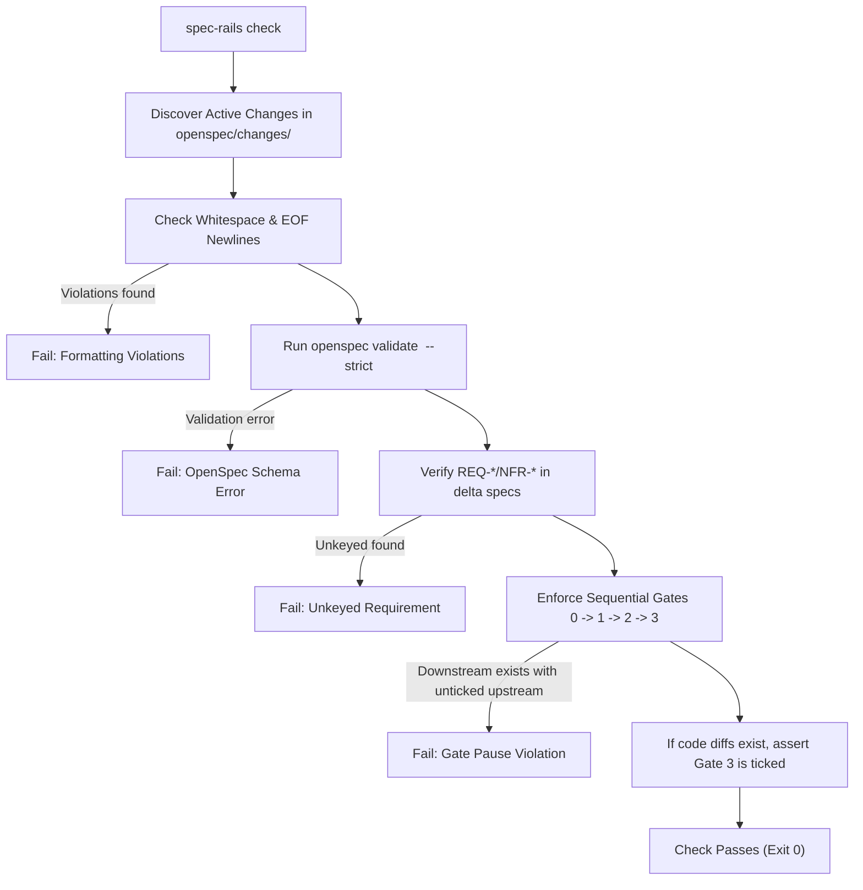

# Architecture & Technical Design

## 1. Overview & Invariants

This design details how `spec-rails check` and `spec-rails verify` implement sequential human review pauses, artifact formatting hygiene, strict requirement key validation, and relaxed free-text evidence parsing.

### Key Invariants
1. **Sequential Gate Progression**: An artifact cannot exist unless its predecessor's Review Gate is ticked:
   - `proposal.md` requires Gate 0 in `research.md`.
   - Delta `specs/` and `design.md` require Gate 1 in `proposal.md`.
   - `tasks.md` requires Gate 2 in `design.md`.
   - Code changes and ticked implementation tasks require Gate 3 in `tasks.md`.
2. **Deterministic Formatting Hygiene**: Every change markdown file MUST terminate with a single trailing newline (`\n`) and MUST NOT contain trailing whitespace on any line.
3. **Canonical Requirement Keys**: Delta requirement headers in `specs/**/*.md` MUST match `^### Requirement: (REQ|NFR)-[A-Z0-9]+-[0-9]+ .+$`.
4. **Resilient Evidence Rails**: Evidence on rail tasks is verified simply as `Evidence: <non-empty text>`.

## 2. Domain Models, State & Interface Contracts

```ts
export interface HygieneViolation {
  file: string;
  line?: number;
  message: string;
}

export function checkArtifactHygiene(filePath: string, content: string): HygieneViolation[] {
  const violations: HygieneViolation[] = [];
  if (!content.endsWith("\n")) {
    violations.push({ file: filePath, message: "Missing trailing newline at EOF" });
  }
  const lines = content.split(/\r?\n/);
  for (let i = 0; i < lines.length; i++) {
    if (/[ \t]+$/.test(lines[i])) {
      violations.push({ file: filePath, line: i + 1, message: `Trailing whitespace on line ${i + 1}` });
    }
  }
  return violations;
}

export function checkRequirementKeys(filePath: string, content: string): string[] {
  const errors: string[] = [];
  const lines = content.split(/\r?\n/);
  for (const line of lines) {
    if (/^###\s+Requirement:\s*/i.test(line)) {
      if (!/^###\s+Requirement:\s+(REQ|NFR)-[A-Z0-9]+-[0-9]+\s+.+$/.test(line)) {
        errors.push(`Invalid requirement header in ${filePath}: '${line}'. Must match '### Requirement: (REQ|NFR)-<DOMAIN>-<N> <Name>'`);
      }
    }
  }
  return errors;
}
```

## 3. Architecture Diagram & Data Flow



## 4. Boundary Rules & Budgets

- **Pure Core vs. I/O Shell**:
  - Pure core: `checkArtifactHygiene` and `checkRequirementKeys` operate on in-memory strings with zero file or network I/O.
  - I/O shell: `src/commands/check.ts` resolves file paths, invokes `openspec validate`, and reads disk contents.
- **Latency Budget**: Full gate check completes in $< 200\text{ms}$ locally.

## 5. Testing Strategy

1. **Unit Tests (`tests/unit/check.test.ts`)**:
   - Assert Gate 0 unticked blocks `proposal.md`.
   - Assert Gate 1 unticked blocks `design.md` and `specs/`.
   - Assert Gate 2 unticked blocks `tasks.md`.
   - Assert Gate 3 unticked blocks code diffs and ticked tasks.
   - Assert trailing whitespace and missing EOF newlines trigger actionable violations.
   - Assert unkeyed delta requirements trigger violations.
2. **Evidence Unit Tests (`tests/unit/evidence.test.ts`)**:
   - Assert free-text `Evidence: vitest run passed with 33 tests` passes.
   - Assert empty `Evidence:` or missing evidence on rail tasks fails.
3. **Coverage & Mutation Target**:
   - $\ge 95\%$ line/branch coverage and $\ge 95\%$ mutation score on `src/commands/check.ts` and `src/utils/evidence.ts`.

## Review Gate
- [x] **Gate 2 Approval**: Architecture & design reviewed and approved by human before task breakdown.
