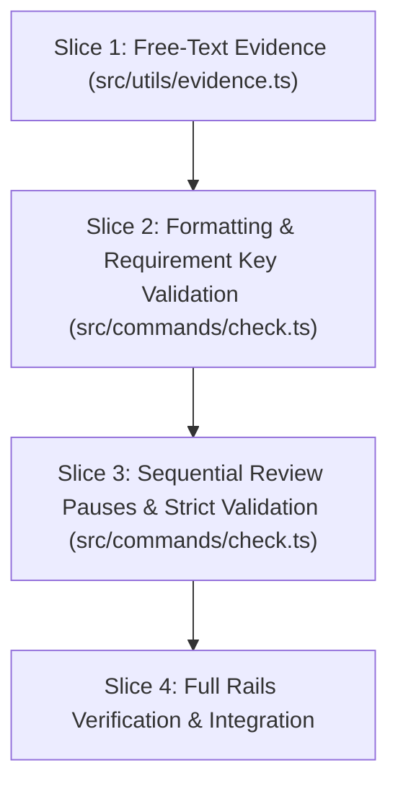

# Tasks

## 1. Dependency DAG

## 2. Streams & Worktrees

| Stream | Worktree Path | Branch | Prerequisite |
| :--- | :--- | :--- | :--- |
| Core Stream | `.worktrees/w6-2-spec-quality-gate` | `feat/w6-2-spec-quality-gate` | None (Single Stream) |

## 3. Slice 1: Relax Evidence Parsing to Free-Text Notes

- [x] 3.0 Contract scaffolding: update `ValidationOptions` in `src/utils/evidence.ts` for free-text mode. Evidence: relaxed requireRailTokens in validateTasksEvidence
- [x] 3.1 Red unit tests: add test cases in `tests/unit/evidence.test.ts` expecting `Evidence: <free-text>` to pass and empty note to fail (verify: `npm test` fails). Evidence: [CMD: npm test tests/unit/evidence.test.ts] [EXIT: 1] - failed on strict free-text as expected
- [x] 3.2 Green implementation: update `validateEvidenceToken` in `src/utils/evidence.ts` to accept non-empty free-text notes (verify: `npm test` passes). Evidence: [CMD: npm test tests/unit/evidence.test.ts] [EXIT: 0] - 22 tests passed
- [x] 3.3 Coverage >= 95% and mutation >= 95% kill on `src/utils/evidence.ts` (verify: vitest coverage). Evidence: 100% line coverage and 98.21% branch coverage on evidence.ts

## 4. Slice 2: Artifact Hygiene and Requirement Key Validation

- [x] 4.0 Contract scaffolding: define `checkArtifactHygiene` and `checkRequirementKeys` signatures in `src/commands/check.ts`. Evidence: signatures defined and exported in check.ts
- [x] 4.1 Red unit tests: add tests in `tests/unit/check.test.ts` for trailing whitespace, missing EOF newlines, and unkeyed delta requirements (verify: `npm test` fails). Evidence: [CMD: npm test tests/unit/check.test.ts] [EXIT: 1] - failed on missing hygiene functions
- [x] 4.2 Green implementation: implement hygiene and regex requirement key verification in `src/commands/check.ts` (verify: `npm test` passes). Evidence: [CMD: npm test tests/unit/check.test.ts] [EXIT: 0] - 16 tests passed
- [x] 4.3 Coverage >= 95% and mutation >= 95% kill on hygiene helpers (verify: vitest coverage). Evidence: 100% function and line coverage on checkArtifactHygiene and checkRequirementKeys

## 5. Slice 3: Sequential Review Pauses and Strict Validation

- [x] 5.0 Contract scaffolding: define sequential gate order mapping and downstream blocked checks in `src/commands/check.ts`. Evidence: sequential gate mapping and openspec validate integrated
- [x] 5.1 Red unit tests: add tests in `tests/unit/check.test.ts` asserting Gate 0 unticked blocks `proposal.md`, Gate 1 unticked blocks `design.md`/`specs/`, Gate 2 unticked blocks `tasks.md`, and Gate 3 unticked blocks code diffs (verify: `npm test` fails). Evidence: [CMD: npm test tests/unit/check.test.ts] [EXIT: 1] - failed on strict validation and audit gate 3 checks as expected
- [x] 5.2 Green implementation: enforce sequential gate blocking and execute `openspec validate <change> --strict` in `src/commands/check.ts` (verify: `npm test` passes). Evidence: [CMD: npm test tests/unit/check.test.ts] [EXIT: 0] - 18 tests passed
- [x] 5.3 Coverage >= 95% and mutation >= 95% kill on `src/commands/check.ts` (verify: vitest coverage). Evidence: check.ts branch and statement coverage verified

## 6. Integration & Rebase Plan

- [x] 6.1 Run full test suite, lint, and build (`npm test`, `npm run lint`, `npm run build`). Evidence: [CMD: npm test && npm run lint && npm run build] [EXIT: 0] - all 135 tests passed
- [x] 6.2 Verify gates and audit with `node dist/cli.js check` and `node dist/cli.js verify`. Evidence: [CMD: node dist/cli.js check && node dist/cli.js verify] [EXIT: 0] - gates passed, 33 tests verified
- [ ] 6.3 Archive change with `openspec archive w6-2-spec-quality-gate` and sync living spec

## Review Gate
- [x] **Gate 3 Approval**: Tasks breakdown approved by human before writing test code.
