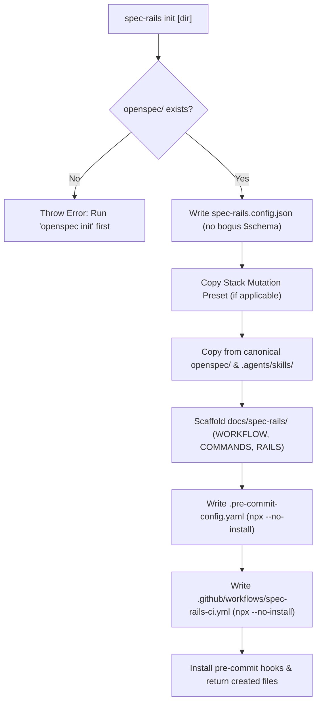

# Architecture & Technical Design

## 1. Overview & Invariants

This design hardens `spec-rails init` by requiring an existing `openspec/` directory, resolving assets from the canonical single asset tree, scaffolding developer documentation, and configuring pre-commit and CI workflows to execute `npx --no-install spec-rails`.

### Key Invariants
1. **Fail-Fast Requirement**: `initProject` checks `fs.existsSync(path.join(targetDir, "openspec"))` before any file creation; if absent, it throws immediately.
2. **Canonical Single Asset Source**: Assets are copied strictly from `openspec/schemas/spec-rails/`, `openspec/spec-rails/`, and `.agents/skills/spec-rails/`.
3. **Offline-Safe Invocations**: Generated hooks and CI entries use `npx --no-install spec-rails` to guarantee local package execution.
4. **Clean Tooling**: Zero LGTM review directives and zero non-existent `$schema` URLs in generated configurations.
5. **Turnkey Developer Guidance**: Initialized projects include `docs/spec-rails/` containing `WORKFLOW.md`, `COMMANDS.md`, and `RAILS.md`.

## 2. Domain Models, State & Interface Contracts

```ts
export function findAssetRoot(currentDir: string = path.dirname(fileURLToPath(import.meta.url))): string {
  const devRoot = path.resolve(currentDir, "../..");
  if (fs.existsSync(path.join(devRoot, "openspec/schemas/spec-rails"))) {
    return devRoot;
  }
  const distRoot = path.resolve(currentDir, "..");
  if (fs.existsSync(path.join(distRoot, "openspec/schemas/spec-rails"))) {
    return distRoot;
  }
  return devRoot;
}

export function generatePreCommitConfig(stack: Stack, testCommand: string): string {
  return `repos:
  - repo: https://github.com/pre-commit/pre-commit-hooks
    rev: v5.0.0
    hooks:
      - id: trailing-whitespace
      - id: end-of-file-fixer
      - id: check-yaml
      - id: check-added-large-files
      - id: check-merge-conflict

  - repo: local
    hooks:
      - id: branch-protection
        name: spec-rails branch protection
        entry: >-
          sh -c 'branch=$(git branch --show-current 2>/dev/null || echo ""); if [ "$branch" = "main" ] || [ "$branch" = "master" ]; then echo "ERROR: Direct commits to $branch are forbidden by Spec-Rails workflow." >&2; exit 1; fi'
        language: system
        pass_filenames: false

      - id: spec-rails-check
        name: spec-rails gate and lane check
        entry: npx --no-install spec-rails check
        language: system
        pass_filenames: false

      - id: test
        name: test suite
        entry: ${testCommand}
        language: system
        pass_filenames: false
`;
}
```

## 3. Architecture Diagram & Data Flow



## 4. Boundary Rules & Budgets

- **Pure File Generators vs Execution Shell**:
  - `generatePreCommitConfig` and doc content templates are pure deterministic string generators.
  - `initProject` acts as the filesystem coordinator.
- **Latency Budget**: `initProject` completes file creation and copying in $< 100\text{ms}$.

## 5. Testing Strategy

1. **Unit Tests (`tests/unit/init.test.ts`)**:
   - Assert `initProject` throws error when `openspec/` is absent.
   - Assert `initProject` creates `docs/spec-rails/WORKFLOW.md`, `COMMANDS.md`, `RAILS.md`.
   - Assert generated `.pre-commit-config.yaml` contains `npx --no-install spec-rails check` and no `check-lgtm-directives`.
   - Assert generated `spec-rails.config.json` does not contain `$schema`.
   - Assert assets are copied from canonical `openspec/` directories.
2. **Coverage & Mutation Target**:
   - $\ge 95\%$ coverage and $\ge 95\%$ mutation score on `src/commands/init.ts`.

## Review Gate
- [x] **Gate 2 Approval**: Architecture & design reviewed and approved by human before task breakdown.
