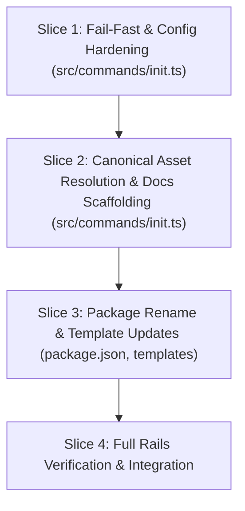

# Tasks

## 1. Dependency DAG

## 2. Streams & Worktrees

| Stream | Worktree Path | Branch | Prerequisite |
| :--- | :--- | :--- | :--- |
| Core Stream | `.worktrees/w6-3-single-asset-tree-init` | `feat/w6-3-single-asset-tree-init` | None (Single Stream) |

## 3. Slice 1: Fail-Fast & Config Hardening

- [x] 3.0 Contract scaffolding: add fail-fast check signature and remove `$schema` from `configPayload` in `src/commands/init.ts`
- [x] 3.1 Red unit tests: update `tests/unit/init.test.ts` to assert `initProject` throws when `openspec/` is missing, and verify `$schema` is not emitted (verify: `npm test` fails)
- [x] 3.2 Green implementation: enforce fail-fast check when `!fs.existsSync(openspecDir)` and remove `$schema` from generated config (verify: `npm test` passes)
- [x] 3.3 Coverage >= 95% and mutation >= 95% kill on fail-fast paths (verify: vitest coverage)

## 4. Slice 2: Canonical Asset Resolution & Docs Scaffolding

- [x] 4.0 Contract scaffolding: define `scaffoldDeveloperGuide` and update `findAssetRoot()` in `src/commands/init.ts` to point to canonical `openspec/` and `.agents/skills/`
- [x] 4.1 Red unit tests: add test cases in `tests/unit/init.test.ts` verifying `docs/spec-rails/WORKFLOW.md`, `COMMANDS.md`, and `RAILS.md` are created (verify: `npm test` fails)
- [x] 4.2 Green implementation: implement developer guide scaffolding and update asset copying to canonical sources (verify: `npm test` passes)
- [x] 4.3 Coverage >= 95% and mutation >= 95% kill on asset copy paths (verify: vitest coverage)

## 5. Slice 3: Package Rename & Template Updates

- [x] 5.0 Contract scaffolding: update `generatePreCommitConfig` and `templates/spec-rails-ci.yml` signatures
- [x] 5.1 Red unit tests: update `tests/unit/init.test.ts` to assert `npx --no-install spec-rails check` and absence of `check-lgtm-directives` (verify: `npm test` fails)
- [x] 5.2 Green implementation: update `generatePreCommitConfig`, `templates/spec-rails-ci.yml`, and rename `package.json` name to `spec-rails` (verify: `npm test` passes)
- [x] 5.3 Coverage >= 95% and mutation >= 95% kill on template generation (verify: vitest coverage)

## 6. Integration & Rebase Plan

- [x] 6.1 Run full test suite, lint, and build (`npm test`, `npm run lint`, `npm run build`)
- [x] 6.2 Verify gates with `node dist/cli.js check` and `node dist/cli.js verify`
- [x] 6.3 Archive change with `openspec archive w6-3-single-asset-tree-init` and sync living spec

## Review Gate
- [x] **Gate 3 Approval**: Tasks breakdown approved by human before writing test code.
