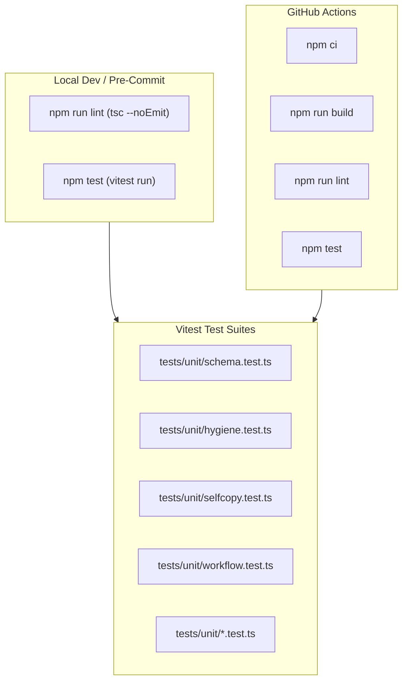

# Architecture & Technical Design: Vitest-Only Harness & Dead Code Deletion (W6.4)

## 1. Overview & Invariants
- **Core Invariant**: All test execution and linting runs natively in Node.js via Vitest (`npm test`) and TypeScript (`npm run lint`), with zero dependence on bash scripts (`tests/*.sh`) or `Makefile`.
- **Porting Plan**:
  - `tests/test_schema.sh` -> `tests/unit/schema.test.ts`: validates `schema.yaml`, artifact dependencies, gate instructions, and templates.
  - `tests/check_hygiene.sh` and `tests/test_lint.sh` -> `tests/unit/hygiene.test.ts`: validates relative doc links, no manual template copy instructions, no legacy `specs/` paths, and YAML/JSON validity.
  - `tests/test_selfcopy.sh` -> `tests/unit/selfcopy.test.ts`: asserts that installed copies in `openspec/schemas/` and `.agents/skills/` are byte-identical to root sources.
  - Port any missing assertions from `test_installer.sh`, `test_ci_audit.sh`, and `test_verify.sh` into existing `tests/unit/init.test.ts`, `tests/unit/audit.test.ts`, and `tests/unit/verify.test.ts`.

## 2. Domain Models, State & Interface Contracts
- **Test Config (`package.json`)**:
  - `"test": "vitest run"`
  - `"lint": "tsc --noEmit"`
- **Pre-commit (`.pre-commit-config.yaml`)**:
  - Replace `make lint` entry with `npm run lint`.
  - Replace `make test` entry with `npm test`.
- **CI (`.github/workflows/test.yml`)**:
  - Drop ShellCheck step.
  - Replace `make test` with `npm test`.

## 3. Architecture Diagram & Data Flow

## 4. Boundary Rules & Budgets
- **Pure Core vs. I/O Shell**: Test assertions read files synchronously via `fs.readFileSync` or spawn `node dist/cli.js` in isolated scratch directories with sanitized `process.env`.
- **Latency & Resource Budgets**:
  - Total `npm test` suite execution MUST complete in under 2 seconds.
  - `npm run lint` MUST complete in under 2 seconds.

## 5. Testing Strategy
1. **Schema & Hygiene Scenarios**:
   - `schema.test.ts`: asserts schema structure, template existence, unticked gate boxes, pure delta spec formatting (`REQ-OSA-1..6`, `REQ-OSA-41`).
   - `hygiene.test.ts`: asserts markdown doc link validity, absence of deprecated template copy instructions (`REQ-OSA-23`, `REQ-OSA-24`, `REQ-OSA-30`).
   - `selfcopy.test.ts`: asserts installed copies match canonical sources (`REQ-OSA-22`).
2. **Unit Tests (>= 95% coverage)**:
   - Full Vitest coverage across `src/` modules.
3. **Mutation Testing (>= 95% kill)**:
   - Stryker tests `src/utils/` and core parsers.

## Review Gate
- [x] **Gate 2 Approval**: Architecture & design reviewed and approved by human before task breakdown.
