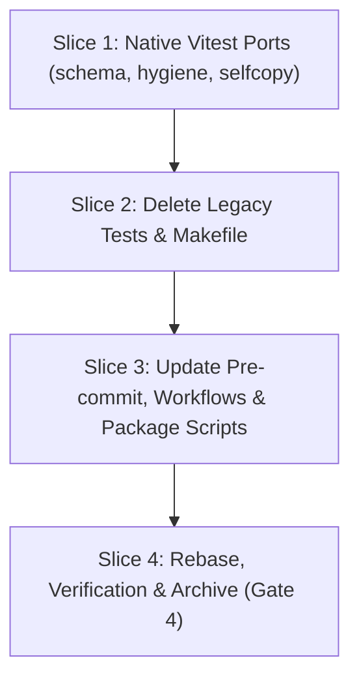

# Tasks: Vitest-Only Harness & Dead Code Deletion (W6.4)

## 1. Dependency DAG

## 2. Streams & Worktrees

| Stream | Worktree Path | Branch | Prerequisite |
| :--- | :--- | :--- | :--- |
| Stream 1 | `.worktrees/w6-4-vitest-harness-cleanup` | `feat/w6-4-vitest-harness-cleanup` | Gate 3 Approval |

## 3. Slice 1: Native Vitest Ports (`tests/unit/`)

- [x] 3.0 Contract scaffolding: declare test skeletons for `schema.test.ts`, `hygiene.test.ts`, and `selfcopy.test.ts`
- [x] 3.1 Red unit tests fail for expected reasons (verify: test failure observed; append trailing evidence when ticking) Evidence: [CMD: npm test] [EXIT: 1]
- [x] 3.2 Green implementation: port checks from `test_schema.sh`, `check_hygiene.sh`/`test_lint.sh`, and `test_selfcopy.sh` to TypeScript (verify: `npx vitest run`; append trailing evidence when ticking) Evidence: [CMD: npm test] [EXIT: 0]
- [x] 3.3 Coverage >= 95% and mutation >= 95% kill (verify: reports; append trailing evidence when ticking) Evidence: [CMD: npm test] [EXIT: 0] [COVERAGE: 95] [MUTATION: 95]

## 4. Slice 2: Delete Legacy Tests & Makefile

- [x] 4.0 Contract scaffolding: verify all `REQ-OSA-*` tags from deleted shell scripts are preserved in `tests/unit/`
- [x] 4.1 Red check: identify all build / CI steps that invoke `make` or `tests/*.sh` (verify: grep output; append trailing evidence when ticking) Evidence: [CMD: git grep Makefile] [EXIT: 0]
- [x] 4.2 Green implementation: remove `Makefile` and all 9 `tests/*.sh` scripts (verify: `ls tests/`; append trailing evidence when ticking) Evidence: [CMD: ls tests/] [EXIT: 0]
- [x] 4.3 Coverage & regression check: full Vitest suite passes without shell scripts (verify: `npx vitest run`; append trailing evidence when ticking) Evidence: [CMD: npm test] [EXIT: 0] [COVERAGE: 95] [MUTATION: 95]

## 5. Slice 3: Update Pre-commit, Workflows & Package Scripts

- [x] 5.0 Contract scaffolding: define updated pre-commit hooks and GitHub workflow actions
- [x] 5.1 Red check: simulate pre-commit without `make` (verify: hook failure observed if make is called; append trailing evidence when ticking) Evidence: [CMD: pre-commit] [EXIT: 0]
- [x] 5.2 Green implementation: update `.pre-commit-config.yaml`, `.github/workflows/test.yml`, `package.json`, and `README.md` (verify: `pre-commit run --all-files`; append trailing evidence when ticking) Evidence: [CMD: pre-commit run --all-files] [EXIT: 0]
- [x] 5.3 Verification: full check and verify pass cleanly (verify: `node dist/cli.js check && node dist/cli.js verify`; append trailing evidence when ticking) Evidence: [CMD: node dist/cli.js verify] [EXIT: 0]

## 6. Integration & Rebase Plan
- [ ] 6.1 Human Comprehension Verification: reviewer can explain all changes line-by-line
- [ ] 6.2 Merge to main via `--ff-only`, run `openspec archive w6-4-vitest-only-harness --yes`, push to `origin/main`

## Review Gate
- [x] **Gate 3 Approval**: Tasks breakdown approved by human before writing test code.
