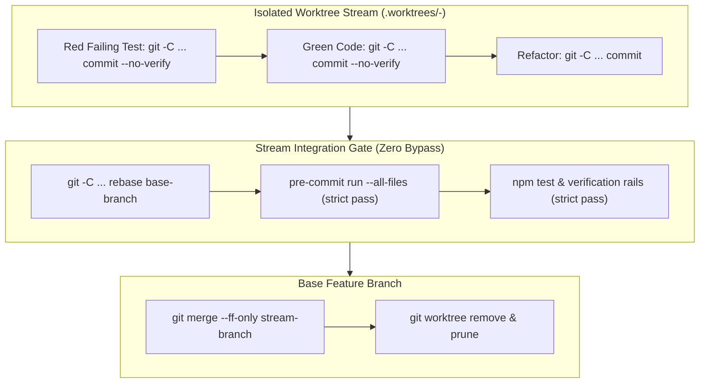

# Architecture & Technical Design: Worktree Execution Rails & Subagent Hygiene (W6.5)

## 1. Overview & Invariants
- **Core Invariant 1 (Tiered Commit Verification)**: Intermediate atomic commits inside isolated `.worktrees/` may use `--no-verify` to capture red test failures or incremental edits. Integration commits, stream merges, and Gate 4 archival strictly require full zero-bypass verification.
- **Core Invariant 2 (Declarative Target Discipline)**: Commands interacting with worktrees never use `cd <worktree> && <cmd>`. They use declarative arguments: `git -C <dir>`, `npm --prefix <dir>`, `cargo --manifest-path <dir>`.
- **Core Invariant 3 (Subagent Zero-Polling)**: Subagents and orchestrators must fire background tasks and yield immediately without entering polling loops, preserving context window budget (< 200k tokens).

## 2. Domain Models, State & Interface Contracts
- **Rule 3 & Rule 4 in `WORKFLOW.md`**:
  - `Rule 3.3`: Worktree command execution must use declarative target flags (`git -C`, `--prefix`).
  - `Rule 4.1`: The zero-bypass pre-commit rule applies strictly to all merges into the base feature branch, commits on non-worktree feature branches, and merges into `main`. For intermediate commits within isolated `.worktrees/` streams, developers/agents may pass `--no-verify` to facilitate atomic TDD commits.
- **Skill Instructions in `.agents/skills/spec-rails/SKILL.md`**:
  - Subagent guidance explicitly prohibits status polling loops and instructs fire-and-halt with reactive wakeup.

## 3. Architecture Diagram & Data Flow

## 4. Boundary Rules & Budgets
- **Pure Core vs. I/O Shell**: Workflow documents and skill definitions live in Markdown; verification is performed by unit test string/AST matchers in `tests/unit/hygiene.test.ts`.
- **Concurrency & Token Budget**: Zero polling ensures long test or mutation runs consume 0 active turns during execution, preventing token exhaustion and context blowout.

## 5. Testing Strategy
1. **Hygiene & Documentation Assertions**:
   - `tests/unit/hygiene.test.ts`: verify that `WORKFLOW.md` and `.agents/skills/spec-rails/SKILL.md` explicitly describe declarative command flags (`git -C`, `--prefix`), permit `--no-verify` on intermediate worktree slice commits, and mandate the zero-polling subagent invariant (`REQ-OSA-51`, `REQ-OSA-52`, `REQ-OSA-53`).
2. **Unit Tests (>= 95% coverage)**:
   - All tests pass via `npm test`.

## Review Gate
- [x] **Gate 2 Approval**: Architecture & design reviewed and approved by human before task breakdown.
