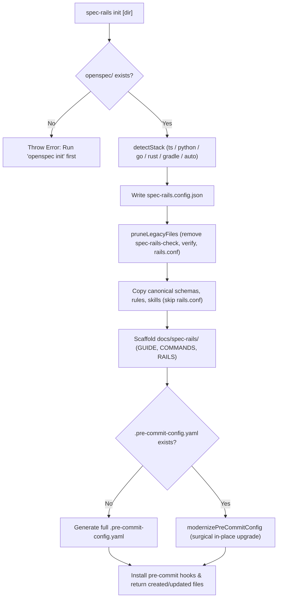

# Architecture & Technical Design

## 1. Overview & Invariants

This design hardens `spec-rails init` for seamless in-place upgrades of consumer repositories (such as `enclave`). It guarantees clean zero-duplicate filesystem hygiene, surgical YAML hook modernization, native Gradle/Kotlin stack auto-detection, and unambiguous documentation naming.

### Key Invariants
1. **Zero Orphaned Binaries**: Running `init` on a repository containing legacy v0.1 files (`spec-rails-check`, `spec-rails-verify`) automatically deletes them.
2. **Single Config Authority**: `rails.conf` is excluded from target copying; any existing `openspec/spec-rails/rails.conf` is pruned when `spec-rails.config.json` is generated.
3. **Non-Destructive Pre-Commit Modernization**: When `.pre-commit-config.yaml` already exists, `spec-rails init` surgically updates only the `spec-rails` entries (`spec-rails-check` modernized to `npx --no-install spec-rails check`; `check-lgtm-directives` and `spec-rails-verify` purged) without disturbing custom project hooks (`ktlint`, `detekt`, `spotless`, `ruff`, etc.).
4. **Gradle/Kotlin Stack Detection**: Repositories containing `build.gradle.kts`, `build.gradle`, or `gradlew` are detected as stack `"gradle"`, configuring `./gradlew test` (or `make test` when a `Makefile` with `test:` target exists).
5. **Distinct Doc Basename**: The user-facing dev guide is scaffolded at `docs/spec-rails/GUIDE.md` to prevent name collision with the internal protocol at `openspec/spec-rails/WORKFLOW.md`.

## 2. Domain Models, State & Interface Contracts

```ts
// src/config.ts
export type Stack = "ts" | "python" | "go" | "rust" | "gradle" | "auto";

// src/commands/init.ts
export function detectStack(targetDir: string): Stack;

export function getStackMeta(stack: Stack, targetDir?: string): StackMeta;

export function pruneLegacyFiles(targetDir: string): string[];

export function modernizePreCommitConfig(content: string): string;

export function scaffoldDeveloperGuide(targetDir: string): string[];
```

### Surgical YAML Modernization Contract
`modernizePreCommitConfig(content: string): string` is a deterministic pure function:
- Strips any hook entry with `id: check-lgtm-directives` (and its indented fields).
- Strips any hook entry with `id: spec-rails-verify` (and its indented fields).
- Updates any hook entry with `id: spec-rails-check` to use `entry: npx --no-install spec-rails check`.
- Preserves all other repos, comments, whitespace, and custom project hooks.

## 3. Architecture Diagram & Data Flow



## 4. Boundary Rules & Budgets

- **Pure Transformers vs Execution Shell**:
  - `modernizePreCommitConfig` is pure string manipulation with zero I/O, regex-driven, and thoroughly testable across edge-case YAML fixtures.
  - `pruneLegacyFiles` is safe: it only deletes files within `openspec/spec-rails/` that match exact legacy filenames.
- **Zero Runtime Dependencies**: Zero external YAML parser packages; maintain 100% bundled independence.
- **Latency Budget**: `initProject` execution completes in $< 50\text{ms}$.

## 5. Testing Strategy

1. **Unit Tests (`tests/unit/init.test.ts`)**:
   - `pruneLegacyFiles`: asserts removal of `spec-rails-check`, `spec-rails-verify`, and `rails.conf` in target repo.
   - `modernizePreCommitConfig`: test fixtures with mixed hooks (e.g. Android/Kotlin detekt + old shell hooks) asserting surgical modernization.
   - `detectStack`: asserts `"gradle"` on `build.gradle.kts`, `build.gradle`, and `gradlew`; tests fallback to `make test` when `Makefile` contains `test:`.
   - `scaffoldDeveloperGuide`: asserts creation of `docs/spec-rails/GUIDE.md`.
2. **Coverage & Mutation Target**:
   - $\ge 95\%$ line/branch coverage and $\ge 95\%$ mutation score on `src/commands/init.ts` and `src/config.ts`.

## Review Gate
- [x] **Gate 2 Approval**: Architecture & design reviewed and approved by human before task breakdown.
