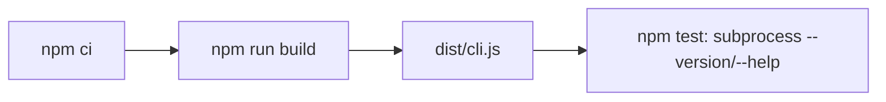

# Architecture & Technical Design

## 1. Overview & Invariants
Workflow-file-only change (Option A, per research.md Gate 0 Go).
- `test.yml` MUST build `dist/cli.js` before `npm test`, mirroring `spec-rails-ci.yml` (`npm ci` then `npm run build`).
- Both workflows MUST use `actions/setup-node@v7` with `node-version: '22'` unchanged.
- Workflow files, documentation, `CHANGELOG.md` and the 0.3.0 bump with `package.json` as the single version source (`src/cli.ts` reads it; the `tests/unit/cli.test.ts` assertion compares against it) only; no `.pre-commit-config.yaml` changes (proposal Out-of-Scope).
- Docs MUST describe the actual flow: local pre-commit (`build-cli` -> `check` -> `verify` -> `lint` -> `test`) and CI (`test.yml`: build -> lint -> test; `spec-rails-ci.yml`: build -> check --audit -> verify -> pre-commit).

## 2. Domain Models, State & Interface Contracts
`test.yml` step order after change:
1. Checkout
2. Set up Node.js (`actions/setup-node@v7`, Node 22)
3. `npm ci`
4. Install OpenSpec CLI
5. **Build CLI: `npm run build`** (new)
6. `npm run lint`
7. `npm test`

Contract: step 5 produces `dist/cli.js`, which `tests/unit/cli.test.ts` resolves via `path.resolve("dist/cli.js")`.

## 3. Architecture Diagram & Data Flow

## 4. Boundary Rules & Budgets
- **Pure Core vs. I/O Shell**: no code involved; CI configuration only.
- **Concurrency, Latency & Resource Budgets**: adds one tsup build (seconds) to the CI job; no NFR-* affected.

## 5. Testing Strategy
1. **BDD Scenarios**: none; no spec-level behavior change.
2. **Unit Tests (>= 95% coverage)**: no code changes; existing `cli.test.ts` subprocess tests are the verification.
3. **Mutation Testing (>= 95% kill)**: not applicable.
4. **Verification**: locally run `rm -rf dist && npm run build && npm test`; then confirm the `CI` job passes on the PR and shows no Node 20 warning for `setup-node`.

## Review Gate
- [x] **Gate 2 Approval**: Architecture & design reviewed and approved by human before task breakdown.
