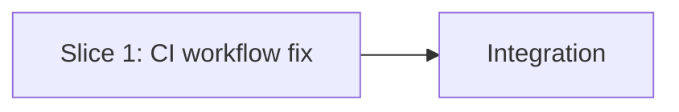

# Tasks

## 1. Dependency DAG

Single slice; no parallel streams.

## 2. Streams & Worktrees
| Stream | Worktree Path | Branch | Prerequisite |
| :--- | :--- | :--- | :--- |
| ci-fix | (none; single stream, work on the change branch) | build-before-tests-in-ci | Gate 3 |

## 3. Slice 1: CI workflow fix

- [x] 3.0 Contract scaffolding: N/A (workflow files only; no interfaces or types) Evidence: N/A
- [x] 3.1 Red: with `dist/` removed, `rm -rf dist && npm test` fails in `tests/unit/cli.test.ts` `--version`/`--help` (verify: output shown; append trailing evidence when ticking) Evidence: without dist/, 2 failed | 7 passed; MODULE_NOT_FOUND dist/cli.js (--version, --help)
- [x] 3.2 Green: in `.github/workflows/test.yml` add an `npm run build` step after "Install OpenSpec CLI" and before "Run Linter"; bump `actions/setup-node@v4` to `@v7` in `test.yml` and `spec-rails-ci.yml` (verify: `rm -rf dist && npm run build && npm test` passes locally; `grep -rn setup-node .github/workflows` shows only `@v7`; append trailing evidence when ticking) Evidence: build step added to test.yml; setup-node@v7 in test.yml, spec-rails-ci.yml (+ templates copy for selfcopy test); clean build + npm test: 13 files, 173 tests passed
- [x] 3.3 Coverage/mutation: N/A, no code changes (verify: `git diff --stat` touches only `.github/workflows/*.yml` and docs) Evidence: N/A; diff limited to workflows, template, docs, CHANGELOG, version files
- [x] 3.4 Docs: update `README.md` (Running Tests, CI sections), `docs/WIKI.md`, `docs/WAY_OF_WORKING.md` to list all commands (`npm ci`, `npm run build`, `npm run lint`, `npm test`, `npm run test:coverage`, `spec-rails check|verify`, `pre-commit run --all-files`) and document the local pre-commit -> CI flow incl. "build before test"; fix stale commands in `docs/how-tos/*` (verify: `grep -rn "npm test" README.md docs` shows build prerequisite noted; every documented command exists in package.json or the CLI `--help`; append trailing evidence when ticking) Evidence: README Running Tests, docs/WAY_OF_WORKING.md section 7 (command table + flow), docs/WIKI.md 1.5; no stale commands found in how-tos
- [x] 3.5 Release notes: create `CHANGELOG.md` (Keep a Changelog) with an `Unreleased` section listing: Fixed - CI `test.yml` builds `dist/cli.js` before tests; Changed - `actions/setup-node` v4 to v7; Docs - commands and CI flow documented; link it from `README.md` Documentation & Guides (verify: file exists, README links it; append trailing evidence when ticking) Evidence: CHANGELOG.md created (0.3.0), linked from README
- [x] 3.6 Version bump 0.2.0 -> 0.3.0 (minor) with a single source of truth: run `npm version 0.3.0 --no-git-tag-version` (updates `package.json` and both lockfile entries); replace the hardcoded `cli.version("0.2.0")` in `src/cli.ts:94` with a typed JSON import: `import pkg from "../package.json" with { type: "json" };` then `cli.version(pkg.version)` (TS 5.9 + `NodeNext` + `resolveJsonModule` support import attributes; `"type": "module"` is set; tsup/esbuild inlines the JSON, keeping `dist/cli.js` self-contained; no `define` plumbing, so vitest and the bundle behave identically); change the `--version` assertion in `tests/unit/cli.test.ts:124` to compare against `package.json`'s version instead of a literal; file the 3.5 changelog entries under `## [0.3.0]` (verify: `rm -rf dist && npm run build && node dist/cli.js --version` prints 0.3.0; `npm run lint` and `npm test` pass; `grep -rn "0\.2\.0" src tests package.json` returns nothing; future bumps need only `npm version`; append trailing evidence when ticking) Evidence: node dist/cli.js --version -> spec-rails/0.3.0; lint and 173 tests pass; no 0.2.0 left in src/tests/package.json

## 4. Integration & Rebase Plan
- [x] 4.1 Human Comprehension Verification: reviewer can explain all generated logic line-by-line
- [x] 4.2 Merged to main (fast-forward) and archived. Evidence: CI verified locally (build, lint, 173 tests); GitHub CI runs on main push

## Review Gate
- [x] **Gate 3 Approval**: Tasks breakdown approved by human before writing test code.
