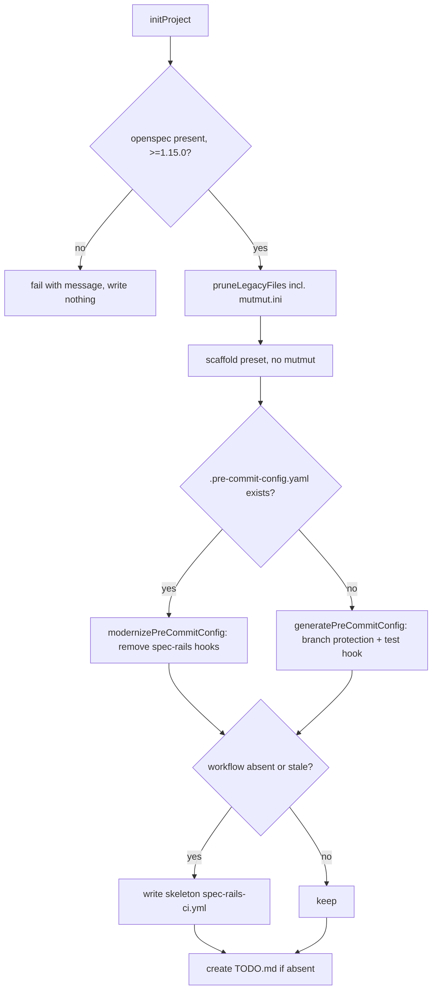

# Architecture & Technical Design

## 1. Overview & Invariants
`init` becomes a pure "wire OpenSpec, scaffold inert files, delete stale files" step. Generated hooks and CI never reference spec-rails (REQ-OSA-55); the developer owns quality gates. Prerequisite check (REQ-OSA-11) is unchanged: no `openspec/` or OpenSpec CLI < 1.15.0 means fail with a message before writing anything.

Invariants:
- Idempotent: a second run changes nothing (REQ-OSA-57).
- Only spec-rails-owned artifacts are deleted/replaced; unrelated hooks, keys and blank lines in `.pre-commit-config.yaml` are preserved byte-for-byte (REQ-OSA-46).
- `TODO.md` is never overwritten (REQ-OSA-56).
- Delete, don't migrate: no compatibility shims.

Decisions: TODO path `openspec/spec-rails/TODO.md`. `spec-rails-ci.yml` is overwritten only when it is stale (contains `spec-rails` invocations or `sh openspec/spec-rails/`) or absent; a developer-edited, spec-rails-free workflow is left alone. This repository's own `.github/workflows/spec-rails-ci.yml` stays project-owned (it runs the spec audit for this repo) and is removed from the self-copy sync pairs (REQ-OSA-21/22 modified). Only mutmut is dropped; ts/go/rust mutation presets stay. `init` logs one console line per action (removed, replaced, created, kept/skipped) so the developer sees what changed, including a reminder to complete `openspec/spec-rails/TODO.md`; a re-run logs no removed/replaced/created lines. `initProject` returns the action list and the CLI prints it (pure core returns data, shell prints).

## 2. Domain Models, State & Interface Contracts
All in `src/commands/init.ts` (existing functions, string-in/string-out):
- `removeHookBlock(yaml, hookId): string` — fix: remove exactly the list item (`- id: <hookId>`) and its more-indented continuation lines, parsed by indentation of the item's own `- ` marker; stop at the next line with indent <= marker indent (a sibling item, blank-then-sibling, or key of the parent). Do not consume the blank line separating hooks.
- `modernizePreCommitConfig(content): string` — calls `removeHookBlock` for `spec-rails-check`, `spec-rails-verify`, `check-lgtm-directives`; no entry rewriting.
- `generatePreCommitConfig(stack, testCommand): string` — drops the `spec-rails-check` hook.
- `isStaleWorkflow(content): boolean` — true when it matches `/spec-rails (check|verify)|openspec\/spec-rails\/spec-rails-/`.
- `STALE_FILES: string[]` — `mutmut.ini`, `openspec/spec-rails/mutation/mutmut.ini`; removed by `pruneLegacyFiles`.
- `getStackMeta(python)` — no `mutationCommand`/`presetFile`.
- Templates: `templates/spec-rails-ci.yml` rewritten as commented skeleton (checkout step plus commented unit/coverage/mutation steps; no-op `echo`); new `templates/TODO.md`; delete `templates/mutation/mutmut.ini` and `templates/presets/python/mutmut.ini`.
- Docs: remove `rails.conf`/"checks"/mutmut text from `rules/WORKFLOW.md` and its byte-identical copy `openspec/spec-rails/WORKFLOW.md` (selfcopy test keeps them in sync); drop mutmut mentions in `docs/WIKI.md` and `docs/designs/multi-language-rails-anti-drift.md` where they describe shipped behavior.

## 3. Architecture Diagram & Data Flow

## 4. Boundary Rules & Budgets
- **Pure Core vs. I/O Shell**: `removeHookBlock`, `modernizePreCommitConfig`, `generatePreCommitConfig`, `isStaleWorkflow` are pure string functions. `initProject`, `pruneLegacyFiles` and file copies are the I/O shell.
- **Concurrency, Latency & Resource Budgets**: synchronous, no network; unchanged from NFR-OSA-2 (installer latency). No new dependencies (NFR-OSA-1).

## 5. Testing Strategy
1. **BDD Scenarios**: tag scenarios with `@REQ-OSA-46`, `@REQ-OSA-49`, `@REQ-OSA-55`, `@REQ-OSA-56`, `@REQ-OSA-57`, `@REQ-OSA-36` in `tests/unit/init.test.ts` (fixtures: voc-eval-style pre-commit with folded `entry:` and sibling keys; stale workflow; root `mutmut.ini`; second-run no-diff).
2. **Unit Tests (>= 95% coverage)**: `removeHookBlock` (inline entry, folded entry, last hook, blank-line preservation), `isStaleWorkflow`, python `getStackMeta`.
3. **Mutation Testing (>= 95% kill)**: `src/commands/init.ts` pure functions via Stryker.

## Review Gate
- [x] **Gate 2 Approval**: Architecture & design reviewed and approved by human before task breakdown.
