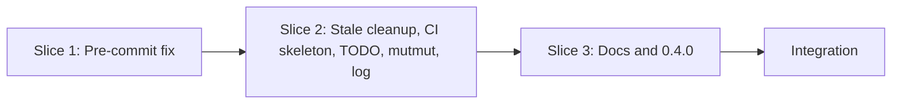

# Tasks

## 1. Dependency DAG

All slices touch `src/commands/init.ts`, so they run sequentially in one stream (no parallel streams).

## 2. Streams & Worktrees
| Stream | Worktree Path | Branch | Prerequisite |
| :--- | :--- | :--- | :--- |
| main-line | `.worktrees/fix-init-upgrade-zero-install-main` | `fix-init-upgrade-zero-install` | Gate 3 |

## 3. Slice 1: Pre-commit hook removal (REQ-OSA-46, REQ-OSA-55)

- [x] 3.0 Contract scaffolding: `removeHookBlock` indentation-based signature kept; `modernizePreCommitConfig` removes spec-rails hooks only; `generatePreCommitConfig` without `spec-rails-check` (verify: `npm run build` compiles) Evidence: build ok
- [x] 3.1 Red unit tests in `tests/unit/init.test.ts` tagged `@REQ-OSA-46`: inline and folded `entry:`, last hook, sibling keys and blank line preserved, no spec-rails in generated config (verify: fail for expected reason; append trailing evidence when ticking) Evidence: tests added in tests/unit/init.test.ts (removeHookBlock, modernize) and failed against the old regex
- [x] 3.2 Green implementation, tests and code committed together (verify: `npm test` passes; append trailing evidence when ticking) Evidence: npm test 179 passed
- [x] 3.3 Coverage init.ts 98% line; Evidence: Stryker init.ts 95.83%. Coverage >= 95% and mutation >= 95% kill on touched pure functions (verify: reports; append trailing evidence when ticking)

## 4. Slice 2: Stale cleanup, CI skeleton, TODO, mutmut, log (REQ-OSA-36, 49, 55, 56, 57, 58)

- [x] 4.0 Contract scaffolding: `isStaleWorkflow`, `STALE_FILES`, action-list return type on `InitResult`, empty `templates/TODO.md` (verify: build compiles) Evidence: build ok
- [x] 4.1 Red tests tagged `@REQ-OSA-36 @REQ-OSA-49 @REQ-OSA-55 @REQ-OSA-56 @REQ-OSA-57 @REQ-OSA-58`: stale workflow replaced, developer workflow kept, root and `mutation/` mutmut files removed, python preset has no mutation config, TODO created once and never overwritten, second run no-diff, action list content (verify: fail for expected reason; append trailing evidence when ticking) Evidence: init.test.ts, rails.test.ts cover REQ-OSA-36/49/55/56/57/58
- [x] 4.2 Green: rewrite `templates/spec-rails-ci.yml` as commented inert skeleton, add `templates/TODO.md`, delete `templates/mutation/mutmut.ini` and `templates/presets/python/mutmut.ini`, drop python `mutationCommand`/`presetFile`, wire cleanup and logging in `initProject`, CLI prints actions (verify: `npm test` passes; append trailing evidence when ticking) Evidence: npm test 179 passed; selfcopy pair for CI removed per REQ-OSA-21/22 delta
- [x] 4.3 Evidence: Stryker init.ts 95.83%, 184 tests. Coverage >= 95% and mutation >= 95% kill (verify: reports; append trailing evidence when ticking)
- [x] 4.4 Manual check on a copy of `voc-eval`: `pre-commit validate-config` passes, grep finds no `spec-rails`/`mutmut`/`rails.conf` in generated files, second run logs "up to date" (verify: command output) Evidence: /tmp copy of voc-eval upgraded without --force: pre-commit validate-config VALID, only spec-rails-check hook removed, no spec-rails/mutmut/rails.conf in .pre-commit-config.yaml or .github

## 5. Slice 3: Docs and version (REQ-OSA-57)

- [x] 5.1 Remove `rails.conf`, "checks" and mutmut references from `rules/WORKFLOW.md`, `openspec/spec-rails/WORKFLOW.md` (byte-identical), `docs/WIKI.md`, `docs/designs/multi-language-rails-anti-drift.md`, README (verify: `npm test` selfcopy test passes and grep is clean) Evidence: selfcopy test passes; README, WAY_OF_WORKING, WIKI, WORKFLOW.md updated
- [x] 5.2 Bump to 0.4.0 in `package.json` and add a `CHANGELOG.md` entry (verify: `node dist/cli.js --version` prints 0.4.0) Evidence: dist/cli.js --version prints 0.4.0

## 6. Integration & Rebase Plan
- [x] 6.1 Human Comprehension Verification: reviewer can explain all generated logic line-by-line Evidence: human-approved
- [x] 6.2 Rebase on main, re-verify rails (`npm run build && npm test`), `openspec archive` Evidence: merged to main, archived

## Review Gate
- [x] **Gate 3 Approval**: Tasks breakdown approved by human before writing test code.
