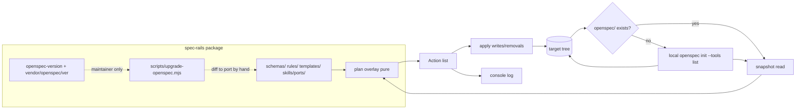

# Architecture & Technical Design

## 1. Overview & Invariants
`spec-rails` shrinks to one command, `init`, in two phases: **bootstrap** (only when `openspec/` is absent) wraps the local `openspec init --tools <list>` so OpenSpec itself generates every per-agent artifact; **overlay** (every run, no CLI needed) writes spec-rails files and rewrites the generated workflow skills to be CLI-free. Nothing is fetched; the only process spawned is `openspec init` at bootstrap and an optional `pre-commit install`.

Invariants:
- **I1 No footprint**: after the overlay no file calls `openspec` or `spec-rails` for the six ported workflows; `package.json` and lockfiles are never touched (NFR-POS-1).
- **I2 Convergence**: the overlay is a pure function of (shipped assets, existing target tree). Applying it twice yields the same tree (REQ-OSA-13).
- **I3 Ownership**: each target file is *managed* (refreshed to shipped bytes), *overlaid* (body replaced, agent frontmatter kept) or *developer-owned* (created only if absent).
- **I4 One pin**: the OpenSpec version lives in `openspec-version` only (REQ-POS-1); bootstrap rejects a different major.minor.
- **I5 Deletion over migration**: legacy artifacts are removed, never converted.
- **I6 CLI only at bootstrap**: `init` never runs `openspec` when `openspec/` exists, and never runs `openspec update` (REQ-POS-6, 8).

Ownership table:

| Target path | Class | Source |
| :--- | :--- | :--- |
| `openspec/schemas/spec-rails/**` | managed | `schemas/spec-rails/` (canonical, existing) |
| `openspec/spec-rails/WORKFLOW.md`, `AGENTS.md` | managed | `rules/` |
| `.agents/skills/spec-rails/SKILL.md` | managed | `skills/spec-rails/SKILL.md` |
| generated `openspec-*` skills/commands/prompts in any agent layout | overlaid | `skills/ports/<workflow>.md` bodies |
| `docs/spec-rails/{GUIDE,COMMANDS,RAILS}.md` | managed | generated by existing `scaffoldDeveloperGuide` |
| `openspec/config.yaml` | owned; only the `schema:` line is set | written by `openspec init` |
| `openspec/spec-rails/TODO.md` | owned | `templates/TODO.md` |
| `.pre-commit-config.yaml` | owned; legacy hooks removed in place | generated string |
| `.github/workflows/spec-rails-ci.yml` | owned; replaced only if it calls spec-rails/openspec | `templates/spec-rails-ci.yml` |
| `.gitignore` | owned; `.worktrees/` line appended once | |
| legacy: `spec-rails.config.json`, `rails.conf`, `mutmut.ini`, `spec-rails-check/verify`, `.github/skills/opsx-*` | deleted | |

## 2. Domain Models, State & Interface Contracts
```ts
type Action =
  | { kind: "created" | "updated" | "removed" | "skipped"; path: string };

// pure
planInit(existing: Snapshot, assets: Assets): Action[]  // decides, no I/O
// shell
initProject({ cwd }: { cwd?: string }): { actions: Action[] }
```
`Snapshot` is the set of relevant target paths with content; `Assets` is the shipped file map. `planInit` returns writes/removals; the shell applies them and prints one line each (REQ-OSA-58). An action list of only `skipped` means the repo was already converged.

CLI: `spec-rails init [dir] [--tools <list>]` (list forwarded verbatim to `openspec init --tools`, default `agents`), `--help`, `--version`. `--stack` and `--force` removed; `check|verify|audit` unregistered.

Bootstrap (REQ-POS-6): if `openspec/` is absent, run `openspec --version`; reject absence or a major.minor different from `openspec-version`; then `openspec init --tools <list> --no-animation <dir>` (no copilot-cloud prompts: pass `--no-copilot-cloud`). Failure aborts before the overlay writes anything.

Overlay (REQ-POS-7): scan the target for files OpenSpec generated for the six workflows, identified structurally rather than by agent: a file whose frontmatter `name` is `openspec-<workflow>`, or whose basename/command id matches `opsx-<alias>`/`<alias>` under a known tool directory found by walking dot-directories one level deep for `skills/*/SKILL.md`, `commands/**`, `prompts/*.prompt.md`. For each, split frontmatter from body, drop `allowed-tools: Bash(openspec:*)` and `user-invocable: false`, and substitute the body with `skills/ports/<workflow>.md` (agent-neutral). The set of tools is therefore whatever `openspec init --tools` produced; spec-rails keeps no per-agent table. Anything unrecognised is left alone and logged.

Skill porting contract (REQ-POS-2). Each upstream `openspec <cmd>` step maps to a file operation:

| Upstream | CLI-free replacement |
| :--- | :--- |
| `openspec list --json`, `list --specs` | list `openspec/changes/*` (excluding `archive`) and `openspec/specs/*` |
| `openspec new change <n>` | create `openspec/changes/<n>/` with `.openspec.yaml` (`schema: spec-rails`, `created: <date>`) |
| `openspec status --change <n> --json` | read `openspec/schemas/spec-rails/schema.yaml` DAG; an artifact is `done` when its output file exists, `ready` when its `requires` are done |
| `openspec instructions <id>` | read the artifact's `instruction` and template from `schema.yaml` and `schemas/spec-rails/templates/` |
| `openspec validate` | removed; the skill tells the agent to re-read deltas against the header rules |
| `openspec archive` / sync | move to `changes/archive/<date>-<n>/` and apply ADDED/MODIFIED/REMOVED deltas to `openspec/specs/` by hand per the skill steps |

Upgrade contract (REQ-POS-3/4/8): `vendor/openspec/<version>/` holds the pristine upstream skills and commands for the `agents,github-copilot,claude` layouts. `scripts/upgrade-openspec.mjs <v>`:
1. `npx --yes @fission-ai/openspec@<v> init --tools agents,github-copilot,claude` into a temp dir (maintainer-only; network allowed here only);
2. diff new vs current `vendor/openspec/<old>/skills`;
3. replace the vendor directory, write `openspec-version`, print the diff;
4. exit non-zero on fetch failure before touching anything.
The maintainer then ports the printed diff into `skills/ports/*.md` by hand and bumps each port's `portedFrom` to the new version. REQ-POS-5's test fails until every port's `portedFrom` equals `openspec-version` and every upstream workflow has a port (or is listed in `skills/ports/EXCLUDED.md` with a reason). Target repos upgrade with `openspec update` then `spec-rails init`; the overlay restores CLI-free bodies, because `openspec update` rewrites them.

## 3. Architecture Diagram & Data Flow


## 4. Boundary Rules & Budgets
- **Pure Core vs. I/O Shell**: `planInit` and the pre-commit modernizer (`removeHookBlock`, `modernizePreCommitConfig`) are pure string/tree functions. The shell (`initProject`) owns `fs`, symlink refusal (realpath), `pre-commit install` (best effort, ignored when absent) and logging. `upgrade-openspec.mjs` is a separate maintainer script and is never imported by `src/`.
- **Concurrency, Latency & Resource Budgets**: single-threaded, synchronous; NFR-OSA-2 (installer under 5 s, now with no `openspec` startup). Idempotent re-run performs reads only.
- **Deletions**: remove `src/commands/{check,verify,audit}.ts`, `src/config.ts`, their tests, `templates/{presets,mutation,rails.conf}`, `src/` stack detection, the `zod`/`fast-glob` bundle deps if unused afterwards, and the `test-e2e` target and docs that mention them.
- **Self-hosting**: this repo keeps its own committed copies under `.agents/skills`/`.github/skills` equal to the shipped ones (REQ-OSA-22 sync check stays; it is an `init`-output comparison, not a CLI call).

## 5. Testing Strategy
1. **BDD Scenarios**: one test per scenario in both delta specs: empty-dir init (REQ-POS-6, REQ-OSA-11), double-run byte equality (REQ-OSA-13), legacy cleanup including `spec-rails.config.json` and `opsx-*` skills, developer-edited file preservation (REQ-OSA-14), no `openspec`/`spec-rails` string in generated executable positions (NFR-POS-1), `package.json` untouched, `--help` lists only `init` (REQ-OSA-32), pre-commit surgical removal retained, skill checks (REQ-POS-2: no `openspec ` commands, no `user-invocable: false`), vendor/pin consistency (REQ-POS-1/3/5), upgrade script against a fake `npx` shim (REQ-POS-4: success, reproducible, failure leaves tree unchanged).
2. **Unit Tests (>= 95% coverage)**: `init.ts`, the pre-commit modernizer and the upgrade script's diff/replace logic; branches for symlink refusal, missing target and non-writable target.
3. **Mutation Testing (>= 95% kill)**: Stryker on `src/commands/init.ts` and the modernizer; equivalent mutants (loop guards, scaffold strings) are listed in the change evidence with justification. The previously recorded 84% baseline must not be carried over.

## Review Gate
- [x] **Gate 2 Approval**: Architecture & design reviewed and approved by human before task breakdown. -- Go (human)
