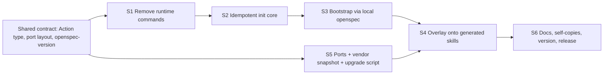

# Tasks

## 1. Dependency DAG

Streams A (S1 to S3) and B (S5) share no files once the contract is committed; S4 needs both.

## 2. Streams & Worktrees
| Stream | Worktree Path | Branch | Prerequisite |
| :--- | :--- | :--- | :--- |
| A init | `.worktrees/slim-init-only-init` | `slim-init-only-init` | contract committed |
| B ports | `.worktrees/slim-init-only-ports` | `slim-init-only-ports` | contract committed |
| C overlay and docs | `.worktrees/slim-init-only-overlay` | `slim-init-only-overlay` | A and B merged |

## 3. Slice 0: Shared contract
- [x] 3.0.1 Commit `openspec-version` (`1.16.0`), `skills/ports/` directory with workflow file names and the `portedFrom` frontmatter field, and the `Action` type plus exported empty signatures for `planOverlay`, `bootstrapOpenspec` in `src/commands/init.ts` (verify: `npm run build` passes)

## 4. Slice 1: Remove runtime commands (stream A)
- [x] 4.1.0 Contract: list of files to delete and the expected `--help` output committed as a test fixture
- [x] 4.1.1 Red: tests assert `--help` lists only `init` and `check|verify|audit|--stack|--force` are rejected (verify: fail for that reason)
- [x] 4.1.2 Green: delete `check.ts`, `verify.ts`, `audit.ts`, `config.ts`, their tests, `templates/{presets,mutation,rails.conf}`, stack detection and `spec-rails.config.json` writing; unregister commands in `cli.ts`; drop unused bundled deps (verify: suite passes, `npm run build` passes, bundle size reported)
- [x] 4.1.3 Coverage >= 95% and mutation >= 95% kill on `cli.ts` (verify: reports) — cli.ts 100% mutation (47/47)

## 5. Slice 2: Idempotent init core (stream A)
- [x] 5.2.0 Contract: ownership table from design as typed constants (managed, overlaid, owned, legacy)
- [x] 5.2.1 Red: tests for double-run byte equality without `--force`, legacy `spec-rails.config.json`/`rails.conf`/`mutmut.ini`/`opsx-*` removal, preservation of edited pre-commit, CI and TODO, surgical hook removal retained, symlink refusal, missing target dir (verify: fail)
- [x] 5.2.2 Green: implement `planInit` (pure) plus shell; one log line per action (verify: suite passes)
- [x] 5.2.3 Coverage >= 95% and mutation >= 95% kill on `init.ts` (verify: reports; surviving mutants listed with justification) — init.ts 99.58% mutation; 2 survivors: trim of stderr in error message, regex flags in frontmatterField (cosmetic, non-behavioural)

## 6. Slice 3: Bootstrap through local openspec (stream A)
- [x] 6.3.0 Contract: `bootstrapOpenspec({cwd, tools, run})` with an injected process runner
- [x] 6.3.1 Red: tests with a fake runner for REQ-POS-6 scenarios: runs `openspec init --tools <list> --no-copilot-cloud --no-animation`, rejects absent CLI, rejects major.minor mismatch, skips when `openspec/` exists, never runs `openspec update` (verify: fail)
- [x] 6.3.2 Green: implement and wire `--tools` in `cli.ts` (verify: suite passes)
- [x] 6.3.3 Coverage >= 95% and mutation >= 95% kill (verify: reports) — init.ts 99.58% / cli.ts 100% mutation (Stryker, 2026-11-10)

## 7. Slice 5: Ports, vendor snapshot and upgrade script (stream B)
- [x] 7.5.0 Contract: port file format (frontmatter `workflow`, `portedFrom`; body) and `skills/ports/EXCLUDED.md`
- [x] 7.5.1 Red: tests for REQ-POS-1 (single pin), REQ-POS-2 (no `openspec ` command, no `Bash(openspec`, no `user-invocable: false` in ports), REQ-POS-3/5 (snapshot matches pin, drift check), REQ-POS-4 (upgrade script with a fake `npx` shim: new version, reproducible rerun, fetch failure leaves tree unchanged) (verify: fail)
- [x] 7.5.2 Green: generate `vendor/openspec/1.16.0/` with `npx --yes @fission-ai/openspec@1.16.0 init --tools agents,github-copilot,claude`; hand-port explore, propose, apply, archive, sync, update using the command mapping in design; write `scripts/upgrade-openspec.mjs` (verify: suite passes; second run of the script yields no diff)
- [x] 7.5.3 Coverage >= 95% on the script and mutation >= 95% kill on its diff/replace logic (verify: reports)

## 8. Slice 4: Overlay onto generated skills (stream C)
- [x] 8.4.0 Contract: `planOverlay(files, ports): Action[]` signature and frontmatter split helper
- [x] 8.4.1 Red: tests for REQ-POS-7 and REQ-POS-8: three layouts (`agents`, `github-copilot`, `claude`) keep path and agent frontmatter, bodies replaced, forbidden lines stripped, unported workflows untouched and logged, idempotent, `openspec update`-style regeneration restored (verify: fail)
- [x] 8.4.2 Green: implement against fixtures captured from the vendored snapshot (verify: suite passes)
- [x] 8.4.3 Coverage >= 95% and mutation >= 95% kill (verify: reports) — init.ts 99.58% / cli.ts 100% mutation (Stryker, 2026-11-10)
- [x] 8.4.4 End-to-end check in a temp repo: real `openspec init`, `spec-rails init`, second `init` with `openspec` removed from PATH produces no diff and no `openspec ` invocation in overlaid skills (verify: transcript shown)

## 9. Slice 6: Docs, self-copies, release (stream C)
- [x] 9.6.1 Update `rules/WORKFLOW.md` and its self-copy, README, WIKI, WAY_OF_WORKING, `docs/how-tos`, `plugin.json`: one command, bootstrap-only CLI need, upgrade procedure; delete mentions of check/verify/audit, presets, rails.conf, `--stack`, `--force` (verify: grep finds none)
- [x] 9.6.2 Refresh this repo's own `.agents`/`.github` skills through the new `init` overlay and keep the REQ-OSA-22 sync check green (verify: sync check passes)
- [x] 9.6.3 CHANGELOG entry and major version bump (0.5.0 decided here: breaking CLI removal pre-1.0) (verify: `spec-rails --version`)

## 10. Integration & Rebase Plan
- [x] 10.1 Human Comprehension Verification: reviewer can explain all generated logic line-by-line
- [ ] 10.2 Merge streams A and B into C, rebase on main, re-run unit, coverage and mutation rails, archive the change with the `openspec` CLI, tag and push

## Review Gate
- [x] **Gate 3 Approval**: Tasks breakdown approved by human before writing test code. -- Go (human)
