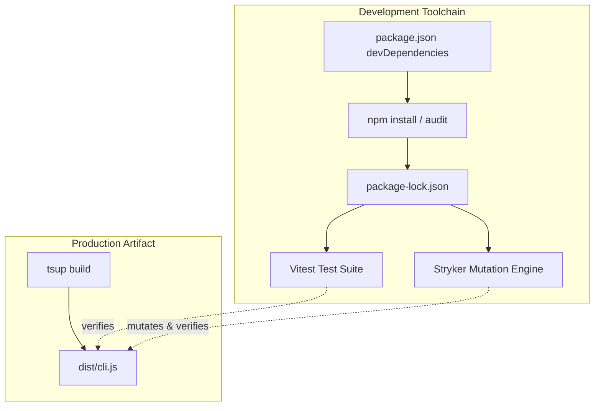

# Architecture & Technical Design

## 1. Overview & Invariants
- **Overview**: Upgrades test toolchain packages in `devDependencies` to modern patched releases (`vitest`, `@vitest/coverage-v8`, and transitive dependencies) to eliminate known CVEs.
- **Invariants**:
  - `dist/cli.js` production bundle remains byte-for-byte independent of test toolchain dependencies.
  - Test command (`npm test`) runs headless Vitest without exposing a UI server (`vitest --ui` is prohibited).
  - All 83 existing unit tests across `tests/unit/*.test.ts` must pass without assertion degradation.

## 2. Domain Models, State & Interface Contracts
- **Package Manifest Changes**:
  - `devDependencies.vitest`: bump from `^2.1.8` to target major line (e.g. `^3.2.7` or `^4.1.12` / `^5.1.0` depending on Stryker compatibility check).
  - `devDependencies.@vitest/coverage-v8`: match corresponding Vitest major release.
  - `package-lock.json`: regenerate clean lockfile via npm install.
- **Configuration Contract**:
  - `vitest.config.ts` (or inline package script `vitest run`): maintain coverage provider and reporter flags.

## 3. Architecture Diagram & Data Flow

## 4. Boundary Rules & Budgets
- **Pure Core vs. I/O Shell**: Tooling upgrades have zero touchpoints with core application logic (`src/core/*`) or CLI dispatch shell (`src/cli.ts`).
- **Concurrency, Latency & Resource Budgets**: Test suite run duration must remain under 2 seconds (currently ~386ms for 83 tests). Zero memory leaks in worker pool.

## 5. Testing Strategy
1. **BDD Scenarios**: Existing OpenSpec verification workflows (`spec-rails verify`) executed against real worktrees.
2. **Unit Tests (>= 95% coverage)**: Run `npm test` and `npm run test:coverage` to confirm 100% of the 83 unit tests execute without regression.
3. **Mutation Testing (>= 95% kill)**: Validate Stryker mutation testing still runs against the upgraded Vitest runner without syntax or worker compatibility errors.
4. **Security Audit**: Verify `npm audit` to confirm eradication of critical/high vulnerabilities.

## Review Gate
- [ ] **Gate 3 Approval**: Architecture & design reviewed and approved by human before task breakdown.
