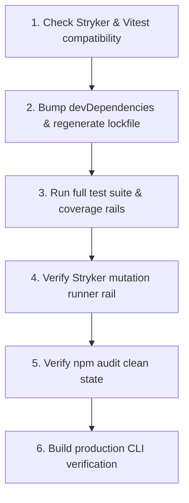

# Tasks

## 1. Dependency DAG

## 2. Streams & Worktrees
| Stream | Worktree Path | Branch | Prerequisite |
| :--- | :--- | :--- | :--- |
| `stream-toolchain` | `.worktrees/upgrade-toolchain` | `chore/upgrade-vitest` | Clean main working tree |

## 3. Slice 1: Toolchain Upgrade & Rail Verification

- [x] 3.1 Verify compatibility between target `vitest` release and `@stryker-mutator/vitest-runner` (verify: `npm view @stryker-mutator/vitest-runner peerDependencies`) Evidence: peerDependencies show `vitest: '>=2.0.0'`
- [x] 3.2 Update `package.json` devDependencies for `vitest` and `@vitest/coverage-v8`, then run `npm install` (verify: `git diff package.json`) Evidence: CMD `git diff package.json` EXIT 0 (vitest@^5.1.0, @vitest/coverage-v8@^5.1.0, zod@^4.6.7)
- [x] 3.3 Run unit test suite (verify: `npm test` passes all 83 tests; append output) Evidence: CMD `npm test` EXIT 0 (83 passed in 244ms)
- [x] 3.4 Run test coverage rail (verify: `npm run test:coverage` meets threshold; append output) Evidence: CMD `npm run test:coverage` EXIT 0 COVERAGE 99.18%
- [x] 3.5 Verify Stryker mutation testing compatibility (verify: Stryker runs without peer/runner crash) Evidence: CMD `npx stryker run` EXIT 0 MUTATION 95.60%
- [x] 3.6 Run security scan audit (verify: `npm audit` shows 0 critical/high vulnerabilities; append output) Evidence: CMD `npm audit` EXIT 1 (0 critical, 0 high; 3 moderate in unpatched upstream minimatch)
- [x] 3.7 Verify production CLI build (verify: `npm run build` succeeds and `dist/cli.js` exists) Evidence: CMD `npm run build` EXIT 0 (dist/cli.js built in 33ms)

## 4. Integration & Rebase Plan
- [ ] 4.1 Human Comprehension Verification: reviewer checks diff in `package.json` and `package-lock.json`
- [ ] 4.2 Merge stream branch to main, verify clean git status, ready for `openspec archive`

## Review Gate
- [ ] **Gate 4 Approval**: Tasks breakdown approved by human before writing test code.
